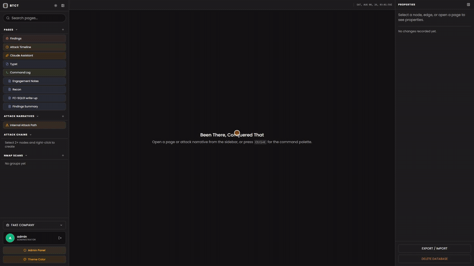

# Been There, Conquered That (BTCT)

A LAN-hosted, multi-user, **real-time collaborative** note-taking and reporting
app for penetration-testing engagements. It combines Notion-style pages, nmap
import, team shell-command capture, shared screenshot assets with crop and
redaction, and Google-Docs-style live co-editing across every machine on the
LAN, all from a single Docker container. It is built to stay comfortable on a small host: 1 to
2 GB of RAM and 1 to 2 cores.



*One continuous take against a small demo workspace. If the GIF looks fuzzy, the
crisp version is [`blog/media/btct-demo.mp4`](blog/media/btct-demo.mp4) at
1920x1080.*

> **Launching for a competition?** Start at [Quick start](#quick-start-competition).
>
> **New here?** Jump to the [Feature tour](#feature-tour) for what it does, the
> [Keyboard shortcuts](#keyboard-shortcuts--gestures) for how to drive it fast,
> or [Run locally](#run-locally-on-windows-with-docker-desktop) to get it up.
>
> **AI agent / new contributor working on the code?** Start at
> [Architecture & internals](#architecture--internals-for-developers--llms):
> it's written to be your onboarding doc: the mental model, the data model,
> every key file, the non-obvious invariants, and "how to extend X" recipes.

---

## Quick start (competition)

This branch (`comp-ready`) is the build to run on the day. Every machine needs
Docker; the scripts install it on Linux and start it on Windows. The repo is
private, so `git clone` (and every later update) needs a GitHub login on that
machine once: see [Private repo: sign a machine in once](#private-repo-sign-a-machine-in-once).

When it is up, open `http://<host-ip>:8080` from any machine on the LAN. Six
admin accounts exist: `Roberto`, `Warren`, `Ryan`, `Anthony`, `Jesse` and
`Darren`, all with the password `typst-best456`.

### Linux (Kali, Debian, Ubuntu)

```bash
# 1. Get the code
git clone -b comp-ready https://github.com/rocast560/BTCT.git
cd BTCT

# 2. Check the box first: changes nothing, prints a PASS/WARN/FAIL table
./competition-day.sh --check-only

# 3. Launch: apt update (never upgrade), installs Docker if missing,
#    builds and starts BTCT, waits until it is healthy, prints the URLs
./competition-day.sh

# 4. Optional: install the `btct` menu (start, stop, backups, restore, logs)
./btct.sh install
btct
```

No internet on the day? The evening before, on a machine with the same code,
run `./save-btct-image.sh --build` and copy `btct-image.tar.gz` (plus its
`.sha256` and `.id`) into the checkout. Then step 3 becomes
`./competition-day.sh --offline`, which loads that image instead of building
(or point at the USB stick: `--offline --image /media/usb/btct-image.tar.gz`).
`--limits` caps the container at 1 GB and 2 CPUs.

### Windows (Docker Desktop)

Install and start [Docker Desktop](https://www.docker.com/products/docker-desktop/)
(WSL2 backend) and [Git for Windows](https://git-scm.com/download/win), then in
PowerShell:

```powershell
# 1. Get the code
git clone -b comp-ready https://github.com/rocast560/BTCT.git
cd BTCT

# 2. Launch: starts Docker Desktop if needed, writes .env, asks for a
#    backup folder, builds and starts BTCT, opens the browser
powershell -ExecutionPolicy Bypass -File .\Start-BTCT.ps1

# 3. Optional: a Desktop shortcut for next time, and the `btct` menu
powershell -ExecutionPolicy Bypass -File .\Install-BTCTShortcut.ps1
powershell -ExecutionPolicy Bypass -File .\btct.ps1 install
```

Teammates on other machines reach it at `http://<this-pc-ip>:8080`; allow port
8080 through Windows Firewall if they can't (see
[LAN access from teammates](#lan-access-from-teammates)).

### Update to the latest version

One command pulls the newest `comp-ready`, rebuilds and restarts BTCT, and
keeps every note, account and screenshot on that machine:

```bash
# Linux (Kali, Debian, Ubuntu), from anywhere after ./btct.sh install
btct update            # shows the new commits and asks first
btct update -y         # no questions
# without the btct command: ./btct.sh update   (in the checkout)
```

```powershell
# Windows, in the checkout
powershell -ExecutionPolicy Bypass -File .\btct.ps1 update
# or, after .\btct.ps1 install, from any PowerShell:
btct update            # btct update -y for no questions
```

What it does, in order:

1. Refuses when the checkout has local changes to tracked files (and prints
   how to set them aside with `git stash`). Settings live in `.env`, which git
   does not track, so they are never in the way.
2. Checks the branch. A checkout on another branch is offered a switch to
   `comp-ready` (`-y` accepts; `--branch NAME`, `-Branch NAME` on Windows,
   updates from another branch). A branch with no upstream is set to track
   `origin/comp-ready`.
3. Fetches, lists the new commits and asks. Nothing has changed yet.
4. Fast-forwards the checkout and builds the new image while the old
   container keeps serving. A failed build puts the checkout back where it
   was and changes nothing else.
5. Tags the image that ran until now as `btct:previous`.
6. Stops BTCT (it flushes its data), copies the data volume into the backup
   folder as `pre-update-<stamp>.tgz` (`BACKUP_HOST_DIR`, else `./backups`;
   the newest 3 are kept), then starts the new version and waits for
   `/healthz`. The outage is the stop plus the copy: seconds for a normal
   engagement. When the backup folder has too little space for the copy it
   says so and asks (`-y` goes on without it).

The data never leaves its Docker volume (`<project>_btct-data`, mounted at
`/data`): a rebuild replaces the image, not the volume. The snapshot is an
extra copy, taken with the container stopped because a copy of the live
LevelDB or SQLite would be torn.

If the new version does not come up healthy, it prints how to go back:

```bash
btct rollback          # run btct:previous again, data as it is now
btct rollback --data   # also put the data back to the newest pre-update snapshot
```

`--data` moves whatever is in the volume aside to `/data/pre-rollback-<stamp>/`
first, so nothing written since the update is deleted. On Windows the switch
is `-Data`. A rollback leaves the newer code checked out; the next
`btct update` builds it again.

#### Private repo: sign a machine in once

The repo is private, so a clone or an update on a new machine needs GitHub
credentials. When `btct update` cannot fetch for that reason it prints these
steps. Run them once, as the user who owns the checkout (not root):

- GitHub CLI: `gh auth login`, then `gh auth setup-git` (git then asks `gh`
  for the token every time).
- Or a fine-grained personal access token (GitHub, Settings, Developer
  settings, Fine-grained tokens: only this repository, Contents read-only),
  then:
  ```bash
  git config --global credential.helper store
  git clone -b comp-ready https://github.com/rocast560/BTCT.git   # or, in a checkout: git fetch origin
  # user name: your GitHub name; password: the token
  ```
  `store` keeps it in `~/.git-credentials` (plain text, mode 600). On Windows,
  Git for Windows opens its own browser sign-in instead, which also works.

### After launch

- Turn on scheduled backups: Admin Panel, Backups.
- Stop and start: `btct stop` / `btct start` (or `docker compose stop` / `docker compose up -d`).
- Update to the latest `comp-ready`, keeping the data: `btct update` (see [above](#update-to-the-latest-version)).
- Full details: [Competition day (Kali)](#competition-day-kali),
  [Command-line menu (btct)](#command-line-menu-btct),
  [Run locally on Windows](#run-locally-on-windows-with-docker-desktop).

---

## Table of Contents

- [Quick start (competition)](#quick-start-competition)
  - [Update to the latest version](#update-to-the-latest-version)
- [Feature tour](#feature-tour)
  - [Pages & the markdown editor](#pages--the-markdown-editor)
  - [Screenshots: crop, redact, organize](#screenshots-crop-redact-organize)
  - [Nmap import](#nmap-import)
  - [Lightweight operations interface](#lightweight-operations-interface)
  - [Command log (team shell-command capture)](#command-log-team-shell-command-capture)
  - [Real-time collaboration](#real-time-collaboration)
  - [Workspaces, navigation & layout](#workspaces-navigation--layout)
  - [Edit history & versioning](#edit-history--versioning)
  - [Report (Typst)](#report-typst)
  - [Export & import](#export--import)
  - [Accounts, roles & settings](#accounts-roles--settings)
- [Keyboard shortcuts & gestures](#keyboard-shortcuts--gestures)
- [How it works (runtime)](#how-it-works-runtime)
- [Tech stack](#tech-stack)
- [Architecture & internals (for developers & LLMs)](#architecture--internals-for-developers--llms)
  - [The mental model](#the-mental-model)
  - [The two-tier Yjs/CRDT design](#the-two-tier-yjscrdt-design)
  - [Data model](#data-model)
  - [Data layer: database, repos, stores](#data-layer-database-repos-stores)
  - [Editor internals](#editor-internals)
  - [Server & HTTP API reference](#server--http-api-reference)
  - [Key files map](#key-files-map)
  - [Conventions & invariants (read before changing anything)](#conventions--invariants-read-before-changing-anything)
  - [Recipes: how to extend](#recipes-how-to-extend)
- [Repository layout](#repository-layout)
- [Run locally on Windows with Docker Desktop](#run-locally-on-windows-with-docker-desktop)
- [One-click launcher (Windows)](#one-click-launcher-windows)
- [What persists (and what doesn't)](#what-persists-and-what-doesnt)
- [Backups & restore](#backups--restore)
- [Moving an engagement between machines](#moving-an-engagement-between-machines)
- [Competition day (Kali)](#competition-day-kali)
- [Command-line menu (btct)](#command-line-menu-btct)
- [Releases & production deploy](#releases--production-deploy)
- [Tests](#tests)
- [Security posture](#security-posture)
- [License](#license)

---

## Feature tour

### Pages & the markdown editor

Pages are Notion-style documents with a title, an editable `/slug` path, tags,
and an optional icon (ASCII only: every browser session clears an icon with an emoji or other
non-ASCII character, see invariant 57). Right-click a page for **New note inside** (a child page under it), plus rename,
edit path, move to root and delete. They live in a nestable tree (drag a page onto another to
re-parent it; a cycle guard stops you dropping a parent into its own child). A page
whose parent is gone, or that two concurrent moves left in a parent loop, still
shows, at the root of the tree (`computeRootPages`); nothing rewrites the doc.

The body is a **live-preview markdown editor** ([Milkdown](https://milkdown.dev)
+ Crepe, Obsidian-style): you type markdown and it renders inline as you go.

- **Editor style** (per account, **Profile → Editor Style**, or *Editor style:
  switch to …* in the command palette; it applies at once, no reload):
  - **Live preview (Obsidian)**, the default: one continuous document. No drag
    handles, plus buttons or block outlines; paragraphs follow each other like
    lines in a text file; a mouse drag or `Shift+arrows` selects text across
    paragraphs, `Ctrl/⌘+A` selects all, and Esc does not enter block
    selection. It follows Obsidian's Live Preview construct by construct:
    - **Cursor line**: the line holding the cursor shows its markdown,
      dimmed: `## ` before a heading (at the heading's own size), `> ` in a
      quote, the ```` ```lang ```` and ```` ``` ```` fences around a code
      block. `**…**`, `*…*`, `~~…~~`, `` `…` ``, `==…==` and `[text](url)`
      show around the marks the cursor is in or touching. A selected rule
      shows `---`; a selected image, or an inline image on the cursor line,
      shows its ``. A selection across several lines shows the
      markdown of every line it covers. Tables stay rendered, as in Obsidian.
    - **Lists**: a bullet stays a dot, a to-do stays a checkbox (click it to
      tick) and a number stays `1.` while you edit the item's text. The raw
      `-`, `- [ ]` or `- [x]` takes the dot's or box's own spot, so the text
      never moves, only when the cursor stands in front of the marker:
      ArrowLeft or Home at the start of the item, or a click on the bullet.
      A selection across items shows their markers too. Nested lists hang
      a thin indentation guide from under the parent's bullet.
    - **Editing the markers like text**: the markers are drawn next to the
      text and are never part of it, but the cursor moves across them as if
      they were. ArrowLeft and ArrowRight step over each revealed marker
      before moving on, a click on a marker's right half lands after it, and
      typing picks up the marks of where the cursor is drawn (after a closing
      `**` it is plain, before it bold). Backspace right after a revealed
      marker, or Delete right before one, undoes that piece of markdown with
      a real edit: `## ` becomes `# `, then plain text; `- [ ] ` becomes
      `- `; the first item of a list becomes a plain line and a later one a
      continuation line of the item above; a quoted line leaves the quote;
      `**`, `*`, `~~`, `` ` ``, `==` and `[…](…)` remove their mark from the
      whole run. `#` typed in front of `## ` raises the level. Delete at the
      start of a line deletes the next character, as in a text editor.
    - **Typing and paste**: `**bold**`, `*italic*`, `~~strike~~`,
      `` `code` `` and `==highlight==` convert when the closing marker is
      typed, and `==text==` in pasted markdown or HTML becomes a highlight.
      `*` or `_` typed over a selection inside a line makes it italic (a
      second one bold, a third both), `~` strikes it and `=` highlights it,
      like Obsidian's "Auto pair Markdown syntax". Enter continues a list
      (a to-do continues unticked), Enter on an empty item outdents it one
      level and then leaves the list, Tab and Shift+Tab indent and outdent.
    - **Focus**: the cursor line keeps its markdown showing when you click
      into another pane or the sidebar, as Obsidian's does; an editor you
      have not clicked into yet shows none.
    - **Source mode**: *Source mode: show all markdown* in the command
      palette (Obsidian's "Toggle Live Preview/Source mode") shows every
      line's markdown at once, list markers included, with the same cursor
      behaviour. It lasts for the browser session.

    Copying, undo, export and your teammates' view only ever see the real
    content, whatever the markers show. Code blocks show as a filled box
    with the language label; tables, images (resize, right-click, crop and
    blur) and the `/` menu work as in the Blocks style.
  - **Blocks (Notion)**: drag handles, the `+` button and Notion block
    selection (below), exactly as before.

- **Block syntax**: `# ` … `###### ` headings, `- ` / `1. ` lists, `- [ ]`
  task lists (click to toggle), `> ` quotes, `|` tables, `---` rules, ``
  images, `[text](url)` links.
- **Slash menu**: type `/` to open the block-insert menu (Heading, lists,
  quote, **Code**, table, image, …); filtering uses Notion's vocabulary, so
  `/bullet`, `/num`, and `/todo` match the bulleted / numbered / to-do list
  entries. Inserting **Code** defaults the new block to the `shell` language.
- **Typing conversions**: the usual markdown (`**bold**`, `*italic*`,
  `~~strike~~`, `` `code` ``, `#`/`##`/`###` headings, `-`/`1.` lists, and in
  the Live preview style `==highlight==`), plus
  two Notion shortcuts: **`[]`** turns into a to-do checkbox the moment you
  type the `]` (no space, `[ ]`/`[x]` + space work too), and **`"` + space**
  starts a quote. Select text and press **`` ` ``** to wrap the selection as
  inline code.
- **Floating format toolbar**: a Notion-style horizontal bar that appears above
  a non-empty text selection (not for a node or table-cell selection, so a click
  into a table cell does not open it; Escape closes an open dropdown, then the
  bar, until the selection changes). A **Turn into** dropdown (left) shows the selection's current
  block type and converts it to text / H1–H3 / to-do / bulleted / numbered /
  quote / code, lifting it out of any list or quote first. Then the inline marks
  (bold / italic / strikethrough / inline code) with **live active states**, an
  inline **link** editor, a **7-color highlighter** dropdown (yellow, green,
  blue, pink, orange, purple, red + clear), and a keyboard icon that opens the
  **Keybinds** dialog. *Highlight marks are session-only*: they're an annotation
  aid and are intentionally stripped when the page is saved (CommonMark has no
  highlight syntax), so the saved markdown stays portable.
- **Turn-into shortcuts**: `Ctrl/⌘+Shift+0..8` convert the current block the
  way Notion's digit family does: `0` text, `1`/`2`/`3` headings, `4` to-do,
  `5` bulleted list, `6` numbered list, `8` code.
- **Links**: `Ctrl/⌘+K` (or the toolbar link button) opens Crepe's inline
  "Paste link…" input on the selection instead of a browser prompt; run it on
  an already-linked selection to unlink it.
- **Code blocks**: full syntax highlighting via CodeMirror, in a filled block
  with the language and a copy button in a strip along the top. The colours are
  the theme's code palette, a light one and a dark one, every token at least
  4.5:1 on the block (comments included); your code accent retints keywords in
  both. Click the language button to pick a language; or press
  **Ctrl+/** (Cmd+/) to jump to the picker, either with the caret inside the block
  or with the block selected. Type to filter, press **Enter** to drop to the
  closest match, then **arrow-key** through the list and Enter to set it (Esc
  closes). New code blocks default to `shell`, whether
  they come from `/code` or from typing ``` and pressing Enter; type a language
  after the fence (```py) to keep it.
- **Terminal palettes**: `shell`/`bash` and `powershell` blocks are highlighted
  like a real terminal, with the command itself coloured (green for shell,
  yellow for PowerShell cmdlets), variables in cyan/blue, strings, keywords and
  comments each in their own colour, with a light and a dark version of each
  palette. Every alias folds in, so ```bash, ```sh, ```ps1 and ```pwsh all get
  the right look; other languages keep the theme's code palette.
- **Resize images**: hover or click an image and drag the handle at its
  bottom-right corner to shrink (or grow) it. Works for inline images, picture
  blocks and pasted / dropped note images (`asset_image`). The size is saved with the note and survives
  reload; other operators see it live.
- **Paste an image = a shared asset you can redact**: paste or drop an image
  into a note and it is uploaded to the same asset store as the report, so it
  shows up in the **Assets Manager**. Right-click it for **Blur / edit image**
  (or select it and press **Ctrl/⌘+Shift+B**) to open the same crop/blur editor
  the report uses, **Copy image with blur** (the picture exactly as the note
  shows it, crop and blur baked in, never the original), or **Open in Assets
  Manager**. Over https or localhost the copy is a PNG any app can paste; over
  plain http the browser allows only an HTML copy, which pastes into notes,
  Word, Google Docs and Outlook but not into bitmap-only apps such as Paint.
  The blur is non-destructive:
  the original bytes are never overwritten, so opening the image again (in the
  note or the manager) lets you adjust or remove the blur and get the original
  back. The note shows the redacted version live. Delete the image from the note
  and its asset is removed from the Assets Manager too; the image is then kept
  only for the history retention window and pruned after that. Deleting an asset
  from the Assets Manager (an explicit delete) asks for confirmation and removes
  it immediately.
- **Copy link to an image**: every image card on the Assets tab (and on the
  report's assets rail) has a **Copy link** button on hover and a right-click
  menu with **Copy link**, **Copy Typst snippet**, **Crop or redact** and
  **Delete**. The link is `btct-asset:<id>`, plain text, so it pastes
  anywhere. Pasted into a note it becomes that image; pasted into the report
  code it becomes a filled `#image-placeholder` slot; pasted into a finding's
  exploitation step it becomes that step's screenshot. The id never changes,
  so a link copied before a rename still works. Over plain HTTP (the usual
  LAN setup) the browser has no clipboard API, so the copy falls back to the
  old `execCommand('copy')`; a small "Link copied" note confirms it, and if
  even that fails the note shows the link to copy by hand.
- **Data retention (admin)**: **Admin panel → Data Retention** sets how many
  days page edit-history and removed images are kept before they are permanently
  deleted (off by default, so nothing is auto-deleted until you choose a number).
  The timer is persisted, so an overdue prune runs right after the container
  restarts, even if it was down past the deadline. There is also a **"delete
  edit history in a date range"** button for a one-off purge.
- **Keyboard shortcuts reference**: open **Shortcuts** (Tools sidebar, or the
  command palette) for a grouped cheat-sheet (getting around, text editor,
  blocks, code blocks, images); the editor rows show your current
  bindings. Its last card, **Command line (btct)**, lists the
  [`btct` menu's](#command-line-menu-btct) subcommands in monospace;
  `src/test/shortcuts-btct.test.tsx` fails when that list and `btct.sh`'s
  dispatch drift apart.
- **Notion-style block selection** (Blocks style only): tap **Esc** to leave text editing and
  select the block the caret is in. Then **↑/↓** to move the selection,
  **Shift+↑/↓** to multi-select, **Ctrl/⌘+Shift+↑/↓** to move the selected
  block(s) up/down, **Ctrl/⌘+D** to duplicate them, **Backspace/Delete** to
  delete them, **Ctrl/⌘+A** to select all, **Enter** to edit the focused block,
  **Esc/click** to exit. While still editing text, **Ctrl/⌘+A** ladders the
  Notion way (select the block's text, then the block, then every block), and
  **Ctrl/⌘+Shift+↑/↓** moves the current block without selecting it first.
  **Copy** (or cut) a selected block and it goes to the clipboard as both rich
  content and markdown, so pasting it into another note, a terminal or a chat
  keeps a code block as a fenced code box rather than dropping the fences.
- **Per-account personalization**: each account can rebind the editor shortcuts
  (Keybinds dialog, which also lists the built-in block shortcuts) and choose a
  **code accent** color that retints code-block keywords. Both follow your
  account (stored server-side) and apply live.
  (Note: there's no `[[wikilink]]` syntax; use standard markdown links.)

### Screenshots: crop, redact, organize

Paste or drop an image into a note and it is **not** embedded as bytes. It is
uploaded as a shared asset and the note keeps a reference, so the same picture
shows up in the **Assets** tab, and anything you do to it there shows up in
every note that uses it.

- **Folder tree**: file assets by engagement phase, host, whatever shape the
  work wants. Drag a card onto a folder (or drop OS files straight onto one),
  drag folders into folders to nest them, and click a folder to browse it with
  a breadcrumb. Folders are organizational only: an asset's path stays
  `/assets/<name>` wherever it sits, so re-filing never breaks a note.
- **Crop as a viewport**: the frame starts at the image's own proportions and
  you pan and scale the image behind it, so what is inside the frame is
  exactly what the note renders. Drag a **handle** on the frame's edges or
  corners to crop: on release the frame takes the shape of what is left.
  **Fill** covers the frame, **Fit** puts the whole image inside it,
  **Auto-trim** detects a screenshot's border and trims to the content, and
  **Reset** goes back to the whole, uncropped image.
- **Shrink without cropping**: right-click a note image for **Size** (25%,
  50%, 75% or 100% of the column, or **Auto** for its natural size), or drag
  its bottom-right corner. Either way the height follows the width, so the
  aspect ratio holds. In the report, **Place screenshot** has a **Scale**
  slider (a share of the text width, written as the slot's `width:`) and an
  **Original** button that shows the whole image uncropped at its own shape;
  a finding's screenshot has a **Size** menu that does the same.
- **Redaction**: switch to blur mode and drag rectangles over anything
  sensitive. A new region starts as **pixelate at 40%**, and each region can
  be switched to gaussian or given its own strength (25% to 300%). Pixelate
  floors its block size at 8px however light the strength, so the lightest
  setting is still past the point mosaic-reversal tooling works; the gaussian
  path downscales before it blurs, because a plain gaussian over readable text
  can sometimes be reversed. Admins set a workspace default strength per style
  and each account can override it.
- **Nothing is destructive.** The crop and the redaction rectangles are
  metadata on the asset record, applied when the bytes are read. The upload is
  never overwritten, so you can reopen an image at any time, adjust a redaction
  or remove it, and get the original back.
- **Live for everyone**: the metadata is in the shared Yjs doc, so a crop or a
  blur reaches every teammate immediately. The bytes live server-side on the
  `/data` volume rather than in the CRDT, because a workspace with thirty
  multi-MB screenshots would otherwise be broadcast to and permanently cached
  by every connected client.
- **Deleting a note image retires it** (soft delete) 10 seconds later, on the
  client that deleted it, rather than removing the bytes, so page history keeps
  rendering it until the retention window prunes it. When the 10 seconds are up
  it is retired only if no other note in the workspace (`asset:<id>`) and not
  the report (`/assets/<filename>`) still uses it. Putting the image back (a
  paste, an undo, a version restore) un-retires it, so a cut and paste never
  loses an image. The Assets tab's own delete button is a hard delete and asks
  first.
- **Failed uploads are not lost.** A pasted image shows "Uploading..." where it
  will land; if the upload fails, a notice in the corner keeps the file and
  offers **Retry**, and an upload that finishes after its note was closed
  offers to insert it into the current note. A text paste over 1,000,000
  characters is refused with a **Save as .txt** offer (the `.txt` arrives in
  `paste_<date>_txt.zip`) instead of a socket the server would close.
- **The Assets tab stays light**: cards load as they scroll into view and show
  a 320 px thumbnail, and rendered images are held in a 64 MB cache.

### Nmap import

Create a scan group in the sidebar, then drag-drop (or pick) one or more nmap
**XML** files. The parser extracts host IP, hostname, OS (osmatch/osclass with a
port-signature fallback), and per-port service/version/script output, skipping
hosts that are down. Re-importing the same IP merges ports. Each machine is a
full-width row (OS icon, IP, name, open-port count); click anywhere on it to
expand its open, closed and filtered ports plus NSE script output in place.
`Ctrl+Shift+click` instead opens it as its own tab, where the OS is also
editable. Right-click a row for **Add Name** / **Rename Machine**: the name
shows next to the IP and is collaboratively-synced (same field as the
hostname editor in that tab).

### Command log (team shell-command capture)

A running record of the commands the team actually executed on their own boxes,
so the report's evidence trail writes itself instead of being reconstructed from
memory. Open it from the sidebar (**Command Log**) or the command palette.

- **How it's fed.** Each operator runs a small standalone Python agent
  (`cmdlog-agent/`) on their Kali box. A shell hook (bash/zsh) captures each
  whitelisted command as it's typed and the agent ships it to BTCT with the
  operator name, hostname, working directory, start time, **exit code, and
  duration**. A long scan appears the moment it starts and its result fills in
  when it finishes. Nothing changes about how operators type commands.
- **Whitelist-driven.** Only tools on the whitelist are logged (nmap, gobuster,
  hydra, sqlmap, crackmapexec, impacket, …); everything else you type is ignored
  and never leaves the box. Admins edit the whitelist in **Admin → Command Log**,
  and every agent picks up the change within ~60s.
- **Secrets are redacted** before they leave the operator's box: passwords, hashes,
  auth headers, and URL credentials become `«REDACTED»`; the unredacted line stays
  in a local log on that box. Redaction is tool-aware (`nmap -p 1-65535` keeps its
  ports; `mysql -pSECRET` is scrubbed).
- **Live + filterable.** The viewer filters by operator, tool, host, status
  (running / success / failed), time window, and free-text command search, and
  **exports the filtered set as CSV or JSON** for the report (the file,
  `command-log-<ms>.csv` or `.json`, arrives in `command-log_<date>_csv.zip` or
  `command-log_<date>_json.zip`); when the archive
  holds more rows than the view loaded, the header says `loaded N of M` and the
  export reads the whole archive. CSV cells that a spreadsheet would run as a
  formula get a leading apostrophe. New commands push in live with no reload.
- **Manual entries.** Not everything is captured by the agent: an **Add entry**
  button lets you hand-enter a command as any operator (command, tool, host, cwd,
  start time, exit code, duration). Manual entries go through the same durable
  path (SQLite + CRDT) and are never redacted.
- **Setup.** Turn it on in **Admin → Command Log** (mints a shared ingest token),
  then on each box: `python3 -m btct_agent install --server http://<host>:8080
  --token <token> --operator <you>` and `python3 -m btct_agent run`. See
  [`cmdlog-agent/README.md`](cmdlog-agent/README.md).
- **Delivery never jams.** The agent cuts a command to 4096 characters, splits a
  batch the server refuses and drops (and counts as `rejected`) an event still
  refused on its own, while configuration and network failures are retried.
  A POST carries at most 200 events (the server's cap; `--batch-size` above
  that is clamped), and events past the `accepted` and `skipped` counts the
  server answers with stay queued for the next POST. Its outbox is an append-only JSONL with a committed offset, so a backlog of
  thousands drains in seconds.

Storage is split on purpose: the server keeps a **durable SQLite archive** of every
command (unbounded, queried over REST with filters) and mirrors only the most recent
~500 per workspace into the shared CRDT for the live view, so the collaborative doc
stays bounded while no history is ever lost.

### Lightweight operations interface
The interface uses the Typst Studio palette: charcoal (dark) or warm paper (light) surfaces, one coral accent, compact tables and a DIN-style UI face (Barlow, self-hosted, with Bahnschrift first where Windows has it) beside JetBrains Mono for anything literal. Both fonts ship in the image, so a box with no internet renders the same. Surfaces stay neutral, so the only hues are the status colours, the code-syntax colours and the accent. The note and report editors sit on a slightly recessed writing surface. Light and dark are both real: the choice is saved per device, applied before the first paint (the login screen follows it too) and set from Profile, the Theme dialog, the sidebar sun/moon button or the command palette. There is no continuous decorative animation or backdrop blur.

The workspace overview shows real page, scan and asset counts, recently updated pages, and direct links to the report, the command log and a scan group. Heavy editors, exports, image tools and account panels load when opened. History polling and the minute clock pause while the browser tab is hidden. Icons share a single bundle to reduce startup requests.

Closed pages save to the offline cache before releasing their memory and live connection. Open page and history tabs stay connected, including background tabs. Reopening a closed page restores its saved content and reconnects; offline changes reach the server when the page reconnects. If the browser cannot save a page, the app retains it in memory. Exports read every page body read-only from the server (no IndexedDB, no history twin) four at a time, re-read a body that comes back empty, and list any page they could not confirm.

Six features have been removed outright: web recon, the attack-narrative graph canvas, the Findings Collector, the Attack Timeline, attack chains, and the in-app Claude assistant (with the hosted MCP server that shared its tools). There is no UI, route, repo, store slice or subscription left for any of them, and the client no longer ships `@xyflow/react`, `@dagrejs/dagre`, `html-to-image` or `date-fns`, nor the server `@anthropic-ai/sdk`, `@modelcontextprotocol/sdk` or `zod`.

Existing records are kept, not deleted. Workspaces that had graphs, findings, chains, timeline events or site maps still hold them in the shared document, and they still round-trip through workspace ZIP files and full server backups as archived data (see [Export & import](#export--import)).

Generated `dist/` bundles are ignored by Git. Run `bun run build` for a local production client; Docker builds the client directly from source. This avoids carrying obsolete recon code and unused generated assets in the branch.

Measurements, verification and preview commands: [Lightweight redesign record](docs/lightweight-redesign-2026-09-06.md).

The 2026-10-12 hardening pass (relay persistence and clean shutdown, staged restores and the restore epoch, the schema 3 workspace archive, client resilience, image build switches) is written up per area, with what was measured and what was left open, in [docs/competition-fixes-2026-10-12/](docs/competition-fixes-2026-10-12/).

### Real-time collaboration

Everything is live and multi-user over the LAN:

- **Character-by-character merge** on every text field (page title/slug,
  workspace and scan names, nmap hostnames). Two people typing in the same
  field never clobber each other (Yjs `Y.Text` CRDTs).
- **Live page co-editing** with remote carets and name tags (Google-Docs style),
  backed by a per-page CRDT document and Milkdown's collab plugin.
- **Presence & follow**: each user broadcasts `{ id, name, color }` plus their
  current view. Press **`Mod+Shift+U`** (or the command palette → *Active Users /
  Follow*) to open the active-users window and **follow** a teammate: your view
  live-mirrors theirs, scrolling to their text caret or opening the nmap host
  they're inspecting. If you have split panes
  the first follow asks whether to drop the view into a pane or take over; per-
  teammate **precision** (jump to their exact spot vs. just open their view) is set
  in **Profile → Following**. Press **Stop** or navigate away to detach.
- **Offline-first**: IndexedDB caches every doc so the UI renders instantly and
  reconciles when the connection returns. A dot beside your name in the
  sidebar shows the connection; after 10 s offline a banner says edits are kept
  in this browser, a rejected session offers **Log in again** (the cache is
  kept), and if browser storage is blocked the app runs from the server with a
  banner instead of hanging. A server that is down or answering 5xx never logs
  you out; only a 401 or 403 does.
- **One broken view stays in its pane**: a tab that throws shows a card with
  Reload, Try again and Close this tab while the rest of the app keeps working,
  and a page that loads after a redeploy reloads itself once to pick up the
  new build.

### Workspaces, navigation & layout

- **Workspaces**: create/switch/delete from the sidebar footer; the active
  workspace is remembered across reloads. All pages, scans and assets are
  scoped to it.
- **Tabs**: open pages, nmap groups/machines, the command log, the assets
  manager, the shortcuts sheet and (with `ENABLE_TYPST=1`) the
  [report](#report-typst) as tabs. Cycle with **←/→**, close
  with **Alt+W**, and the **browser back/forward** buttons walk your tab history.
  **Drag a tab left or right** along its strip to reorder it (a bar shows where
  it lands; dropping on the empty end of the strip moves it last). The
  Properties panel's **Open version history** button turns into **Close
  version history** while that page's History tab is open, and the tab has its
  own close button in its header.
- **Split panes**: drag a tab to a pane edge (left/right/top/bottom) to split;
  drag the gap between two panes to resize (it shows a thin accent bar on
  hover; focus it and use the arrow keys, or double-click or press Enter to go
  back to half and half); emptying a pane collapses the split automatically.
- **Shell layout**: every region (sidebar, each pane, the properties pane) is
  a card floating on the canvas, 8px apart, and the gaps are the resize
  handles. Each pane has a 32px header with underline tabs; the top-right one
  also carries the UTC clock and the properties toggle. The sidebar is 280px
  (drag the gap on its right, 200 to 480px) and collapses to a 44px icon rail
  (tools, new note, palette, colour mode, admin, profile) with the button in
  its header.
- **Narrow screens** (under 900px of layout width, so a 200% interface zoom
  counts): the sidebar becomes an overlay drawer opened from the menu button
  in the first pane header. It takes focus, keeps Tab inside, and closes on
  Escape, a click on the scrim, or when you open something from it. A split
  layout shows one pane at a time with numbered buttons to switch, and the
  properties pane opens over the panes with a scrim (Escape closes it). Nothing
  scrolls sideways at 400px. From 900px up the sidebar stays docked and keeps
  its rail.
- **Command palette**: **Ctrl/⌘+K** to create a page, open a tool, toggle dark
  mode, or jump to any page by name. (If text is selected in the editor,
  Ctrl/⌘+K instead inserts a link.)
- **Search**: the sidebar search box does live title/tag search over pages.
- **Sidebars**: left = navigation tree (Tools, Notes, Nmap Scans; 24px rows,
  12px indent per level, the open item marked by an accent bar); right =
  context properties ("last edited by" badge, page versions, the workspace
  change log, export/import). The History tab's version timeline sits beside
  the rendered version and moves under it on a narrow screen.

### Edit history & versioning

Two complementary systems. See [Edit history & rollback](#edit-history--versioning-detail)
below for the full mechanics:

- **Activity log**: every create/update/delete/restore on a workspace or page,
  with author + timestamp + a reversible
  field delta (or a snapshot of every removed record for deletes: restoring a
  deleted page brings back its subpages too). Content saves are folded into one
  entry per page, per user, per 5 minutes, and the log keeps the newest 2000
  entries per workspace. Surfaced as the
  right-sidebar **History** feed and as per-entity "Last edited by …" badges;
  reversible entries get an **Undo** button.
- **Page version history (Google Docs style)**: the server keeps a version
  timeline per page. Versions are recorded automatically about two minutes
  after editing stops (and every ten minutes during a long session, and when
  the last editor leaves), on demand as **named** versions from the Properties
  panel or the History tab, and after every restore. Nothing is thinned; a
  named version is deleted by its author or an admin, an automatic one by an
  admin. **Open version history** opens a tab with the rendered version on the
  left and a day-grouped timeline on the right; **Show changes** colours every
  insertion and deletion since the previous version in the colour of the
  account that made it, and the timeline filters by person or by named
  versions only. **Restore this version** rewrites the live page as a normal
  edit (everyone sees it, later versions are kept) and records a "Restored …"
  version; the button waits until the page has synced with the server. Versions written by older builds appear as *imported* (restorable,
  without per-user colours).

### Report (Typst)

The deliverable, written in [Typst](https://typst.app/) next to the notes
instead of in a separate word processor. **It is off unless the server is
started with `ENABLE_TYPST=1`** (compose reads it from `.env`; the default is
`0`). With the flag on, "Write the report" appears on the workspace overview,
a **Report** row under Tools in the sidebar, and "Write the Report" in the
command palette. There is one report per workspace.

- **Source on the left, rendered pages on the right.** The source is a
  collaborative `Y.Text` like everything else in BTCT, so two people can write
  the report at once and see each other's carets. The preview is paged SVG and
  updates as you type; clicking a rendered line jumps the editor to it.
- **Lock the preview** with the padlock in the preview's toolbar (or `L` with
  the pointer over the pages). Locked, a click no longer jumps to the code or
  flashes an asset, so you can select and copy the rendered text freely, links
  included; the toolbar says "Locked" and the cursor turns into a text cursor.
  The lock is yours alone: it is kept in this browser's localStorage under a
  key with your account id (`btct.typst.previewLock.v1.<userId>`, a list of
  locked workspace ids), never in the shared document, so a teammate's
  preview is unaffected and another account signing in on the same browser
  starts unlocked. It is per workspace, and other tabs of the same account
  follow it.
- **Find in the preview**: `Mod+F` with the pointer over the pages (or the
  preview focused) opens a find bar over the rendered report instead of the
  browser's, which cannot see most of it: the pages sit in a shadow root, and
  only those near the viewport are in the DOM at all. It searches the text of
  every page, highlights every match on the pages that are mounted (the
  current one in orange, the rest in yellow, both legible on the white
  paper in either mode), shows "3 of 12", and `Enter` / `Shift+Enter` or the
  arrows step and scroll to the next or previous match, mounting its page
  first when it is far away. `Aa` makes it case-sensitive, `Esc` closes it and
  clears the highlights. A phrase may cross a line break or a change of
  style; whitespace in the query matches any spacing. It searches only while
  the bar is open, 150 ms after the query or a recompile settles, and a
  recompile keeps your place. With the caret in the code, `Mod+F` is still
  the source find and replace. It works locked or not.
- **It compiles in the browser.** The Typst compiler is WebAssembly served
  from the same container, so nothing leaves the machine and the server stays
  as dumb as it was. Nothing is installed on the operator's box.
- **First open costs about 17 MB, once.** Measured against the real image:
  11.1 MB of compiler and renderer wasm, 5.8 MB of the 17 bundled fonts and
  0.2 MB of JavaScript, all gzipped on the wire, over 37 requests. The
  wasm and the JS chunks have hashed
  filenames and are served `public, max-age=31536000, immutable`, so they are
  never fetched again. The fonts are served `no-cache` with an ETag, so a
  later load revalidates them and gets 17 empty `304`s instead of the bytes.
  Until you open the tab, none of it is requested: a flag-off session
  downloads exactly zero of those files. The whole measurement, including
  what it costs a box that never turns the flag on, is in
  [docs/typst-tab-2026-09.md](docs/typst-tab-2026-09.md).
- **Your screenshots are the figures.** The report has its own assets rail
  down the right side: the same folder tree, crop and redaction as the Assets
  tab, stacked to fit a narrow column. Code, preview and rail are cards on
  the canvas inside the tab, and the gaps between them are the dividers:
  drag one to resize (a thin accent bar shows on hover), focus it and use the
  arrow keys to step 24px, or double-click it or press Enter to put that pane
  back to its default width. The Assets button in the tab's header hides or
  shows the rail, and the header wraps on a narrow screen. Declare a figure
  slot in the source with `#image-placeholder("caption")`, then drop a
  screenshot into it from the rail: it is placed by path, and the crop and
  the blur rectangles you drew are what lands in the PDF. The `+` on a card
  inserts `#image("/assets/<file>")` at the caret instead. Pasting a copied
  asset link (`btct-asset:<id>`, from **Copy link**) into the code inserts a
  filled slot, `#image-placeholder("<name>", path: "/assets/<file>",
  height: …)`, with the height fitted to the image's shape, and adds the slot
  helper to the report in the same edit when it has none.
- **Custom fonts** are uploaded from that rail and only from there (the
  standalone Assets tab still refuses anything that is not an image). BTCT
  reads the family name out of the file, lists it, and its button writes
  `#set text(font: "<family>")`. The 17 defaults (New Computer Modern,
  Libertinus Serif, DejaVu Sans Mono) are staged into `public/fonts/` at
  build time by `bun run fonts`, so the compiler never calls a CDN.
- **Finding-block editing mode.** The **Findings** button in the tab's header
  turns the tooling into a finding-block editor: a rail down the left lists
  every `#finding(...)` block in the report, grouped by severity (Critical,
  High, Medium, Low, then No severity). A block written as `level: "info"` is
  listed under Low with a small "info" note, and its source is left as
  written. A block with no `level:` or with `level: none` is listed under No
  severity, neutral and untinted, after Low. Each finding
  carries a team-shared status tag (Blank, Needs work, Written, Completed) you
  set from the rail, so everyone sees what is left to write; a finding nobody
  has tagged shows a computed status marked "auto". Filter chips at the top
  filter by status and by severity, and a search box filters by title or CVSS
  score. A progress bar counts how many findings are complete. Each severity
  section is drawn in the CPTC report's own finding-bar colour (Critical
  purple, High red, Medium orange, Low yellow): a solid badge, a stripe and a
  coloured count on the section header, and a light tint of the colour behind
  its rows, in both light and dark mode; the severity filter chips carry a dot
  of the same colour (plus a No severity chip). Badges and the form's pressed
  severity chip are white bold text on a solid fill: the report colour for
  Critical and High, and for Medium and Low the same hue darkened only as far
  as white text needs for 4.5:1 (burnt orange `#b1600f`, deep gold
  `#8f710b`, the `--sev-*-solid` tokens). Selecting a finding opens a form that fills in every
  argument of the CPTC `#finding`: title, number (automatic or a fixed label
  such as `6.1.x`), severity, CVSS score and vector, likelihood, impact,
  affected scope (host, service, port rows), rediscovered, description,
  business impact, likelihood description, MITRE techniques and mitigations
  (rows you add, remove and reorder), exploitation, remediation and
  resources. Edits commit when a field loses focus and write back to the
  Typst source as minimal changes. A `//` or `/*` typed into a text field is
  saved escaped (`\//`, `\/*`), since Typst would read it as a comment; URLs
  and code in backticks are kept as typed. Selecting a finding scrolls the preview so
  that finding's rendered block sits near the top of the pane and outlines it
  for about a second and a half, on whatever page it is (an unloaded page is
  brought in first), after any recompile; selecting it again, or the
  crosshair **Show in preview** button in the form, jumps again. The block is
  found in the rendered text (typst.ts gives no usable source map): every
  finding block draws the capitalised label "CVSS SCORE" once, so when the
  render has as many of those as the source has findings, the n-th label is
  the n-th finding, which settles duplicate and empty titles; otherwise the
  title is matched (across line breaks), preferring a match a "CVSS SCORE"
  follows closely, with duplicates told apart by order. With the preview
  **unlocked** the code pane also dims to just that block (and opens if it
  was hidden). With the preview **locked** only the form opens and the
  preview jumps: the code editor is not scrolled, spotlit or focused, a
  hidden Code pane stays hidden, focus stays in the form, and the form says
  so; **Show in code** still opens it on request. The lock is read when you
  select, so flipping it with a finding open applies to the next selection.
  Edits in the form write to the source either way. Text whose `[` and `]` do not pair up is refused
  with a note rather than written, since it would break the block.
  **Exploitation** is a step editor: each step has a title, a description,
  commands (with a language) and screenshots, and steps are added, removed
  and moved up or down. They are written in the CPTC shape (`*1. Title* \`,
  the description, `#cmd[```bash …```]`, `#image-placeholder(…)`) and
  renumber themselves. Each step's **Add screenshot** opens a picker of the
  workspace's images (thumbnails, folders, a search over file names, and an
  Upload button); the pick goes in as a filled figure slot with a caption you
  can edit and a height fitted to the image, so it shows in the preview and
  in the PDF and Word exports with its crop and redaction applied. **Crop /
  redact** on a step's screenshot opens the usual editor, crop handles
  included, and its **Size** menu shrinks the figure keeping its shape.
  **Add template screenshot** puts the template's empty screenshot slot (the
  caption the report's `template-exploitation` uses, `{{FIGURE CAPTION}}`
  otherwise) back into a step, and **Back to placeholder** on a filled
  screenshot takes the image out and leaves that empty slot. Paste a copied asset
  link into a step's description, onto its screenshot slot ("or click here
  and paste an asset link") or onto an existing screenshot to add or swap the
  image. Exploitation text that is not in the step shape (prose, hand-written
  Typst) stays in a markup editor with a notice and is never rewritten; **Turn
  it into steps** keeps it as the first step's body, and **Edit as markup**
  goes the other way. **Remediation** is a list editor when it is a `+ item`
  (or `- item`) list and a markup editor otherwise. A field that names a
  shared template, such as the CPTC report's `exploitation:
  template-exploitation`, offers **Copy template-exploitation here**, which
  copies that template's text into this finding so the form can edit it. A
  report without a `cmd` or `image-placeholder` definition gets one when a
  step first needs it, and a figure given a size teaches the report's
  `image-placeholder` a `width` argument: BTCT's own helper is replaced, and
  a customized one (the BTCT report template's) keeps its styling and has
  its `width: 90%` literals read the new argument instead. The rail is resizable: drag the gap to its right,
  use the arrow keys on it, or double-click it for the default width. Every
  status stays
  editable, Completed included. Picking another severity moves the block to
  that severity's section (in a report with no severity sections only its
  `level` changes). **No severity** writes `level: none` and moves the block
  out of the severity sections to the end of the findings area (after the Low
  section's content and a `#pagebreak` that closes it, before the next
  chapter); picking a severity again moves it into that section. BTCT's own
  `#finding` helper draws such a block with a neutral grey bar and no
  severity label. The CPTC template's `#finding` looks its colours up by
  level (`levels.at(level)`), which fails on `none`, so for a report whose
  definition does not handle `none` the form explains that instead of
  writing a value that would not compile, and offers **Let #finding draw no
  severity**, which rewrites that one lookup line to
  `if level == none { (bar: luma(110), fg: white, name: "") } else { … }`. A field written as a Typst expression the form cannot
  edit is shown read-only with a button to write it inline instead. **Add**
  (pick a severity) or the `+` on a severity group inserts one blank finding
  block at the end of that section, tagged Blank, with every field empty and
  the title focused; there is no pre-written text. A report with no
  `#finding` definition gets BTCT's helper definition first. Status tags live
  in a `// @finding id=… status=…` comment on the line above each block, so
  they travel with the finding through copy, export, backups and a severity
  move, and render nothing. Escape leaves the form, then the mode (only
  while focus is in the rail, so the preview's find bar keeps its own
  Escape). Four cards do not fit a laptop-width pane, so turning the mode on
  closes the Assets rail and turning it off reopens it; the Assets button
  still opens it on demand. The preview lock and find bar work as usual
  alongside the rail.
- **Import report and Export report** (toolbar). **Import report** takes a
  `.zip`, a folder or a single `.typ` file, picked or dropped on the dialog.
  A GitHub "Download ZIP" of a templates repo works as it is: when it holds
  more than one `main.typ` (or, with none, more than one `.typ`) the dialog
  lists them by folder name and you pick one. The chosen report travels with
  its `fonts/` and `assets/` folders, a font beside the `.typ`, and any image
  or font the source names by a path inside the bundle (`img/logo.png`,
  `../shared/badge.png`); everything else is listed as not imported. Before
  anything changes a confirm dialog says that the source will be replaced,
  how many fonts and images will be uploaded, and what collides:
  - same file name and same bytes as an existing asset (an image only when
    it has no crop or blur; a font by bytes whatever its name): nothing is
    uploaded, the existing asset is used (a retired one is brought back);
  - same name, different bytes: the existing asset is **kept untouched** (a
    note or an earlier figure may show it, and asset bytes never change under
    an id), the imported file is uploaded under the next free name
    (`cover-2.png`) and the imported source is rewritten to `/assets/cover-2.png`;
  - an image the source names that the bundle lacks: "uses the workspace's
    existing asset" when one of that name exists, else "not found".
  Images land at `/assets/<name>`, which is where `"assets/cover.png"`
  already resolves beside BTCT's `/main.typ`, so a template imported into an
  empty workspace arrives byte for byte; a literal is rewritten only when its
  file was renamed or sat outside `assets/`. The source is replaced through
  the live `Y.Text` as one minimal delta, so a collaborator's caret survives
  and Ctrl+Z in the code editor brings the old report back. Limits: a ZIP of
  at most 200 MB and 2000 entries, a `.typ` of at most 5 MB, 25 MB per image
  or font (the asset store's cap); member names that are absolute or climb
  with `..` are refused and listed, and only image (`png jpg jpeg gif webp
  svg`) and font (`ttf otf woff woff2 ttc`) files are uploaded.
  **Export report** downloads `<workspace>_<YYYY-MM-DD_HHMM>_report.zip`
  holding `<workspace>_<YYYY-MM-DD_HHMM>_report/` with `main.typ` (the current
  source), `assets/<file>` for every image the source names (the rendered
  bytes, crop and blur baked in, so a redaction never leaves unredacted; a
  render that fails stops the export) and `fonts/<file>` for every uploaded
  font. That is the template layout: the ZIP imports back into any BTCT
  workspace and compiles with `typst compile main.typ --font-path fonts`.
  Like the workspace archive it is one ZIP, not a ZIP inside a ZIP.
- **Copy a finding into another workspace.** **Copy finding** (the copy
  button on a rail row, shown on hover, or in the form's header) puts the
  whole block on the clipboard: its `// @finding` marker, the `#finding(...)`
  call and any `#end-of-block` after it, under one comment line that names
  the workspace it came from (`// @btct-finding-copy v=1
  workspace=<id>`). It is still plain Typst, so pasting it into any editor,
  the Code pane or a `.typ` file just works. It works over plain http (the
  LAN box): the copy goes through a hidden textarea in the click, and if
  even that is refused the text is shown selected for Ctrl+C. **Paste**
  next to **Add** opens a window with a box to paste into (a page served over
  http cannot read the clipboard itself, so the paste has to be a real
  Ctrl+V); a Ctrl+V while the rail itself has focus works too. The pasted
  block goes into its severity section with a new id (never a second block
  with the same id), its status kept and its `#end-of-block` fitted to the
  report, and the report gets the `#finding`, figure-slot and `cmd` helpers
  it lacks, as **Add** does. A block with no severity follows the No
  severity rule: a CPTC-style lookup is taught to draw `none`, and a
  definition that cannot be taught refuses the paste with a note. The
  screenshots the block names (`/assets/<file>`) are looked up in the source
  workspace's asset records, and each one this workspace lacks is uploaded
  here again with its crop and blur regions copied as metadata, so a
  redaction stays non-destructive. A file name already taken here by a
  different image gets a new name (`shot-2.png`) and the pasted block's
  paths are rewritten to it; an identical image already here (a second
  paste of the same finding) is reused, not copied again. An image that
  cannot be found is listed in the notice and its path kept. Pasting into
  the same workspace duplicates the finding and copies no images.
- **A new finding starts on a new page.** **Add**, a severity group's + and
  No severity write the block with `#pagebreak(weak: true)` above it (weak, so
  a block already at the top of a page leaves no empty page). The break is
  part of the block: it moves with a severity change, copies and pastes with
  it and is deleted with it. Under a severity heading that has no finding yet
  the break goes above the heading instead, so the heading is not left alone
  at the bottom of the previous page.
- **The finding block is modular.** Every `#finding` argument BTCT knows is
  one row of `src/lib/typst-finding-schema.ts` (its name, label, value shape,
  editor, whether a blank block writes it, and what the rail reads from it);
  the parser, the serializer, the form, the search and the copy and paste
  all read that table. The form also follows the report's own `#let finding`
  definition: a schema argument the definition does not declare is hidden
  and never written (so a blank block never passes an argument the template
  would reject), a parameter only the definition declares gets a plain field
  under "Fields this report's #finding adds" (a text, markup, checkbox or
  list editor chosen from the shape of its default), and an argument a block
  passes that the definition does not declare is listed read-only as
  "Unused by this template" and kept as written. **To change the finding
  template:** edit `#let finding` in the report (the look), and if its
  arguments change, update `src/lib/typst-finding-schema.ts` (one place);
  everything else follows. `renameFindingArg`, `addFindingArg` and
  `removeFindingArg` in the same file rewrite every `#finding` block of a
  report in one minimal-delta pass, so the existing blocks follow too.
- **Export**: **PDF** and **SVG** come from the same in-browser compiler and
  need nothing of the server. Every export downloads as
  `<workspace>_<YYYY-MM-DD_HHMM>_<format>.zip` (`_pdf`, `_svg`, `_docx`)
  holding the file under its own name (`document.pdf`, `document.svg`,
  `<workspace>.pdf`, `<workspace>.docx`). Two more buttons, **DOCX** and **PDF (server)**,
  appear when the server has the `typst` binary and, for Word, a Python with
  `pdf2docx`; the Docker image ships both, so on a normal deployment they are
  simply there. Both run
  on the server, which stages the report and its screenshots in a temporary
  directory and **bakes every crop and redaction into the images before either
  format is produced**, using the same geometry the preview drew. Each image is
  redacted in a short-lived child process of its own, one at a time, and a
  redaction that fails, is killed or times out stops the whole export with a
  422: there is no path on which the original bytes are used instead. The
  original upload is never touched, and a format that cannot be re-encoded
  (gif, webp, or an svg carrying a crop or a blur) is refused rather than
  written out unredacted. The banner after an export says how many images were
  baked.
  DOCX is made **from the finished PDF**, not from your Typst source, so it
  keeps the layout: the cover, the coloured risk tables, the finding cards,
  the code blocks and the page breaks are the ones you compiled, and the text
  is still editable in Word. A running header or footer comes back as a real
  Word header and footer with a live page-number field, including one that
  changes from chapter to chapter, alternates on odd and even pages or moves
  on a landscape page. Typst marks its own
  header and footer in the PDF it writes, so the converter lifts exactly what
  typst marked and guesses only for a PDF with no such marks. A table of
  contents is rewritten one clean line per entry with dot leaders, and in a
  tagged PDF only where the tags say there is one. Measured on
  a 23-page report: 23 pages in Word, median page similarity 0.98 against the
  PDF. Two things to know. **The report's fonts travel inside the file** and
  are named the way Word looks a font up, so a reader who has none of them
  still sees the report, but a font Word will not carry is named in a warning
  rather than silently substituted. And Word re-flows with its own metrics, so
  a long line can wrap one word differently. Treat the DOCX as the copy for
  somebody who wants Word, and the PDF as the deliverable.
- **Server export limits.** Every one of these answers with a 422 and a
  sentence in the report tab's banner, and in every case the browser PDF
  export is the way through, because it has the whole browser's memory rather
  than a slice of a 1 GB box:
  - **10 megapixels per image.** A 4K screenshot (8.3 MP) is fine; a 5K one is
    not. Downscale it or export from the browser.
  - **120 megapixels of screenshots per export**, counted over every staged
    image whether or not anything redacts it, because the compiler holds each
    decoded bitmap while it writes the PDF. Raise it with
    `TYPST_EXPORT_MAX_TOTAL_MP` (accepted 10 to 2000) on a machine with more
    memory; a 1 to 2 GB box should keep the default, and even the default is
    not comfortable (see [docs/typst-tab-2026-09.md](docs/typst-tab-2026-09.md)).
  - **200 MB of staged files** across the report's images and fonts.
  - **SVG**: UTF-8 only, at most 2 MB, no entity declarations, no `<image>` or
    `<feImage>` element and no `data:` URI anywhere in the file. An SVG has no
    pixel size to check, so those are the rules that keep one from carrying a
    bitmap bomb into the compiler.
  - **No Typst packages.** A report that imports or even names an
    `@preview/…` or `@local/…` spec is refused before the compiler starts, and
    the package cache is pointed inside the staged directory as well.
  - **One CPU core**, so an export cannot take both from the Yjs relay. The
    cost is a ceiling on document size: the compiler lays out on the main
    thread with one job and overflows its stack somewhere between 2000 and
    3000 sections, which is reported as "this report is too large for the
    server compiler".
  - **120 seconds** per compile, **no limit** by default on the Word
    conversion that follows it (set `DOCX_CONVERT_TIMEOUT_S` for one; an
    export whose browser disconnects is stopped either way), **30 seconds**
    per image redaction, **100 MB**
    per output file, and **two exports at a time** (one running, one queued). A
    third caller gets a 429 and is asked to come back in a moment. Measured in
    the 1 GB container on a 23-page report with a cover and six fonts: 0.8 s
    for the PDF and 6.9 s for the Word file, peaking at 176 MiB.
  - **Word conversion bounds**, on top of the compile's own: **300 pages**,
    **25 MB** of compiled PDF, a per-page complexity ceiling (3 MB of
    instruction stream, 10,000 vector drawings) and **150,000 drawings for the
    whole document**. A report's page holds about 60 drawings and the whole of
    one about 480, so these only ever catch a document that would have taken
    minutes: three pages of 120,000 rectangles are refused in 0.04 s instead
    of costing the converter half a minute.
  - **The decoration the converter drops is put back.** A code block's grey
    panel and the bar down its left edge, a chart legend's colour squares and
    a footer's full-width strip are all filled rectangles that pdf2docx keeps
    only when they become table cells. They come back as paragraph shading, a
    paragraph border and a coloured square, read from the PDF's own geometry.
    A footer strip drawn down to the page's edge comes back the same height
    and at the edge, with the footer text lifted onto the PDF's baseline,
    rather than as a grey line the height of the text with white under it.
    A running header set on a coloured bar gets the bar back too: before,
    its white text was printed on white paper on every page.
    (On screen Word fades the header and footer while you edit the body, so
    the grey looks lighter there than in print; double-click the footer to
    see its real colour.)
  - **A code block is one shaded table, whatever pdf2docx made of it.**
    pdf2docx writes a code block's lines as one table per line with a 1 pt
    paragraph between each (about a point of extra height per line, which is
    what used to push a page's last block onto a page of its own), or as
    paragraphs, or part of each. The converter gathers the block's lines
    whatever their shape, takes the tables apart (each row's height becomes
    the spacing before the next line, so the pitch holds), breaks a line
    pdf2docx joined where the PDF broke it, gives a line back the spaces
    pdf2docx turned into an indent (tool output pastes with its columns
    intact), and puts the lines into one table of the PDF's own height with
    the accent bar as a cell. Two code blocks on one page are no longer
    mistaken for two cells of a table: a filled rectangle counts as a cell
    only when another touches it in its column or stands beside it in its row.
  - **A screenshot is cropped to its frame and sits inside it.** typst draws
    the whole image and clips it to the figure's frame; pdf2docx floated the
    whole image behind the text at its unclipped size, painted the frame as
    an empty grey cell over it and printed the caption on the picture (on a
    page the figure opens, the top of the picture covered the running
    header). The converter reads the clip from the PDF's drawing commands,
    crops the picture to it, and moves it into the frame's cell as an inline
    picture, where the caption follows it in the flow. Frames are paired
    with pictures in reading order within each frame size, and only when the
    counts agree; a picture the PDF does not frame is cropped and placed by
    its position instead. Two figures side by side are two cells of one row.
  - **Pages are counted by the breaks that start one.** pdf2docx writes a
    section per page, and then three more for two pictures side by side (a
    continuous two-column section, a next-column one, a continuous one for
    the rest of the page). Counting sections, every pass that needs a page
    went blind on such a document: no paragraph had a page, text was matched
    by a cursor that ran away on repeated prose, the vertical pass refused
    the whole file. The columns are folded into one borderless table row
    before anything counts, and a page is a run of sections up to the next
    page-starting break.
  - **A wrapper table's row that holds something else stays.** pdf2docx puts
    a code block's last line in one row of a table and two screenshots in
    the next; lifting the line out and removing the table lost the
    screenshots. Rows with content outside the text column stay a table of
    their own, after the lines.
  - **A row of exact height may grow when its content is taller.** Word
    clips what an exact row cannot hold, with no trace in the file: a
    resource list lost its last link and a card its last line. Where the
    file's own spacing and line heights add up to more than the row by more
    than a glyph's descent (4 pt; the last block's space after is not
    content), the row becomes "at least" that tall; the page may drift, no
    text is hidden.
  - **Smaller measured facts.** A listing's rule of dashes squashes to
    nothing in the text comparison, so its break is cut from the paragraph's
    own text; a break the converter put after a hyperlink is reused through
    the run pdf2docx wraps the link in, so a resource list no longer gains an
    empty line per link; a run is justified only when its line ends spread by
    a point or less (measured: justified prose stays within 0.4 pt, a ragged
    finding card scattered its ends by 1 to 70); every tab before a break gets
    a right tab stop a point inside the column, so it cannot wrap; a line
    typst ran off the page is given a negative right indent and runs off the
    page in Word too; an inline picture cropped to its frame keeps the
    clipped strips as spacing; one centred line in a cell keeps its centring
    (a date or a risk label starts where an indented line does); every line
    of a code block carries its own leading spaces, counted from where its
    letters start, with no hanging indent and no tab characters left over
    from pdf2docx (Word takes a tab to the next half-inch stop, so nested
    YAML and JSON drifted 20 to 47 pt), and a listing continued on a new
    page (every row indented) takes the same text edge as every other
    panel, so code blocks in a finding card all line up; a cell's steps that
    pdf2docx joined into one paragraph are broken where the PDF breaks them;
    a table
    whose first row is a rectangle the PDF drew is placed on that rectangle.
  - **Each section break is a 1 pt stub.** pdf2docx ends every page with up
    to eleven 0.7 pt padding paragraphs and an unformatted paragraph holding
    the break, which inherits 20 to 26 pt of default spacing; when a page had
    drifted near its bottom, that tail fell off and made a page that held
    nothing but a header and footer. The padding goes and the break paragraph
    gets a 1 pt line in a 1 pt font.
  - **A contents list over two pages keeps its page break.** Its entries are
    assigned to the stretch on their own page first (titles repeat: 10.2 and
    10.3 can both be "Timeline Detail BRAVO"), and each page's entries go
    into that page's section. The first entry after the contents page's own
    break is never given a negative spacing, which used to fail the export
    of any report whose contents ran to a second page. A "List of figures"
    or "List of tables" heading between two lists stays where it stood: the
    rebuild claims each entry's title and page number first and keeps
    anything else that holds a letter, and if something it cannot copy (a
    picture) sits there, the page is left as pdf2docx wrote it.
  - **A running header that changes is still a header.** A chapter title in
    the head, different heads on odd and even pages, a band of its own on a
    landscape page: each version goes to the Word sections of the pages that
    show it. Afterwards each page's header and footer text is looked for in
    its own section, and a page whose band went missing sends the file down
    the ladder like any other lost line.
  - **Turned text is kept.** pdf2docx keeps a line only when it runs left to
    right or bottom to top, so a stamp, a diagonal watermark or a chart's axis
    label at any other angle vanished. Each comes back as a text box at the
    PDF's position, angle, font, colour and opacity. (When Word prints such a
    box to PDF it draws the letters as outlines, so that PDF cannot be
    searched for them; the .docx itself holds the text.)
  - **A table's borders follow the cells the PDF filled.** pdf2docx fuses a
    row of touching cells of one colour into a single rectangle, then puts
    each column border midway between the words: a striped host index came
    out with columns 133 and 78 pt wide where the PDF has 174.6 and 34.3, so
    every stripe was the wrong width. The converter keeps the cells the
    fusion threw away, puts each border on the edge most rows share, keeps a
    two-line stripe as one row, and ends the table where most rows end.
  - **A line-numbered listing is one panel.** pdf2docx writes it as a
    two-cell table, numbers then code, and the cells never drew the PDF's
    single rectangle. Each number moves into its line with tab stops at the
    PDF's two columns, and the listing becomes an ordinary code panel.
  - **Centred lines stay centred, and no line starts with a space or a
    dash.** A caption longer than the column less 180 pt used to be set left;
    the converter now asks the PDF whether both margins agree. A centred
    caption pdf2docx positioned with a left indent is centred without it, and
    a picture standing in the middle of the text area is centred rather than
    pushed in by an indent, so a figure and its caption stay centred when
    Word's fonts or the picture's size differ (`pictures-centred`). A list
    item in a table cell, such as a remediation step that nearly fills its
    cell, is never centred (`list-items-left`). A break lands
    after the dash the PDF line ended on, and a space that would open the
    next line moves back to the end of the one above.
  - **A labelled box keeps its shape.** An empty screenshot slot (the grey
    "[ Screenshot placeholder ]" frame) came out as a cell whose label was
    pushed down by spacing and leading spaces, so it sat at the top or off to
    one side, and outside a finding as a shaded line with no frame at all. A
    tag such as a finding's "Rediscovered" came out with square corners. The
    converter now reads each filled box holding one centred line from the PDF
    and rebuilds it: a square box as a one-cell table of the box's size, fill
    and border whose cell centres the label, a rounded one as a rounded
    rectangle shape with its outline, since a Word cell cannot round its
    corners (`labels-rebuilt`; `--skip labels` turns it off).
  - **Each run of lines has its own right edge.** One edge for the whole
    document gave a landscape page's paragraph a 248 pt right indent and
    justified its ragged lines; a padded block or a quote lost its inset.
    Each run now takes the edge its own lines reach, and a page of a less
    common paper size takes its own. A justified line that ends in a comma,
    full stop or hyphen hangs a little past the column in the PDF; the
    converter measures the column from the lines that do not, so such a
    paragraph stays justified. A centred table cell that wraps stays centred.
    Small type, such as an 8 pt disclaimer, is measured against the same edge
    as the body instead of one 2.7 pt narrower.
  - **Code keeps the spaces between coloured words.** Typst draws the space
    between two highlighted tokens on its own, and pdf2docx threw such a space
    away, so `def exploit(target):` reached Word as `defexploit(target):` and
    `kali@pt ~/hfg $ nmap` as `kali@pt~/hfg$nmap`. The space is kept now.
  - **A cell's second line stays in its row.** A striped host table whose
    port cell holds two services ("smb 445" over "rdp 3389") was cut between
    the two lines, so the second one became a paragraph between two tables,
    or, with a row span, landed in the next host's row. The cells the stripes
    draw (and the unfilled rows between them) now hold both lines together.
  - **Screenshots side by side stay side by side.** When the right screenshot
    is taller than the left, pdf2docx put it on the left caption's line, so
    the figure took twice its height, the next paragraph was drawn over a
    picture and the captions were cut off. The two pictures share one line
    again, each caption keeps its own, and a table row that holds pictures is
    measured so it can grow instead of clipping the caption under them.
  - **Notes in the margin stay in the margin.** A review comment or side note
    typst places beside the text column used to land in the page flow as a
    table under the paragraph it sits beside, pushing the rest of the page
    down (two extra pages per finding in one test design). It is now a text
    box at the note's place on the page. A note with a fill of its own (a
    severity pill) keeps it: the box takes the fill of the note's cell. A
    note whose table also holds a picture stays where it was. A grey sidebar drawn
    the height of the page no longer makes a heading's row a page tall; an
    empty box with a border, such as a signature field, is kept.
  - **Text in a narrow table column keeps its lines.** A cell's lines are
    condensed by what Word needs to fit the PDF's width, as body lines are,
    so a sidebar line that just fits no longer wraps in Word and pushes the
    cell's last paragraph out of sight. That covers a one-line checklist
    label and a numbered step's first line too, which Word used to wrap and
    an exact-height row then cut off.
  - **A dash that ends a line stays on it.** When typst breaks after a dash
    ("consecutus? – Laudem"), pdf2docx sometimes opened the next line with
    it, which made that line too wide and pushed a line below out of its
    row. The dash goes back where the PDF has it; a list item or a quote's
    attribution that starts with a dash keeps it.
  - **List items keep their hanging indent.** A numbered or bulleted
    item's wrapped lines start under its text, as in the PDF, rather than
    under the number, and a step's round number badge no longer has its
    text drawn over it. Items pdf2docx joined into one paragraph each keep
    their own marker on the list's edge.
  - **Outlines keep their levels.** A multi-level list ("1", "1.1",
    "2.1.1") lost its second level's indent: pdf2docx rounds its tab stops to
    a tenth of a point but compared each line's offset unrounded, and 81.3
    minus 65.5 comes out a hair under 15.8, so those lines got no tab. Every
    line reaches its own stop now, which also puts other lists' "2.2" and
    "b." items back 15 to 19 pt to the right. The item after a list's longest
    line no longer runs on after it: a row that starts a list item starts a
    line of its own, unless the row above runs to the column's edge the way
    justified prose does: a boxed score that opens such a row is a wrap.
  - **Hyphenated words leave no blank lines.** A word typst hyphenated at a
    line end got two line breaks around its soft hyphen, so every such
    glossary entry had an empty line and the page ran over. It has one
    break and a visible hyphen now.
  - **Contents pages with ten or more figures.** "Figure 1" was matched
    inside "Figure 10", so a contents page whose figure labels sit beside
    the entries was left as one run-on block; it is rebuilt again.
  - **Terminal windows line up with the PDF.** A code panel without an
    accent bar (a dark terminal window) stood 9 to 10 pt left of the PDF
    because Word hangs a table's edge one cell margin left of where the file
    puts it; the margin is added back for a panel in the body. A first line
    pdf2docx centred, or a wrapped tail it right-aligned, is set back to the
    panel's text edge, while a title the PDF really centres stays centred.
    A box with a centred title over code takes its edge from the code, not
    from the empty line pdf2docx writes under the title.
  - **A note between two host tables stays between them.** The rule that
    keeps a cell's second line in its row refuses a line that starts left of
    the text above it in that cell, where a paragraph between two tables of
    the same columns stands, or one more than a line and a half below it. So
    "Short note." or a bullet between two tables no longer joins them into
    one, and a cell's right-aligned, centred or indented next line stays in
    its row. Across a rule the table draws, an empty row is merged with the
    one above only when the text really reaches into it.
  - **Ticked checkboxes sit beside their text.** pdf2docx wrote a ticked box
    as a small table stacked above its label, so every ticked item was taller
    than the PDF's and lines in a fixed-height cell were cut off. The box is
    now a bordered character at the start of its label, at the PDF's height.
    A filled box (a legend's colour swatch) and a label that starts with a
    letter, such as "A firewall", are left as they are.
  - **A cover's side band and stripes come back.** A large filled shape with
    no text on it (a coloured band down a cover, a full-bleed block) is drawn
    behind the text again, and a cover's first line keeps its distance from
    the top of the page. A band that runs to the page's edge is drawn even
    with text on it, so a chapter title in white on a dark full-width strip
    no longer disappears; the running header's and footer's own strips are
    left to the Word header and footer.
  - **Stacked footer lines stay stacked.** A footer that prints
    "CONFIDENTIAL" over "INTERNAL USE ONLY" used to come out as one line
    reading "INTERNAL USE ONLYCONFIDENTIAL"; each line is its own now, in the
    PDF's order and on the PDF's baselines, with the page number (or "Page 3")
    on the nearer line. On a strip or behind a rule wider than the text, the
    second line starts where the first does. A band that has to stay on one
    line (on a coloured bar, or set tighter than its type) reads its labels
    top to bottom with a space between them.
  - **Footer page numbers stay inside the margin**, including a "n / total"
    footer with a progress bar and a footer whose number moves from the right
    on odd pages to the left on even ones.
  - **Text that a table's grid cut through is kept.** When pdf2docx draws a
    table's rows so that one line falls across several thin rows, no row held
    enough of it and the line vanished (a finding card's technique IDs), and a
    cut `fi` lost its `i`. Every such character now goes to the cell it
    overlaps most.
  - **Page numbers that restart, and "Page 3 of 42".** Roman front matter
    followed by a body that starts at 1, or a numbering that restarts, prints
    in Word what the PDF prints, and the 42 in "Page 3 of 42" (or "Page 3 Of
    42", "3 out of 42") is a field that follows the Word file rather than
    fixed text; "Page 3 | Team 3" stays text. A page number Word would get
    wrong counts as a lost line, so the file falls back instead.
  - **Line-numbered listings with blank or wrapped lines.** An HTTP request's
    blank line between headers and body, or a long curl line typst wrapped,
    used to leave the listing as pdf2docx's tables with the body beside the
    wrong number. Each number now stands beside its own line, a wrapped line
    of a listing whose numbers are a column of their own starts under the
    code rather than under the numbers, and a shaded box of numbered steps,
    years or ports that is not a listing keeps its fill.
  - **A contents page beside a logo keeps the logo**, by leaving that contents
    page as pdf2docx wrote it (with a warning) rather than deleting the row
    the logo shares. A closing page that holds only turned text ("END OF
    REPORT") keeps a page of its own.
  - **A token typst could not break is restored.** A 96-character hash in a
    URL runs into the right margin in the PDF, and pdf2docx keeps only what
    lies inside its page box. The missing end is put back from the PDF's
    text (only for a line that reached the page's edge, and only when most
    of it matched), so the report stays on the top rung instead of losing
    its header and footer over twelve characters.
    Typst's line-break hyphens (soft hyphens) are removed so Word does not
    print "em-ployed" in the middle of a line, real hyphens are left alone,
    and a space the converter ran together after a list marker is restored.
  - **Links with unsupported addresses are removed** from the Word file.
    Word follows a hyperlink's address, and `FILE://host/share/x` resolves as
    UNC and leaks the reader's credentials to whoever owns that host, so only
    `http`, `https` and `mailto` survive into the .docx. The export says how
    many it dropped.
  - **The Word file is checked against the PDF's text before you get it.**
    Lifting a running header out of the page body and rewriting a table of
    contents both delete part of the document, so afterwards every line of the
    PDF, except the band's own, is looked for in the Word file. If anything is missing, that file is
    thrown away and the report is converted again with both repairs off, and
    the banner says: "The header and footer could not be lifted safely on this
    report, so the Word file keeps them in the page body and its page count
    may differ from the PDF." If text is still missing, there is one more rung:
    the report is converted again and nothing is rearranged at all, so no code
    panel is rebuilt as a table, no picture is cropped, no line is broken and
    no block is moved onto the PDF's baselines. That file looks least like the
    PDF and says so in the banner. If text is still missing after that, the
    file is kept and the banner names how many lines and the first of them, so
    you can check before sending. One exception: when every missing line is
    text the PDF itself prints on top of other text, and the rungs below lost
    it too, the first file (header and footer lifted) is the one kept, since
    that text cannot be read in the PDF either. The banner then names the
    page. Typst does this, with no warning, to a table too tall for one page
    inside a `#figure`, because it never splits a figure;
    `#show figure: set block(breakable: true)` lets the table continue on
    the next page.
  - **The Word file matches the PDF line for line.** Each paragraph is broken
    where the PDF broke it, with a manual line break, so the pages read the
    same. A word the typesetter broke across two lines keeps its hyphen. The
    cost is re-flow: after rewriting a paragraph, delete the manual breaks in
    it (Find and Replace, `^l` with a space) to let Word wrap it again.
    Measured through Word, its lines are 0.74% wider than typst's for the
    same text, and a line typst justified also had its spaces shrunk, so a
    PDF line reproduced as is would wrap its last word. The runs of a broken
    line are condensed by what that line needs (a twip or two a character,
    sized from its width and its spaces), a justified paragraph is justified
    in Word too and ends its lines at the PDF's column rather than at the
    margin pdf2docx measured, and a line the PDF left short (a heading, a
    paragraph's last line) gets a tab before its break, which is what stops
    Word stretching it across the column. Paragraphs inside table cells are
    broken the same way.
  - **And block for block down the page.** Every paragraph's spacing is set so
    its first line lands on the baseline the PDF has for it, which stops the
    small per-block errors adding up: on the reference report the two renders
    used to be 8 to 14 pt apart by the foot of a page and are now inside 2 pt
    all the way down. A page the converter laid out in a way this cannot model
    is left as it was, and a correction that would push a block onto the next
    page is refused, so the page count never moves.
  - **The report's fonts are embedded**, whole rather than subsetted, when the
    font's own licence bits allow it, so the file reads the same on a machine
    that does not have them. A font whose foundry forbids embedding is named in
    a warning instead, as is one whose file is damaged, and the file carries at
    most 15 MB in any one face and 40 MB in all. Embedding costs about 1.5 MB
    for the reference report's ten faces, which counts against the 100 MB
    output ceiling. An embedded font is copied into the Word file as you
    uploaded it, so whatever is inside that font file travels with the
    deliverable: upload fonts you trust.
  - **And named the way Word looks a font up**, which is the legacy family in
    the font file's own name table plus the bold and italic bits the file
    states, not the PostScript name a PDF uses. A run asking for
    `DejaVuSansMono` never reaches a font declared as `DejaVu Sans Mono`, and
    Word substitutes without saying so: before this, the reference report's
    code blocks rendered in Verdana with the real monospace face sitting
    unused inside the same file. A weight Word does not keep per family, a
    semibold say, is declared as the family of its own that its file says it
    is, with the bold bit cleared, rather than as the family below it with a
    fake weight painted over.
  - **Fonts with PostScript outlines are redrawn as TrueType** before they go
    in, because Word carries TrueType and nothing else and would otherwise
    substitute for them silently. That is most `.otf` files, including the
    Libertinus Serif and New Computer Modern the compiler ships, so it is the
    starter template's own case: before this the whole report came out in
    Cambria. Every advance width, every vertical metric and the kerning and
    shaping tables are unchanged, so no line moves; only the outlines are
    approximated, within a thousandth of an em. Redrawing is a modification,
    so it is done only under a licence read off the font that this recognises
    as allowing it (the SIL Open Font License, Apache 2.0, Bitstream Vera,
    the GUST Font License, the Ubuntu Font Licence), and a font that says
    something else is refused and named in a warning. Pass
    `--no-font-conversion` to `convert.py` to turn it off, and such a font is
    refused instead. It costs 1.0 to 4.9 seconds a face, taken out of the
    export's own deadline, and a face it has no time left for is refused
    rather than started.
  - **A font licensed for preview and print only is refused**, whatever its
    outlines, because Word honours that bit by opening the whole document
    read-only: it cannot be repaginated, exported or edited. That is per face,
    so a family whose italic is restricted is carried in the faces that are
    not. `server/typst/pdf-to-docx/font_probe.py` is the check behind all of
    this: it builds font families nothing can have installed, sets a report in
    them and reads Word's own render back.
  - **Temporary disk.** An export stages into the OS temp directory (`/tmp` in
    the container, on its writable layer, not on the data volume) and uses up
    to about 300 MB while it runs: the 200 MB of staged files, one image being
    redacted beside them, and the finished PDF plus, for Word, the stripped
    copy of it and the .docx. A `read_only:
    true` container, or a tmpfs on `/tmp` smaller than that, breaks server
    export; use `tmpfs: /tmp:size=512m` if you run the container read-only.
  - **Health probes keep answering.** Measured in the 1 GB container on a
    report with twelve 10-megapixel redacted screenshots, the worst `/healthz`
    during the export was **15 ms** over 70 polls with no failures, because
    every redaction runs outside the relay process. Numbers, and what it was
    before, in [docs/typst-tab-2026-09.md](docs/typst-tab-2026-09.md).
- **`Mod+F`** opens the report's own search over the whole document, because
  CodeMirror's built-in only decorates what is currently scrolled into view.
- A Report tab left open in your browser when the flag gets turned off does
  not load any of this. It restores as an inert "Report tab is turned off"
  notice, and closes like any other tab.
- **Closing the tab hands the compiler back.** The worker keeps the
  instantiated wasm, the 17 faces and a copy of every workspace image while
  the tab is open; five minutes after the last Report tab closes it is
  terminated and those inputs are dropped. Reopening inside that window costs
  nothing, and reopening after it repaints from the render cache while a new
  worker starts.

### Export & import

- **Every download is a ZIP.** Whatever the browser saves (command log, report
  exports, profile settings, markdown, a refused paste) arrives as
  `<portable name>_<YYYY-MM-DD_HHMM>_<format>.zip` holding the original file
  under its original name (the format tag is the file's extension, so a PDF
  and a DOCX made in the same minute get different names); text is deflated, PDF, Word and pictures are stored. The
  workspace archive and the notes tree are one ZIP each, never a ZIP inside a
  ZIP. Imports take the new ZIP and the bare file older builds downloaded.
- **You choose where it goes (Chrome and Edge).** Where the browser has the
  File System Access API (Chrome and Edge on Windows and Linux), every export
  above, the workspace ZIP, report PDF/DOCX/SVG, command log, markdown,
  settings export and refused paste, opens the system save dialog (Windows
  Explorer, or the GTK dialog on Linux) with the file's name filled in, so
  you pick the folder and the name; the dialog remembers the last folder
  (`id: btct-exports`, first time in Downloads). Cancel saves nothing. If
  the export took longer than the browser lets a click count as a gesture
  (a large workspace, a server-side PDF), a small "*name* is ready. Save… /
  Cancel" bar asks for one more click first. **Ask where to save each
  export** (Export / Import dialog, and Profile, per device, on by default)
  turns it off and files go straight to Downloads again. **Firefox**
  (Kali's Firefox ESR included) and Safari have no such API: downloads go to
  the Downloads folder, and Firefox shows its own Save dialog only when
  *Settings > General > Files and Applications > Downloads > Always ask you
  where to save files* is selected. A one-time hint in Firefox says exactly
  that (dismissed per browser).
- **All Pages → Markdown**: the notes as a folder tree (a folder per page,
  children inside their parent, portable names deduplicated per folder) in
  `<workspace>_<YYYY-MM-DD_HHMM>_notes.zip`, or one `<Title>.md` in
  `<Title>_<YYYY-MM-DD_HHMM>_md.zip` for a single page. Image links stay
  `asset:<id>`.
- **Full Workspace → ZIP** (schema 3): one folder
  `<workspace>_<YYYY-MM-DD_HHMM>/` holding `README.md`,
  `notes/<Title>/<Title>.md` with
  `<Title>.attachments/NN-<stem>/modified.<ext>` and `original.<ext>` (the
  original is unredacted), `notes/Command log.csv`, `assets/` (images no note
  shows, and fonts, under their Assets Manager folders) and `.btct/` (every
  table uncapped, asset records with crop and blur, asset folders, the command
  log, page bodies, `report.typ`, retired tables). Names are NFC, free of
  characters Windows refuses, at most 60 bytes a segment (a note title is cut
  to 48 bytes, so `<Title>.attachments` and `<Title>.md` fit too, and a
  workspace name to 44, beside the date stamp of the root folder) and
  deduplicated per folder ignoring case. README.md and the status line list pages that may be
  incomplete, images that failed and paths too long for Windows Explorer.
  Text is deflated, pictures are stored.
- **Selected Workspaces → ZIP**: the Export section lists every workspace
  with a checkbox (the open one is ticked; **Select all** and **None** sit
  above the list), and the button exports every ticked one. With one ticked
  the result is exactly the single-workspace ZIP above. With two or more it
  is one `btct-workspaces_<YYYY-MM-DD_HHMM>.zip` holding one complete
  `<workspace>_<YYYY-MM-DD_HHMM>/` folder per workspace side by side (two
  workspaces with the same name get `_2`, `_3` on the later folder), never a
  ZIP inside a ZIP. **Workspace ZIP** under Import brings back every workspace
  in such a file, one after another, with the chosen mode; one that fails is
  named in the status line and the rest still import. Workspaces that are not
  in the file are left alone.
- **Import as new** gives every record, page room and asset a fresh id, so a
  copy imported next to its original shares nothing with it; images are
  uploaded with their crop and blur (still removable), and the command log is
  imported into the server's archive. **Replace existing** keeps ids,
  overwrites records in place and deletes only those the archive lacks
  (teammates' tabs stay open); page bodies are merged, so text added after the
  export stays and the History tab rolls a body back; assets and folders not
  in the archive are kept. A damaged archive says so instead of importing part
  of itself silently. Schema 2 and 1 archives still import; older builds
  cannot read schema 3.
- The workspace's Typst report source, if any was written, rides along as
  `report.typ`; a replace-import removes an existing report only when the
  archive records that the source workspace had none, and an archive from an
  older build leaves an existing report alone since it never recorded either
  way. The ZIP also carries the tables behind removed features (graphs, nodes,
  edges, attack chains, timeline events, site maps) under `.btct/`, with the
  same file names older builds used, so an archive stays complete and
  re-imports into either build.
- What a workspace ZIP does **not** carry: page version history, accounts,
  server settings and tokens, and workspaces you did not tick. Version history,
  accounts and settings travel only in a
  server backup (see [Moving an engagement between machines](#moving-an-engagement-between-machines)).

### Accounts, roles & settings

- **Auth**: username/password login (no self-signup; admins create accounts).
  Usernames are case-insensitive (the `users.username` column is
  `COLLATE NOCASE`, so `warren` and `Warren` are one account and cannot both
  exist); passwords are case-sensitive.
- **Default accounts**: every boot makes sure `Roberto`, `Warren`, `Ryan`,
  `Anthony`, `Jesse` and `Darren` exist, all as admins (`server/seed-accounts.mjs`).
  `ADMIN_USERNAME` renames the primary admin (default `Roberto`) and
  `SEED_USERS` lists the others (comma-separated; `SEED_USERS=` seeds none).
  An account is created only when no account of that name exists in any case;
  an existing one keeps its password, role and spelling, and an old `admin`
  account is left alone. One exception, kept from the old bootstrap: on a box
  with no admin at all, an existing non-admin primary account is promoted.
  Passwords come from `ADMIN_PASSWORD` (primary) and `SEED_PASSWORD_<NAME>`
  (for example `SEED_PASSWORD_WARREN`) and are then never printed. Otherwise
  each account gets the team password `typst-best456`, hardcoded as
  `DEFAULT_SEED_PASSWORD` in `server/seed-accounts.mjs`, and the log says
  `created admin '<name>' with the default team password`. After a restore the
  backup's accounts win, and the next boot creates only the names the backup
  lacks. Builds before 2026-10-17 generated a random password per account and
  wrote it to `initial-passwords.txt` beside the SQLite file; nothing writes
  that file any more, and `btct passwords` still prints an old one when it
  exists.
- **Admin panel** (admins only): create/delete users, reset passwords, toggle
  admin (the server blocks deleting yourself or the last admin), configure the
  **Command log** ingest (enable, agent token, tool whitelist, target
  workspace), the **Blur defaults** and **Data retention**, and **Backups** (consistent scheduled snapshots to a host folder, picked with a
  folder dialog by `choose-backup-folder.sh` or `Choose-BackupFolder.ps1` and
  shown in the panel; see [Backups & restore](#backups--restore)). `GET /api/admin/status` reports
  whether the server is storing documents, free disk space and history-twin
  health.
- **Profile**: your presence **color**, your per-account **code accent**, **Appearance** (Light / Dark, this device), the **light palette** (Paper / Linen / Dimmed / Classic, this device),
  your **note heading colours** (one colour for every level, or per-level
  overrides; "Auto" inherits the body text), and your **note width** (Narrow /
  Default / Wide / Full, how wide the note content column renders). Changes
  preview live in open editors. **Interface zoom** (80% to 200%) scales the
  whole app, rails and dialogs included; it is saved on this device rather
  than the account, applies the moment you click, and is not part of Save,
  Cancel or the prefs file. It is hidden on browsers without CSS zoom (Firefox
  before 126). **Export / Import** turns your settings into a JSON file
  (`btct-prefs-<username>.json`, downloaded in
  `btct-prefs-<username>_<date>_json.zip`) you can keep and re-apply on another
  machine; Import takes that ZIP or the bare `.json` an older build saved, and
  an imported file is validated field by field and only applied when you Save.
- **Theme** (admins only): the workspace-wide accent color, the **default
  heading colours** for every account, and a **hardlock** that forces those
  heading colours on everyone (users' own choices are kept but ignored until
  unlocked). Saved server-side and pushed to every connected client live.
  **Default** clears the accent back to the theme's own coral. Text on the
  accent turns black or white by contrast, so a pale accent stays readable.
  Plus a per-device **Light / Dark** control (also in Profile).
- **Interface**: the Typst Studio palette with self-hosted fonts, real light and dark modes saved per device, restrained status colours and no continuous decorative effects. See [Interface themes](#interface-themes).

## Keyboard shortcuts & gestures

"Mod" = **Ctrl** on Windows/Linux, **⌘** on macOS. Editor shortcuts marked ⚙ are
rebindable per account via the Keybinds dialog (gear icon in the floating format
panel).

| Context | Shortcut / gesture | Action |
| --- | --- | --- |
| Global | `Mod+K` | Command palette (or insert link if text is selected) |
| Global | `Mod+Shift+U` | Open the **active-users / follow** window |
| Global | `←` / `→` | Cycle tabs in the active pane |
| Global | `Alt+W` | Close active tab |
| Global | `Mod+Alt+=` / `Mod+Alt+-` / `Mod+Alt+0` | Interface zoom in / out / back to 100% (this device). The browser's own `Mod+=` is left alone |
| Global | Browser back/forward | Navigate tab history |
| Pane gap (focused) | `←`/`→` (`↑`/`↓` between stacked panes), `Enter`, double-click | Resize the sidebar or a split by one step; Enter or a double-click goes back to the default |
| Tab chip (focused) | `Enter` / `Space`, `Delete` | Show that tab / close it |
| Narrow screen | `Esc`, a click on the scrim | Close the navigation drawer or the properties overlay (a menu open inside closes first) |
| Editor | `Mod+B` ⚙ / `Mod+I` ⚙ / `Mod+Shift+X` ⚙ | Bold / Italic / Strikethrough |
| Editor | `Mod+E` ⚙ | Inline code |
| Editor | `Mod+K` / `Mod+Shift+K` ⚙ | Inline link editor (unlink if already a link) |
| Editor | `Mod+Shift+H` ⚙ | Highlight (re-applies the last color used) |
| Editor | `Mod+Shift+0..8` | Turn block into text / H1–H3 / to-do / lists / code |
| Editor | `` ` `` around a selection | Wrap selection as inline code |
| Editor | `[]` · `"` + space | To-do checkbox · quote block |
| Editor | `/` | Slash block-insert menu (`/bullet`, `/num`, `/todo`, …) |
| Editor | ``````````` + `Enter` | Code block (Shell unless a language follows the fence) |
| Editor (Live preview) | `Mod+A` / `Esc` | Select all text / nothing (no block selection in this style) |
| Editor (Live preview) | `←` / `Home` at the start of a line, click a bullet | Cursor in front of the line's markdown (`## `, `> `, the raw `-` / `- [ ]` in place of the bullet) |
| Editor (Live preview) | `←` / `→` next to revealed markers | Step across each marker before moving on |
| Editor (Live preview) | `Backspace` after / `Delete` before a revealed marker | Undo that markdown: `##`→`#`→text, `- [ ]`→`-`→text, leave the quote, remove the `**`/`*`/`~~`/`` ` ``/`==`/link mark |
| Editor (Live preview) | `#` in front of a heading's `## ` | One heading level up |
| Editor (Live preview) | `*` / `_` · `~` · `=` over a selection | Italic (again: bold, again: both) · strikethrough · highlight |
| Editor (Live preview) | `==text==` | Highlight (typed or pasted) |
| Editor (Live preview) | command palette *Source mode* | Show every line's markdown (again: back to Live preview) |
| Editor | `Backspace` at the start of a heading | One heading level down, then plain text |
| Editor (Blocks) | `Esc` | Select the current block (enter block mode) |
| Editor (Blocks) / Block mode | `Mod+A` | Ladder: block text → the block → all blocks |
| Editor / Block mode | `Mod+Shift+↑`/`↓` | Move the current / selected block up / down |
| Block mode | `↑`/`↓`, `Shift+↑`/`↓` | Move / extend the block selection |
| Block mode | `Mod+D`, `Backspace`/`Delete`, `Enter`, `Esc`/click | Duplicate / delete / edit / exit |
| Code block / Block mode | `Mod+/` ⚙ | Focus the language picker (works with the block selected too) |
| Language picker | type, `Enter`, `↑`/`↓`, `Esc` | Filter, Enter drops to the closest match, arrows choose, Enter sets, Esc closes |
| Image editor | `Enter` / `Esc` | Save the crop and redactions / cancel |
| Place screenshot dialog | `Enter` / `Esc` | Place the image in the selected figure slot (Enter does nothing while no slot is selected) / leave blur mode, or close the dialog when you are not in blur mode. Both keys are ignored while the new-slot caption box is open. |
| Table | `Backspace`/`Delete` with a table column, row or whole table selected | Delete that structure (a partial cell selection only clears the cells) |
| Table | `Shift+Enter` in a cell | Insert a row below and move the caret into it |
| Nmap | `Ctrl+Shift+click` a machine row | Open machine in a new tab |
| Report (Typst) | `Mod+F` | Open the report's own whole-document search (CodeMirror's built-in only decorates the rendered viewport, so this replaces it and swallows the browser's find) |
| Report preview (focused or under the pointer, caret not in the code) | `Mod+F` | Find in the rendered pages: a bar over the preview, every match highlighted, "n of m" |
| Report preview find bar | `Enter` / `Shift+Enter`, `Esc` | Next / previous match (scrolled into view), close and clear the highlights |
| Report preview (focused or under the pointer, not typing in a field) | `L` | Lock or unlock the preview for you: locked, clicks select text instead of jumping to the code |
| Report (Typst) | `Tab` / `Shift+Tab`, `Mod+Z` / `Mod+Shift+Z` | Indent / outdent, and collaborative undo / redo. Everything else in the source pane is CodeMirror's default keymap; the Report tab adds no other bindings and none of them are rebindable. |

---

## How it works (runtime)

BTCT is two cooperating processes packaged into one Docker image:

1. **Bun HTTP/WebSocket server** (`server/`)
   - REST API for auth (`/api/login`, `/api/me`, `/api/me/profile`, admin routes,
     `/api/settings`); see the [API reference](#server--http-api-reference).
   - Serves the built Vite client (`STATIC_DIR=/app/dist`) on the same port.
     Extensionless paths fall back to `index.html`; a missing file under
     `/assets/` or with an extension is a 404.
   - Hosts a Yjs WebSocket endpoint at `/yjs/<roomname>?token=<jwt>` that proxies
     clients into shared CRDT documents via `y-websocket/bin/utils.setupWSConnection`.
     The JWT is verified once at the WS upgrade, and its account must still
     exist. Each socket's messages go through an inbox
     (`server/relay-inbox.mjs`) and are applied 256 at a time, one Yjs
     transaction per batch, one batch per event-loop turn, so a client that
     sends faster than the box can apply never starves timers, LevelDB writes
     or the SIGTERM handler. A socket with more than 20,000 messages (or
     64 MiB) waiting is closed; its client sends those edits again when it
     reconnects. A socket that is no longer open has everything it queued
     applied in one go, and an update that reaches a room already closing is
     stored at once, so the last edits a client sends before it closes are
     in LevelDB before the room can load again and before shutdown's drain.
     A refused upgrade gets a real status line (401 bad token, 409 stale
     restore epoch, 404, 400, 503), written through `ws` because Bun's
     upgrade socket drops a raw `socket.write`. A room name must match
     `[A-Za-z0-9_-]{1,128}` or the upgrade gets 400, and an upgrade that
     gives up after its room loaded (socket gone, account deleted, shutdown,
     handshake error) releases the room (`releaseIdleRoom`) so abandoned
     upgrades never pin a doc in memory. `headersTimeout` is 30 s; the
     request timeout is left alone so a large import over a slow link works.
   - Stores users + settings in `bun:sqlite` at `/data/data.sqlite`. Passwords are
     PBKDF2‑SHA256 (200 000 iterations); session tokens are HMAC‑SHA256 (7-day TTL).
     SQLite runs WAL with `synchronous = NORMAL`, `busy_timeout = 5000` (a
     backup or import holding the write lock is waited for, not an instant
     `SQLITE_BUSY`) and `journal_size_limit` 64 MiB.
   - Persists all Yjs rooms to `/data/yjs/` via LevelDB (`YPERSISTENCE`, which
     the image sets), through `server/relay-persistence.mjs`: each room's
     updates are stored as one write at most every 300 ms (sooner past 2 MB or
     2000 updates), a failed write is kept and retried, and `/healthz` answers
     503 while writes fail. After a failed write it stays failing until the
     LevelDB log has been sealed (memtable flushed into a table file, new
     log, old log gone): a write that ENOSPC cut short leaves a torn record,
     and LevelDB's next open drops everything written after it.
   - Stops cleanly on SIGTERM (`docker stop`): applies what each socket's
     inbox still holds, closes rooms, drains LevelDB, closes LevelDB and SQLite
     and exits 0 in a second or two, also on half a CPU under a client sending
     3200 updates a second.

2. **Vite/React client** (`src/`)
   - Authenticates against `/api/login`, then opens WebSockets to `/yjs/...`.
   - Holds **one shared Yjs doc** (room `btct-shared`) with all workspaces, pages,
     change logs, page snapshots, nmap scans + machines, assets and the live
     command-log window. Every collaboratively-edited text field is a `Y.Text`
     keyed `<entity>:<id>:<field>`.
   - Holds **one Y.Doc per page** (room = the page id) for the markdown body,
     cached in IndexedDB.
   - Awareness pushes `{ id, name, color }`, rendered as carets + a presence row.

When a user drags a node, edits a page, or imports nmap XML, the change is written
to the appropriate Yjs structure → broadcast over the WS → every peer's Zustand
store re-derives its UI from the merged doc state. Auth/admin/settings go through
normal REST.

---

## Tech stack

### Client
- **Vite 8** + **React 19** + **TypeScript (strict)**
- **`@myriaddreamin/typst.ts` 0.7** + `typst-ts-web-compiler` +
  `typst-ts-renderer` for the optional [report tab](#report-typst).
  Lazy-loaded, never in the entry bundle
- **Milkdown 7 (Crepe)** + `@milkdown/plugin-collab` + **CodeMirror 6** code blocks
  (`@codemirror/language-data`, light and dark token palettes from `tokens.css`)
- **Yjs 13** + **y-websocket 2** + **y-prosemirror 1** + **y-indexeddb 9**
- **Zustand 5** for app/auth/theme state
- **Tailwind CSS 4** + **Radix UI** primitives + **lucide-react** icons
- **cmdk** command palette, **JSZip** export bundles
- **Vitest 4** unit tests

### Server (`server/`)
- **Bun 1.3** runtime (`bun:sqlite`)
- Plain `node:http` + `ws.WebSocketServer`
- `y-websocket/bin/utils.setupWSConnection` for every Yjs room
- **`y-leveldb`** for durable Yjs persistence (via `YPERSISTENCE`)
- PBKDF2-SHA256 password hashing, HMAC-SHA256 signed bearer tokens

### Packaging / deployment
- **Docker** + **docker compose** (multi-stage `Dockerfile`)
- Single image serves API + WebSocket + static client on one port
- Persistent SQLite + Yjs LevelDB on the `btct-data` volume at `/data`
- PowerShell automation: `Start-BTCT.ps1`, `Install-BTCTShortcut.ps1`,
  `Choose-BackupFolder.ps1`, `Backup-BTCT.ps1`, `Restore-BTCT.ps1`,
  `Publish-BTCT.ps1`; on Linux, `install-btct.sh` and
  `choose-backup-folder.sh`

---

## Architecture & internals (for developers & LLMs)

> This section is the orientation guide for anyone (human or AI) changing the
> code. Read [Conventions & invariants](#conventions--invariants-read-before-changing-anything)
> before you touch the data layer. Several non-obvious rules keep collaboration
> from corrupting.

### The mental model

There is **no application database in the traditional sense.** The "database" is
a set of **Yjs CRDT documents** synced over WebSockets and cached in IndexedDB.
The flow for any data change is always:

```
UI event → repo/store action → write to a Y.Map / Y.Text  (inside doc.transact)
        → y-websocket broadcasts to the server + peers
        → each client's Y observer fires
        → shared-bindings re-derives Zustand state (debounced)
        → React re-renders
```

The Bun server is intentionally thin: it does **auth + static hosting + a Yjs
relay with on-disk persistence**. Beyond page version history, command-log
ingest and asset retention it does *not* understand what the data means. It
lives inside the CRDT documents the clients share.

### The two-tier Yjs/CRDT design

| | Shared doc | Per-page doc |
| --- | --- | --- |
| Room name | `btct-shared` | the page's `id` |
| Holds | all entity records + every collaborative text field | one page body |
| Structure | one `Y.Map` per table + one `texts` `Y.Map` of `Y.Text`s | a `prosemirror` `Y.XmlFragment` |
| Edited by | repos / stores | Milkdown collab plugin |
| Cache | IndexedDB `btct-btct-shared` | IndexedDB `btct-page-<id>` |
| Files | `src/realtime/shared-doc.ts` | `src/realtime/yjs-providers.ts` |

- **Records** are plain JSON in a per-table `Y.Map` keyed by `id`
  (last-writer-wins). Tables: `workspaces`, `pages`, `changeLogs`,
  `pageSnapshots`, `nmapScans`, `nmapMachines`, `typstAssets`, `assetFolders`,
  `commandLogs`. The maps behind removed features (`graphs`, `graphNodes`,
  `graphEdges`, `attackChains`, `timelineEvents`, `siteMaps*`) still exist in
  older documents but are not in `TABLE_NAMES`: only
  [src/export/retired.ts](src/export/retired.ts) reads them, for archiving.
- **Collaborative text fields** are `Y.Text`s in the single `texts` map, keyed
  `<entity>:<id>:<field>` (e.g. `page:<id>:title`). A `mirrorTextsToRecords`
  observer writes each `Y.Text`'s value back into the JSON record's field, so the
  rest of the app (sidebar, search, exports) can read plain JSON. The
  collaborative fields are: page `title`/`slug`, workspace `name`, nmap scan
  `name`, nmap machine `hostname`.
- **The Typst report source** is a `Y.Text` in the same map, keyed
  `typst:<workspaceId>:source`, one per workspace. It is the one text with no
  JSON record behind it, so it is not in `TEXT_FIELDS_BY_ENTITY` and the mirror
  never touches it. `useTypstSource` seeds it with `getOrInitYText` (the starter
  template), and only once the local doc already holds the key (adopt, never
  seed) or the websocket provider reports `synced`: no repo `create()` stands
  behind this text, so a seed on a cold client would race the real one arriving
  over the websocket and Yjs would pick a winner by client id. `whenReady` is
  not enough on its own, because it also resolves on a 4 s cap; an offline
  client with no cached report waits instead of seeding.
  CodeMirror edits it through `yCollab`, remote carets included;
  code that rewrites it goes through `replaceYTextContent` like every other
  programmatic text write. Those rewrites are the ZIP import and the report tab
  itself: placing a screenshot in a figure slot, changing a slot's height,
  repointing the document after a rename (done by the store's
  `renameTypstAsset` itself, through the Typst-free
  `src/lib/asset-retarget.ts`, so callers never retarget), adding a slot, and search
  replace-all. Each one hands `applySource` a function of the *current* text
  (`updateYTextContent`), never the 120 ms-stale mirror the view renders, or
  the delta would read a collaborator's keystrokes as a deletion.
- **Page bodies** never go in the shared doc. They live in the per-page doc and
  are checkpointed via [page snapshots](#edit-history--versioning-detail).

### Data model

All types live in [src/types/index.ts](src/types/index.ts). IDs are UUIDv4.
Fields shown as *(Y.Text)* are collaborative; everything else is last-writer-wins.

| Entity | Key fields |
| --- | --- |
| **Workspace** | `id`, `name` *(Y.Text)*, `description`, timestamps |
| **Page** | `id`, `workspaceId`, `parentId`, `title` *(Y.Text)*, `slug` *(Y.Text)*, `icon`, `tags[]`, `content` (markdown), `sortOrder`, `isGraphPage` (legacy, always false for new pages), timestamps |
| **NmapScan** | `id`, `workspaceId`, `name` *(Y.Text)*, `importedAt`, `rawXml?` |
| **NmapMachine** | `id`, `scanId`, `ip`, `hostname` *(Y.Text)*, `os` (windows\|linux\|attacker\|unknown), `ports[]`, `linkedNodeId?` (legacy), timestamps |
| **ChangeLogEntry** | `id`, `workspaceId`, `action`, `target`, `targetId`, `summary`, `timestamp`, author (`userId`/`userName`/`userColor`), `field?`, `prevValue?`, `newValue?`, `reversible` |
| **PageSnapshot** | `id`, `pageId`, `workspaceId`, `timestamp`, author, `label?`, `updateBase64` (`Y.encodeStateAsUpdate`), `byteLength` |
| **TypstAsset** (an image asset; the type and its `typstAssets` table keep their names so existing documents still parse) | `id` (= server blob id), `workspaceId`, `kind` (`image`; `font` exists only in old records), `filename` (also its `/assets/<name>` path), `mime`, `size`, `width?`/`height?`, `crop?` (`CropRect`, normalized 0..1; `null` = full image), `blurs?` (`BlurRegion[]`, normalized redaction rectangles; `null` = none), `fontFamily?`, timestamps. **Metadata only; the bytes live server-side.** |
| **CommandLogEntry** | `id` (agent-generated, the idempotency key), `workspaceId`, `operator`, `command` (redacted), `tool`, `cwd?`, `host?`, `localUser?`, `shellPid?`, `startedAt`, `receivedAt`, `exitCode?` (`null` = still running), `durationMs?`, `redacted?`. **No Y.Text fields**, all LWW JSON. Written **only by the server ingest endpoint**; the shared-doc copy is a bounded live window over the SQLite archive. |

### Data layer: database, repos, stores

- **[src/db/database.ts](src/db/database.ts)**: a Dexie-*shaped* API
  (`get`/`add`/`put`/`update`/`delete`/`where().equals()`) backed by the shared
  Y.Maps instead of IndexedDB tables. Every write is wrapped in a Yjs transaction.
- **`src/db/*-repo.ts`**: one repo per entity (`pageRepo`, `workspaceRepo`,
  `changelogRepo`, `nmapScanRepo`/`nmapMachineRepo`,
  `typstAssetRepo`, `assetFolderRepo`, `commandLogRepo`). Repos do CRUD +
  queries, **pre-seed `Y.Text`s on create**, and cascade deletes (deleting a
  scan removes its machines; deleting a workspace removes its pages).
- **[src/stores/app-store.ts](src/stores/app-store.ts)**: the Zustand store:
  workspaces, pages, tabs, pane layout, search, change log, nmap, assets,
  command log. Mutating actions call the repos **and** the `log()` helper to
  write a change-log entry.
- **[src/stores/shared-bindings.ts](src/stores/shared-bindings.ts)**:
  `bindSharedSubscriptions()` wires each table's `Y.Map.observe` to a debounced
  store reload (`queueMicrotask`), so a burst of CRDT changes coalesces into one
  re-render.
- **[src/realtime/use-y-text.ts](src/realtime/use-y-text.ts)**:
  `useYTextInput(key, initial)` binds an `<input>` to a `Y.Text` with diff-based
  deltas and caret-preservation on remote edits.

### Editor internals

The page editor ([src/components/editor/PageEditor.tsx](src/components/editor/PageEditor.tsx))
mounts one Crepe instance per page, with the Toolbar feature disabled and these
custom plugins layered on:

- [src/lib/highlight-plugin.ts](src/lib/highlight-plugin.ts): the 7-color
  `highlight` mark + `ToggleHighlight` command. **Session-only**: its
  `parseMarkdown` is a no-op and `toMarkdown` drops the mark (keeps the text).
- [src/lib/code-theme.ts](src/lib/code-theme.ts): CodeMirror language list +
  a class-based `HighlightStyle` (`Prec.highest`) whose colors come from
  `--code-*` CSS vars; `applyCodeAccent(hex)` live-retints `--code-keyword`.
- [src/lib/code-chrome.ts](src/lib/code-chrome.ts): `codeChromeTheme`, the
  CodeMirror chrome (caret, selection, focused-line wash, gutters, bracket and
  search matches, tooltips, the search panel) from the tokens, shared by note
  code blocks and the Report tab's `TypstEditor`. Crepe's CodeMirror feature
  defaults to One Dark, which painted dark chrome in light mode; `PageEditor`
  passes `theme: null` to switch it off (Crepe fills defaults with lodash
  `defaultsDeep`, which keeps a null but would deep-merge One Dark into an
  extension object).
- [src/lib/theme.ts](src/lib/theme.ts): the accent (`applyThemeColor` writes
  `--primary`/`--ring`) and note heading colours (`applyHeadingColors` writes
  `--heading-color` and `--heading-1..6`). `resolveEffectiveHeadings` is the
  precedence rule: admin hardlock → the user's own prefs (as a whole, once
  customised) → admin defaults → inherit. Pure; tested in
  `src/test/theme-prefs.test.ts`. `src/stores/theme-store.ts` holds the admin
  policy, seeded by `GET /api/settings` and then followed live through the
  server-written `settingsPublic.theme` map, plus the workspace blur-strength
  defaults (`settingsPublic.blur`), resolved per account by
  `resolveBlurStrengthPolicy` in [src/lib/editor-prefs.ts](src/lib/editor-prefs.ts).
- [src/themes/tokens.css](src/themes/tokens.css): the one token source and the
  Tailwind `@theme` mapping; [src/themes/registry.ts](src/themes/registry.ts) +
  [src/themes/operations.css](src/themes/operations.css): the shell's shape
  rules (see [Interface themes](#interface-themes)).
- [src/lib/color-mode.ts](src/lib/color-mode.ts), [src/lib/contrast.ts](src/lib/contrast.ts),
  [src/lib/swatches.ts](src/lib/swatches.ts): per-device light/dark, black-or-white
  text by WCAG contrast, the one colour-preset list.
- [src/components/ui/Dialog.tsx](src/components/ui/Dialog.tsx) and the other
  primitives beside it (`Button`, `Field`, `Tabs`, `Badge`, `Banner`, `Menu`,
  `Panel`, `Swatches`): the shared components every screen builds on.
- [src/lib/editor-keybinds.ts](src/lib/editor-keybinds.ts):
  `codeBlockShellDefault` (schema default language = shell), `codeFenceInputRule`
  (replaces commonmark's ``` rule, which stores the captured language verbatim
  and so bypassed that default for a bare fence; `PageEditor` `remove()`s the
  preset's rule because input rules are first-match-wins), `userKeybindsPlugin`
  (runs *before* commonmark's keymap so rebinds win; also implements
  backtick-wrap, and mirrors the language-picker shortcut so it also opens when a
  code block is selected), and `focusLanguageKeymap` (the caret-in-block path) +
  `installLanguagePickerNav()` (arrows, Enter and Escape, installed when an
  editor mounts so a mouse-opened picker has them; `closestMatchIndex` picks the
  Enter target) for the language picker.
- [src/lib/editor-prefs.ts](src/lib/editor-prefs.ts): `EditorPrefs` shape,
  defaults, and the `parseShortcut`/`matchShortcut`/`shortcutFromEvent` helpers.
- [src/lib/ui-zoom.ts](src/lib/ui-zoom.ts): the per-device interface zoom
  (steps, `applyUiZoom`/`restoreUiZoom`, `toLayoutPx`); see invariant 31.
- [src/lib/block-select.ts](src/lib/block-select.ts): the Notion-style block
  selection plugin (its own selection state + node decorations). Inert in the
  Live preview style: `isLivePreview()` short-circuits Esc, the `Mod+A` ladder
  and `selectBlockAt`; only `Mod+Shift+↑/↓` block moves stay.
- [src/components/editor/live-preview/](src/components/editor/live-preview/):
  the **Editor style** pref and the Obsidian-style live preview.
  `editor-style.ts` (no ProseMirror imports, so the shell can use it) holds
  `EditorStyle` (`'live' | 'blocks'`, default `'live'`), `resolveEditorStyle`,
  `applyEditorStyle` (stamps `<html data-editor-style>` and notifies
  subscribed editors) and the per-session Source mode flag (`setSourceMode`,
  `isSourceMode`). `syntax-reveal.ts` is pure: `buildRevealMarkers(doc,
  selection)` says which markers go where (line prefixes for every textblock
  the selection touches, one per quote or list level; list markers flagged
  `hidden` unless the cursor is in front of them or a selection crosses them;
  code fences; `---` for a selected rule; `` for a selected image
  block or an inline image on the cursor line; delimiters for every mark
  range that contains or touches the selection, closers ordered so nesting
  stays balanced), and with `all: true` (Source mode) does the same for the
  whole document. Its caret slots answer "several markers share this
  position, how many are left of the cursor": `slotMarkersAt`,
  `naturalSlot` (the slot ProseMirror's own mark rules imply) and
  `slotStoredMarks` (what typing in a slot picks up); a slot re-sides the
  widgets so the native cursor is drawn there. `buildRevealDecorations`
  turns markers into widget decorations, node classes on list items
  (`lp-li-raw-*`, `lp-li-caret`: the CSS swaps the bullet or box for the
  raw marker in the label column and draws the cursor in front of it, since
  ProseMirror's own sits at the text) and `lp-hr-raw` on a selected rule.
  `live-preview-plugin.ts` holds `{ style, focused, engaged, slot, source,
  decorations }` in plugin state and rebuilds only on a doc or selection
  change or its own meta; it maps the old set during an IME composition or
  a mouse drag (a widget inserted at the anchor of a drag made the browser
  drop the selection). Markers show once the editor has had focus and stay
  after a blur. Its `keydown` handler (a DOM handler, so it runs before the
  presets' keymaps) moves the slot on ArrowLeft/ArrowRight/Home, undoes a
  marker on Backspace/Delete through `undoMarker` (real transactions:
  `setNodeMarkup`, `setBlockType`, `lift`, `joinBackward`, `removeMark`),
  raises a heading on `#`, deletes forward on Delete at a line start (the
  commonmark keymap treats it as Backspace there), deletes an empty line
  after a nested list, and wraps a selection on `*` `_` `~` `=`
  (`wrapSelection`). `appendTransaction` keeps the stored marks in step
  with the slot the cursor is drawn in (and the slot with stored marks an
  input rule chose) and converts `==text==` in what a paste inserted;
  `slotFromClick` picks the slot a click lands in. Selection-only and
  meta transactions never change the document. `highlight-syntax.ts` is the
  `==text==` input rule and the paste conversion (Live preview only, never
  in code; the markdown parser still leaves `==` literal). `live-preview.css`
  hides Crepe's block handle under `html[data-editor-style="live"]`, styles
  the markers with `--muted-foreground`, the raw list markers, the drawn
  cursor (Crepe's virtual cursor is hidden while it shows) and the list
  indentation guides. `EditorStyleControls.tsx` is the Profile toggle and
  the command palette items (style switch, Source mode). Tested in
  `src/test/live-preview.test.ts` (including y-prosemirror bindings whose
  state vector must not move while the cursor, its slot or Source mode
  does) and `src/test/highlight-syntax.test.ts`.
- [src/lib/list-item-view.ts](src/lib/list-item-view.ts): the list item node
  view, plain DOM with Crepe's markup (`.milkdown-list-item-block > li.list-item
  > .label-wrapper + .children > .content-dom`) and Crepe's label icons, `.use()`d
  after Crepe so it replaces the Vue one. Crepe's view re-appended the item's
  content from a Vue function ref on every re-render, which took the caret's
  paragraph out of the page for a moment; Firefox then moved the caret to the
  end of the line above, so typing `1. one` quickly right after leaving a list
  left an empty `1.` item and `one` on the line above (both editor styles).
  Here the content element is placed once and the label repaints in place.
  In the Live preview style a click on a bullet or number calls
  `placeCaretBeforeListMarker` (the cursor in front of the raw marker); a
  click on a to-do box ticks it in both styles.
  Tested in `src/test/list-item-view.test.ts` against a real Milkdown editor
  bound to a Y.Doc.
- [src/lib/editor-chrome-click.ts](src/lib/editor-chrome-click.ts): a mousedown
  on the bare chrome of a block (a `contenteditable=false` island such as a code
  block's header bar, outside its buttons, inputs and CodeMirror) is cancelled,
  so focus and the caret stay where they were. Without it the browser put a
  blinking caret in the nearest editable spot, often the empty line above the
  block. A plain DOM listener, because Crepe's code block view stops every
  event before ProseMirror's handlers see it. List markers, draggable handles
  and atom nodes (images, rules, page chips) keep their own handling. Tested in
  `src/test/editor-chrome-click.test.ts`.
- [src/lib/active-editor.ts](src/lib/active-editor.ts): module-level handle to
  the focused editor so `App.tsx` can hijack `Mod+K` for link insertion.

Live settings (keybinds, code accent, editor style) are applied through **module-level refs**
updated by an effect in `App.tsx`, never by rebuilding the editor, which would
tear down the Yjs collab binding.

### Interface themes
There is one token source: [src/themes/tokens.css](src/themes/tokens.css), imported first by `src/index.css`. It holds every colour (light on `:root`, dark on `.dark`, as bare HSL triplets so `hsl(var(--primary) / 0.5)` works), the radius scale, fonts, the type scale, the pane shadow and layout constants (sidebar 280px, editor width 768px, pane gap 8px, icon stroke 1.75), plus the Tailwind 4 `@theme` mapping that turns them into utilities. The dark values come from the theme chosen in BTCT Theme Studio (`typst-studio-custom`, default mode dark), with a few colours moved after a contrast sweep of every screen so text reads at least 4.5:1 (3:1 for icons) on the card, the hover fill and its own 10 to 15% tint: dark muted text 63%, dark status red 3 92% 73%, dark blue and purple 72% and 77%. A contrast fix goes in the tokens, never in one component.

Light mode is **Paper** (the paper-light study, 2026-10-17): warm cream panes (`#f9f7f2`) on a slightly deeper canvas (`#eeeae1`), a recessed writing surface (`#f5f2eb`) and code blocks (`#f0ece3`), warm ink text (`#2b2823`), and no pure white surface in the chrome, because the earlier white-card light read as glaring. The coral accent is 9 70% 40.5% (`#b0351f`, white on it 6.3:1) and the status colours are the same hues a few points darker (green 28%, blue 38.5%, purple 50%, amber 26.5%, red 40.5%), so text reads 4.5:1 on the card, the canvas, the hover fill and its own 10 to 15% tint (the accent on its 10% tint, the one it is drawn on). Three other light palettes are per-device choices in **Profile, Light palette**: **Linen** (neutral warm grey, barely tinted), **Dimmed** (every surface a few steps darker, for a bright screen in a dim room, with darker accents to keep the contrast) and **Classic** (the light theme before Paper: white cards on `#f6f5f3`, accent `#c33b22`). The choice is localStorage `btct.lightPalette` (`src/lib/light-palette.ts`), applied as `data-light-palette` on `<html>` before the first paint by the inline script in `index.html`; each palette is a `:root[data-light-palette="..."]:not(.dark)` block in `tokens.css` that declares every light colour token, and dark mode ignores it. `src/test/tokens.test.ts` holds every palette but Classic to those contrast rules and every palette to the code-colour rule below. The Report preview's page stays white in every palette: it is the printed paper.

| Utility family | Names |
|---|---|
| Surfaces | `bg-background` `bg-card` `bg-popover` `bg-muted` `bg-accent` (hover) `bg-secondary` `bg-editor` (writing surface) |
| Text | `text-foreground` `text-muted-foreground` `text-card-foreground` `text-popover-foreground` |
| Accent | `bg-primary` `text-primary` `text-primary-foreground` `border-primary` `ring-ring` |
| Lines | `border-border` `border-input` `divide-border` |
| Status | `{bg,text,border}-status-{green,blue,purple,amber,red}`, `bg-destructive text-destructive-foreground` |
| Severity | `bg-sev-{critical,high,medium,low}` (the CPTC report colour: stripes, dots, tints), `bg-sev-*-solid` with white bold `text-sev-*-fg` on it (badges, pressed severity chips; Medium and Low darkened to 4.5:1), `text-sev-*-ink` (chevron and count), `text-sev-*-muted`, `bg-sev-*-head`, `bg-sev-*-row`, `hover:bg-sev-*-hover`: the Findings rail's tinted sections, pre-mixed per palette and pinned at 4.5:1 by `tokens.test.ts` |
| Scrims | `bg-overlay` (modal scrim), `bg-media text-media-foreground` (controls drawn on an image) |
| Code | `bg-code-bg` `text-code-fg` `text-code-{keyword,string,function,number,type,comment,accent}` |
| Type scale | `text-micro` 9px, `text-caption` 10px, `text-meta` 11px, `text-xs` 12px, `text-ui` 13px, `text-sm` 14px |
| Radius | `rounded-sm` 2, `rounded` / `rounded-md` 4, `rounded-lg` 6, `rounded-xl` 8, `rounded-2xl` 10 |
| Other | `font-sans` (Barlow / Bahnschrift), `font-mono` (JetBrains Mono), `shadow-pane` (also `shadow-lg/xl/2xl`) |

Opacity modifiers work on every colour (`bg-primary/15`, `border-status-red/40`). `cn()` in `src/lib/utils.ts` knows the named type sizes, so `cn('text-micro', 'text-muted-foreground')` keeps both. `scripts/codemod-tokens.mjs` is the rewrite that moved the old `bg-[hsl(var(--x))]` and `text-[10px]` classes onto these names; `--check` reports any that crept back.

Runtime writers rewrite the same variables on `<html>`, never an editor rebuild: the admin accent (`applyThemeColor`: `--primary`, `--ring` and a `--primary-foreground` that is black or white by WCAG contrast, from `src/lib/contrast.ts`; with no accent chosen the inline values are removed and the theme's own coral shows, a different shade per mode), the code accent (`applyCodeAccent`; the untouched default defers to the theme's keyword colour), heading colours, note width and interface zoom. Text on a user's presence colour (cursor flags, avatars) is picked the same way. Light or dark is the `dark` class on `<html>`: the inline script in `index.html` applies localStorage `btct.colorMode` (and `btct.lightPalette`) before the bundle runs, and `src/lib/color-mode.ts` (`src/lib/light-palette.ts`) saves changes.

**The editor** follows the same tokens. Crepe's colour variables (`--crepe-color-*`, fonts, shadows) are mapped onto them in a `:root` block of `tokens.css`, and Crepe's own colour themes (`frame`, `frame-dark`) are never imported, so the slash menu, block handle, link tooltip, table handles, language picker, placeholder and selection follow the mode and the accent. The editor stylesheet in `src/index.css` overrides Crepe's structural one (`@milkdown/crepe/theme/common`), which arrives later in the editor's lazy chunk, so every override starts with `.milkdown-host .milkdown` to outrank Crepe's `.milkdown ...` whatever the load order. Code tokens are hex (`--code-fg`, `--code-keyword`, `--code-string`, `--code-function`, `--code-number`, `--code-type`, `--code-operator`, `--code-variable`, `--code-builtin`, `--code-comment`, `--code-accent`), as are the shell and PowerShell terminal palettes (`--term-sh-*`, `--term-ps-*`), each declared for light and dark; `src/test/tokens.test.ts` checks every one at 4.5:1 on `--code-bg`, on `--editor-bg` and on the focused line's 3.5% wash in both modes. Moved from the theme for that: light (Paper) comment `#6e6659`, string `#3b7236` and keyword `#b83c2a`, a few terminal colours darkened for the cream code block (Dimmed darkens more), dark comment `#999999`, dark PowerShell keyword `#5ea3dc` and comment `#7fae69`. A code block is one filled surface (the theme's `code: filled` layout): `--code-bg` with a 1px inset ring and a 4% header strip, CodeMirror transparent inside it, a faint wash on the edited line only while focused. The note column (`.note-column` inside `.note-scroll`, used by `PageEditor` and `HistoryView`) takes its side padding from a container query on the pane, 40px down to 12px, and the ProseMirror root has none, so text fills a 400px screen; in the Blocks style the root adds a left gutter for the drag handle when the pane has room. The History viewer's change tints are mixed into `--editor-bg` (22% of the author's colour for an insertion, 10% for a deletion), so text on them keeps the editor's contrast.

[src/themes/operations.css](src/themes/operations.css) (the `data-ui-theme="operations"` skin, declared in [src/themes/registry.ts](src/themes/registry.ts)) only shapes the shell: the floating-pane canvas, rails, tab bars, the active-row bar, login, overview. The shell itself is in `App.tsx` (canvas with an 8px padding), `LeftSidebar.tsx` (`mode` docked, rail or drawer), `SplitContainer.tsx` (one `.pane-card` per leaf, `Splitter` gaps, the narrow-screen pane switcher), `TabBar.tsx` (`TabStrip`, `ShellLeadTools`, `ShellTrailTools`) and `RightSidebar.tsx`; the breakpoint is `NARROW_MAX` in `src/lib/use-layout-width.ts`, measured in layout px so interface zoom moves it. It reads tokens and never matches Tailwind class names; the `--op-*` names are aliases of the HSL tokens, kept for its own component classes. Fonts are self-hosted under `public/ui-fonts/` (Barlow and JetBrains Mono, SIL OFL, licences beside them), so the interface makes no external request. Reduced-motion preferences suppress transitions and animations, and nothing resets report transforms.

Shared components live in `src/components/ui/`: `Button` / `IconButton` (variants primary, danger, outline, ghost, subtle; sizes xs, sm, md), `Input`, `Textarea`, `Select`, `FieldLabel`, `Checkbox`, `Switch`, `Tabs` (underline, arrow keys), `Badge`, `Banner` (tinted inline bar: 10% fill, 40% border, the app's only feedback surface), `MenuSurface` / `MenuItem`, `Panel` / `PaneHeader` / `SectionHeading`, `Splitter` (the pane gap as a resize handle, `role="separator"` with arrow keys), `ToggleChip` (a pressed filter or option chip, `aria-pressed`), `Segmented` (a radio group drawn as a bordered strip: colour mode, note width, follow precision), `BrandLockup` (mark and drawn wordmark as masks, so they follow the accent and mode), `Swatches` (the one colour-preset row, list in `src/lib/swatches.ts`), `ColorModeToggle`, and `Dialog` with `ConfirmDialog` on top of it. Every modal is a `Dialog`: a body portal over `bg-overlay`, `role="dialog"` with `aria-modal` and `aria-labelledby`, a focus trap, focus restored on close, and Escape that closes only the topmost dialog unless a control inside consumed the key (`e.preventDefault()`).

### Server & HTTP API reference

Base URL defaults to the same origin. Bearer token from `/api/login`
(`Authorization: Bearer <jwt>`, 7-day TTL). Implemented in
[server/index.mjs](server/index.mjs); auth crypto in
[server/auth.mjs](server/auth.mjs); SQLite in [server/db.mjs](server/db.mjs).

| Method | Path | Auth | Purpose |
| --- | --- | --- | --- |
| `GET` | `/healthz` | none | Health: `{ ok, persistence: 'ok'\|'failing'\|'off', freeBytes }`, plus `warning: 'low disk'` under 1 GB free (still 200). **503** while LevelDB writes or reads are failing (after a failure, until the LevelDB log has been sealed), or while the server shuts down (`shuttingDown: true`) |
| `GET` | `/api/admin/status` | admin | Persistence counters (`failing`, `sealing` (a seal of the LevelDB log after a failure is running), `failures`, `lastError`, `pendingBytes`, `unsavedClosedRooms`, writes, compactions), `disk` (free and total under the data dir, `lowDisk`), `history` (tracked twins, `corruptTwins`, `lastCorrupt`, `flushFailures`), open relay rooms, uptime |
| `GET` | `/api/settings` | none | Public theme + blur defaults: `themeColor`, `themeHeadings`, `themeLock`, `themeUpdatedAt`, `blurDefaults`, `blurUpdatedAt` (so login paints correctly), plus `features` (env-driven switches, e.g. `{ typst: false }`; `typst` is true only when `ENABLE_TYPST` is on AND the image carries the Typst client) and `restoreEpoch` (string or null; browsers drop their caches when it changes) |
| `POST` | `/api/settings/theme` | admin | Set any of `color` (`#RRGGBB`, or `''` for the theme default; `GET /api/settings` answers `themeColor: ''` when none is set), `headings`, `lock`; the result is mirrored into the shared doc (`settingsPublic.theme`) |
| `POST` | `/api/settings/blur` | admin | Set the workspace default blur strengths (`gaussian`, `pixelate`, each 0.25..3); mirrored into `settingsPublic.blur` |
| `POST` | `/api/login` | none | Authenticate → `{ token, user }` |
| `GET` | `/api/me` | yes | Current user |
| `POST` | `/api/me/profile` | yes | Update own `color` and/or `prefs` (`codeAccent`, `keybinds`, `follow`, `theme`, `blurDefaults`, `noteWidth`; a legacy `uiTheme` slug is accepted and ignored) |
| `GET` | `/api/admin/users` | admin | List users |
| `POST` | `/api/admin/users` | admin | Create user (username 3–32, password ≥8) |
| `DELETE` | `/api/admin/users/:id` | admin | Delete user (not self / not last admin) |
| `POST` | `/api/admin/users/:id/password` | admin | Reset a user's password |
| `POST` | `/api/assets?workspaceId&kind&filename` | yes | Upload one image asset. Body is **raw bytes** (not multipart/JSON). `kind` = `image`\|`font` (`font` is legacy); max 25 MB; extension must be allowed. An image's extension is corrected to match its actual magic number → `{ asset }` |
| `GET` | `/api/assets?workspaceId=…` | yes | Metadata inventory of a workspace's assets |
| `GET` | `/api/assets/:id` | yes | The raw asset bytes (`Cache-Control: immutable`, since bytes never change for an id) |
| `DELETE` | `/api/assets/:id` | uploader/admin | Delete the row **and** the file on disk |
| `GET` | `/api/typst/capabilities` | yes | Which server exports are available: `{ pdf, docx }`. `pdf` means typst was found; `docx` means that plus a Python that can import `pdf2docx`, probed once in a child process and cached (the first probe after boot takes a second or more). The Report tab asks on open and asks again after 1.5, 3, 6 and 12 s when it got no answer (a network error, a 5xx other than 501, 408, 429), so one lost probe no longer hides the server export buttons until the tab is reopened. 404 when `ENABLE_TYPST` is off (as does every route below) |
| `POST` | `/api/typst/:workspaceId/export?format=pdf\|docx` | yes | Export that workspace's report, with its crops and redactions baked in. 200 returns the file bytes (`application/pdf` or the Word MIME type, `Cache-Control: no-store`) plus `X-Baked-Images` (how many images were re-encoded) and, when there is anything to say, `X-Export-Warnings` (percent-encoded JSON array of strings, at most 10 and 4000 characters). 400 bad workspace id or format, 401 no/blocked account, 404 no report for that workspace, 422 anything the report or its images did wrong (the message is the banner text), 429 two exports already queued, 501 the tools for that format are not installed (checked before anything is staged) or went missing mid-export |
| `GET` | `/api/pages/:id/versions` | yes | Version timeline of a page, newest first: `{ versions, users, tracked, dirty, twinExists }`. Imports the page's legacy `pageSnapshots` rows on first read |
| `POST` | `/api/pages/:id/versions` | yes | Record a version of the open page now (`{ name?, trigger: 'named' \| 'restore' }`); 409 when the page room is not open on the server |
| `GET` | `/api/pages/:id/versions/:vid` | yes | One version with its twin `snapshot` and full `state` (both base64; the state is derived from the twin when the row has none). 410 when a snapshot version's twin is missing or damaged |
| `POST` | `/api/pages/:id/versions/:vid/name` | yes (author/admin to rename a named one) | Name or rename a version (`{ name }`, empty clears) |
| `DELETE` | `/api/pages/:id/versions/:vid` | author (named) / admin | Delete one version |
| `GET` | `/api/pages/:id/history/twin` | yes | The page's GC-off history twin as one Yjs update (`application/octet-stream`, gzipped when accepted) |
| `POST` | `/api/cmdlog/events` | ingest token | Batch ingest from a capture agent (`{ workspace?, events[] }`); upserts by id into SQLite + the CRDT live window |
| `GET` | `/api/cmdlog/whitelist` | ingest token | Tool whitelist the agent fetches + refreshes |
| `GET` | `/api/cmdlog/query` | yes | Filtered read of the durable archive (`workspaceId, operator, tool, host, from, to, q, status, limit`) |
| `POST` | `/api/cmdlog/manual` | yes | Hand-enter one command-log record (as any operator); writes to SQLite + the CRDT live window, never redacted |
| `GET` | `/api/cmdlog/export?workspaceId=&format=json\|csv\|count` | yes | The whole command-log archive of a workspace, oldest first, streamed in pages of 500 rows so no SQLite statement stays open while the client reads (`Content-Disposition: attachment`); `count` answers `{ total }`. CSV cells get the formula guard |
| `POST` | `/api/cmdlog/import` | yes | `{ workspaceId, logs: [...] }`, at most 1000 rows and 8 MB a request. Upserts by id in one transaction (SQLite only, not the live window); a row whose id belongs to another workspace is stored as `imp-<sha256(workspace, id)>`. Answers `{ imported, remapped, skipped }`. A ZIP body (a `Content-Type` naming zip, or a body that starts with a ZIP signature whatever its type, such as a Command Log tab download sent as `application/octet-stream`) gets 415 with a sentence saying what the route takes; there is no import of a command-log download, the log comes back inside a workspace ZIP |
| `GET` | `/api/cmdlog/config` | admin | Command-log config incl. token, whitelist, default workspace |
| `POST` | `/api/cmdlog/config` | admin | Enable/disable, set whitelist + default workspace (mints a token on first enable) |
| `POST` | `/api/cmdlog/token` | admin | Regenerate (rotate) the ingest token |
| `DELETE` | `/api/cmdlog/logs?workspaceId=…` | admin | Purge a workspace's command-log archive |
| `GET` | `/api/backup/config` | admin | Backup settings: `enabled`, `fullIntervalMin`, `includes`, `keepLast`, folder (`dir`, and `hostDir`: the host folder compose mounts there, from `BACKUP_HOST_DIR_LABEL`, null outside compose), host token |
| `POST` | `/api/backup/config` | admin | Update any of `enabled`, `fullIntervalMin`, `includes`, `keepLast` (0 to 1000; 0 keeps every run; 12 until set) |
| `POST` | `/api/backup/token` | admin | Regenerate the host-scheduler token |
| `GET` | `/api/backup/status` | admin (checked against the users table) or backup token | Last GOOD run (`lastBackup`, with `newBytes` and `failedRooms`), next run, last error, `runningSince`, `keepLast`, `freeBytes`, folder writability and `hostDir`, disk usage (`usage.newBytes`) |
| `POST` | `/api/backup/run` | admin (checked against the users table) or backup token | Run a backup now (409 while one is already running; 500 with the run's own error when it fails, "not enough space" included, even when the failure could not be recorded in SQLite). The result carries `newBytes` and `failedRooms` |
| `GET` | `/api/backup/list` | admin | Inventory of runs, newest first: `btct-backup-<stamp>.zip` files and older `btct-backup-<stamp>` folders (each with `format` `zip` or `folder`, `bytes`, `newBytes`, `files`, `includes` and a `failedRooms` count; `.tmp` ones as `partial`) |
| `GET` | `/api/backup/archives/:name` | admin (checked against the users table), backup token, or `?ticket=` from the route below | Download one finished `.zip` run: `application/zip`, `Content-Length`, `Content-Disposition: attachment`, `Cache-Control: no-store`, streamed with `streamFileTo`. An older folder run or a `.tmp` is a 400, a name that is not a backup entry (any `/`, `..`, a bad `%` escape) a 400, a missing run a 404 |
| `POST` | `/api/backup/archives/:name/ticket` | admin | A one-time download ticket for that `.zip` run (`{ ticket, expiresIn: 60 }`), for a browser that downloads the GET route as a plain link and so cannot send the header. Signed with a key derived from `AUTH_SECRET` for this purpose only (never valid as a session token), single use, bound to the archive and the account, which must still exist and be an admin when it is redeemed |
| `DELETE` | `/api/backup/archives/:name` | admin | Delete one run by its listed name (a `.zip` or an older folder) |
| WS | `/yjs/<room>?token=<jwt>&epoch=<restoreEpoch>[&ro=1]` | yes (at upgrade, and again after the room loads; the account must still exist, and deleting an account terminates its open sockets) | Yjs CRDT relay; rooms = `btct-shared` + one per page id. While a restore epoch is set, a connection whose `epoch` differs is refused with `409`; a bad token gets `401`, a path outside `/yjs/` `404`, an empty room name `400`, a room LevelDB cannot read or a server shutting down `503` (real status lines; under Bun the reason phrase reads `[object Object]`). `ro=1` marks a reader (exports) the server keeps no history twin for; it is a hint, not a permission |

The `users` table is `(id, username [NOCASE unique], salt, hash, iter, color,
avatar, is_admin, prefs [JSON], created_at)`. The `prefs` column is added by an
idempotent migration. Per-account editor prefs (`codeAccent`, `keybinds`,
`follow`, `theme`) are validated at the REST edge and stored as a JSON blob.
The `settings` table is a simple key/value store: the theme policy
(`theme_color`, `theme_headings`, `theme_lock`, `theme_updated_at`), the
blur-strength defaults, the command-log ingest config (`cmdlog_enabled`,
`cmdlog_token`, `cmdlog_whitelist`, `cmdlog_workspace`), the backup schedule
(`backup_*`, including `backup_keep_last` and `backup_last_good`), the
restore epoch (`restore_epoch`, written by `restore.mjs`) and the retention
window (`retention_days`, `retention_last_run`). The
`assets` table (`id, workspace_id, kind, filename, mime, size, uploaded_by,
created_at`) is the server's inventory of the image blobs it stores; the bytes
live as files under `ASSETS_DIR` named by the row's uuid. This is the **only**
place the server holds workspace content on disk, and it stays deliberately
dumb about meaning. The crop rectangle and display name are CRDT records, not
columns here. See [server/assets.mjs](server/assets.mjs). The `command_logs`
table (`id, workspace_id, operator, command, tool, cwd, host, local_user,
shell_pid, started_at, received_at, exit_code, duration_ms, redacted`) is the
**durable, unbounded archive** of every command captured by the cmdlog agents;
rows are upserted by the agent-generated `id` (so a start event and its later
exit/duration completion merge, and a replayed batch is a no-op), and the shared
Yjs doc mirrors only the most recent ~500 per workspace for the live view. Ingest
uses a static bearer token (`cmdlog_enabled`/`cmdlog_token`/`cmdlog_whitelist`/
`cmdlog_workspace` in `settings`, token admin-readable). See
[server/cmdlog.mjs](server/cmdlog.mjs).

**Environment variables:** `AUTH_SECRET` (required in prod; HMAC key, random &
ephemeral if unset, which silently invalidates tokens on restart), `HOST`,
`PORT`, `STATIC_DIR`, `DB_PATH`, `ASSETS_DIR` (image blobs; defaults
to `assets/` beside `DB_PATH`, i.e. `/data/assets` in Docker), `HISTORY_DIR`
(per-page GC-off history twins behind version diffs; defaults to `history/`
beside `DB_PATH`, i.e. `/data/history` in Docker), `YPERSISTENCE`
(LevelDB dir; the image sets `/data/yjs`, a run from source **must set it or
Yjs rooms are memory-only**; unset or empty, the server logs that at boot and
the relay still works, from memory), `BACKUP_DIR` (where
scheduled backups are written; `/backups` in Docker, bind-mounted from
`BACKUP_HOST_DIR`, else `backups/` beside `DB_PATH`), `BACKUP_HOST_DIR`
(compose only, read from `.env`: the host folder bind-mounted at `/backups`,
default `./backups` next to `docker-compose.yml`; set it with
`./choose-backup-folder.sh` or `.\Choose-BackupFolder.ps1`, and compose also
passes it in as `BACKUP_HOST_DIR_LABEL`, which the server only shows in
**Admin panel → Backups** as `hostDir`), `BACKUP_DEADLINE_S` (a run is
abandoned after this many seconds, default 1800), `BACKUP_ROOM_TIMEOUT_S`
(a room that takes longer is listed as missing, default 60),
`BACKUP_MIN_FREE_MB` (free space a run must leave on `BACKUP_DIR` after
writing its full ZIP, default 256), `SHUTDOWN_TIMEOUT_MS` (forced exit after a SIGTERM, default 8000; keep
it below the container's stop timeout, compose passes 30000 against its 60 s
grace period),
`ALLOWED_ORIGIN` (CORS; unset = same-origin),
`ENABLE_TYPST` (`"1"` or `"true"` turns on the Typst report tab; off by
default, exposed to clients as `features.typst` from `GET /api/settings`, and
not settable from the UI so a small box can't be switched on by mistake),
`TYPST_CLI` (absolute path to the typst binary; unset means "look on
`PATH`", which is what the Docker image relies on),
`PDF2DOCX_PYTHON` (absolute path to a Python interpreter that can import
`pdf2docx`, used for the DOCX export; the Docker image sets it to
`/opt/pdf2docx/bin/python`, and unset means "try `python3` then `python` on
`PATH`"),
`DOCX_CONVERT_TIMEOUT_S` (seconds the Word converter may run; unset or `0`
means no limit, and the converter then runs every layout pass instead of
trimming them to a budget; a positive number brings back a cap, with the
converter told 15 s less so it can stop cleanly; compose passes it from
`.env`; whatever the setting, a Word export whose browser disconnects is
stopped at once),
`TYPST_EXPORT_MAX_TOTAL_MP` (total screenshot megapixels one server export may
stage; default 120, accepted 10 to 2000, anything else falls back to 120),
`ADMIN_USERNAME`/`ADMIN_PASSWORD` (primary admin, default `Roberto` with the
team password `typst-best456`), `SEED_USERS` (further admins created when missing,
default `Warren,Ryan,Anthony,Jesse,Darren`, empty for none) and
`SEED_PASSWORD_<NAME>` (that account's password); a password from the
environment is never logged, and an account without one gets `typst-best456`
(see Default accounts under
[Accounts, roles & settings](#accounts-roles--settings)). Compose passes all of
these from `.env`, `SEED_PASSWORD_*` for the five default names only.
Client build-time: `VITE_API_URL`, `VITE_WS_URL` (default same-origin).
Image build-time (`docker build --build-arg`, or `.env` for compose, both
default `1`): `WITH_REPORT_BINS` (`0` leaves out the typst CLI, the Word
converter's Python and jimp) and `WITH_TYPST_CLIENT` (`0` leaves out the
Report tab's compiler and fonts; `features.typst` is then false whatever
`ENABLE_TYPST` says).

### Key files map

```
src/
  App.tsx                     Root: auth gate, global hotkeys (Mod+K, tab nav),
                              browser-history tab nav, applies per-account prefs
  auth/                       auth-store.ts (Zustand + REST), LoginScreen.tsx
  components/
    editor/PageEditor.tsx     Milkdown/Crepe editor + floating format panel
    editor/KeybindsDialog.tsx Per-account keybind capture UI
    editor/live-preview/      Editor style pref + Obsidian-style syntax reveal (decorations) and its editing keys
    editor/EditorNotices.tsx  Corner notices for failed uploads (Retry) and refused pastes
    nmap/NmapScanView.tsx     XML import, machine grid + machine detail
    cmdlog/CommandLogView.tsx Team command archive (REST seed, then CRDT follow)
    history/HistoryView.tsx   Read-only page-version viewer with per-user diffs
    help/ShortcutsView.tsx    Grouped shortcut cheat sheet (reads live keybinds)
    assets/                   AssetsManager (the tab), AssetsPanel (folder tree
                              + drop zone + grid; its optional `typst` prop
                              turns it into the report's assets rail),
                              ImageEditorDialog (crop and redact),
                              FigureViewport (the framing surface),
                              use-asset-preview (lazy thumbnails, shared with
                              the report's asset picker)
    typst/                    The Report tab, behind ENABLE_TYPST: TypstView
                              (Y.Text source + assets rail + export),
                              TypstEditor (CodeMirror bound with yCollab),
                              TypstPreview (paged SVG in a shadow root, with
                              the per-user lock and the find bar,
                              PreviewFindBar, use-preview-lock),
                              TypstSearchPanel, PlaceScreenshotDialog,
                              FindingsPanel (Findings mode rail and form),
                              FindingFormFields (the form's field editors and
                              the exploitation step editor),
                              AssetPickerDialog (Add screenshot),
                              ReportImportDialog + report-bundle-io (Import
                              report / Export report: reading ZIPs, folders
                              and drops, uploads, the report ZIP)
    sidebar/                  LeftSidebar (tree/nav), RightSidebar (properties),
                              AdminPanel, ProfileEditor, ThemePicker,
                              ChangeLogPanel, PageHistoryPanel, LastEditedBadge
    ui/                       TabBar, SplitContainer (panes), WorkspaceOverview,
                              CommandPalette, WorkspaceSelector, ExportDialog,
                              SaveLocationSetting (the "ask where to save"
                              switch + the one-time Firefox hint),
                              ErrorBoundary (per pane and root),
                              ConnectionBanner (offline / session / storage)
  db/                         database.ts (Y.Map-backed table API) + *-repo.ts
  export/                     markdown.ts, workspace-zip.ts (schema 3 plan,
                              writer, parser), export-workspace.ts,
                              import-workspace.ts, page-bodies.ts (read-only
                              body readers), body-sync.ts, page-body-codec.ts,
                              cmdlog-io.ts, pages-markdown.ts, retired.ts
                              (archive-only access to removed features' tables)
  lib/                        editor-* + highlight-plugin + code-theme +
                              block-select + active-editor +
                              nmap-parser + pane-layout + theme +
                              assets (upload/fetch/crop/blur/border-detect) +
                              asset-image + asset-folders + crop-math (pure
                              crop geometry) + blur-math (pure blur-region
                              geometry + strength heuristics) + pane-resize
                              (pane width clamping + layout persistence) +
                              image-format (magic-number sniffing) + utils +
                              features (env-driven feature switches, e.g.
                              `typst`) + typst-* (the Report tab's own modules,
                              loaded only by that tab: typst-compiler[.worker/
                              .driver/-types] is the wasm engine, plus
                              -language, -search, -pages, -geometry,
                              -source-map, -placeholders (figure slots),
                              -findings (finding blocks), -finding-schema
                              (the finding block's arguments, the report's
                              #finding signature, migration helpers),
                              -finding-copy (Copy / Paste finding: payload,
                              new ids, asset paths), -exploit-steps
                              (exploitation steps and remediation lists),
                              -template, -default-fonts and -render-cache,
                              an SVG LRU capped at 4M chars) + preview-find
                              (find in the rendered pages: matching over text
                              runs, highlight geometry) + preview-lock (the
                              per-account preview lock in localStorage) +
                              typst-report-bundle (Import/Export report, pure:
                              candidates, file selection, caps, collision
                              plan, path rewrites) +
                              finding-jump (Findings mode: which rendered
                              block is the selected finding, its outline,
                              and the preview lock's gate on the code) +
                              asset-link (the btct-asset:<id> link format) +
                              clipboard (copy over plain HTTP) + download
                              (the one download helper) + save-dialog (the
                              system save dialog, showSaveFilePicker, and the
                              per-device "ask where to save" preference) +
                              backup-download (a backup ZIP streamed into the
                              picked file, or a one-time-ticket link) +
                              download-zip
                              (every download as <name>_<date>_<ext>.zip) +
                              zip-upload (imports take the ZIP or the bare
                              file) + export-names
                              (portable, deduplicated file names) + page-seed
                              (deterministic seed of an empty page) +
                              change-log-policy (coalescing, cap, page-tree
                              snapshots) + byte-lru + preload-recovery +
                              editor-notices
  realtime/                   shared-doc.ts (shared Y.Doc + Y.Text registry),
                              yjs-providers.ts (per-page docs), page-snapshots.ts,
                              use-y-text.ts, PresenceAvatars.tsx,
                              restore-epoch.ts (clears IndexedDB caches after a
                              server restore), connection-status.ts,
                              idb-ready.ts (gives up on a blocked IndexedDB),
                              use-page-synced.ts
  stores/                     app-store.ts, shared-bindings.ts, theme-store.ts
  test/                       Vitest suites + fixtures
  types/index.ts              All shared types + default factories
server/
  index.mjs                   HTTP + WS entry, all REST routes, static serving, clean shutdown
  relay-persistence.mjs       The relay's LevelDB binding: one write per room per 300 ms, kept failures, compaction, drain()
  relay-inbox.mjs             Per-socket message queue: applies a batch per event-loop turn in one transaction, cuts off a socket past 20,000 waiting messages
  env.mjs                     Imported first: treats an empty YPERSISTENCE as unset before y-websocket reads it
  auth.mjs                    PBKDF2 hashing + HMAC token sign/verify + one-time download tickets
  db.mjs                      bun:sqlite users + settings + assets + command_logs + page_versions, migrations
  assets.mjs                  Image blob store (disk + metadata rows)
  history.mjs                 Page version history: GC-off twin per room, auto/named/restore versions, twin + version routes
  history-diff.mjs            Who changed a page body between two snapshots (pure, Yjs injected, unit-tested)
  cmdlog.mjs                  Command-log ingest + config (SQLite archive + CRDT live window)
  scheduler.mjs               Single-timeout job scheduler: no overlap, no drift, persisted last run
  backup-format.mjs           Backup layout and names, manifest build/verify (ZIP and folder), config normalisation (pure)
  zip-stream.mjs              Streaming ZIP writer (STORE, CRC32, ZIP64) and reader (traversal-safe) for backups
  data-export.mjs             Consistent reads: VACUUM INTO, per-room Yjs updates, asset inventory
  backup.mjs                  Backup engine: config, scheduled + manual runs, inventory, host token
  restore.mjs                 Restore CLI (run with the server stopped): verify, unpack a ZIP, stage, read back, swap
  restore-checks.mjs          Restore payload checks (SQLite quick_check, Yjs read-back, also on a ZIP's members in place) and the fcntl(F_GETLK) lock probe
  typst/                      Server-side report export, imported only when ENABLE_TYPST is on:
    index.mjs                 The two routes: capabilities, and export?format=pdf|docx
    export.mjs                Finds typst and the converter's Python, spawns them (argv array, minimal env, run-child.mjs: killed on disconnect, compile capped at 120 s, Word converter uncapped unless DOCX_CONVERT_TIMEOUT_S), queue of 2
    run-child.mjs             One child process: argv array, minimal env, optional cap, killed when the caller disconnects
    convert-limit.mjs         Reads DOCX_CONVERT_TIMEOUT_S into the converter's cap and budget (none by default)
    stage.mjs                 One export's temp directory: plans the whole report, then stages main.typ, images, fonts
    bake-worker.mjs           One image, redacted, in a process of its own (argv in, out.bin + result.json out)
    child-env.mjs             PATH and nothing else: the environment every export child gets
    referenced-assets.mjs     Which /assets/ names the report actually mentions (pure)
    warnings.mjs              The X-Export-Warnings header: per-entry and whole-header caps (pure)
    vet-asset.mjs             Decides (purely) whether an asset record may touch the filesystem at all
    image-size.mjs            Dimensions from a PNG/JPEG/GIF/WebP header, and the SVG refusal rules
    pixel-budget.mjs          Total staged megapixels per export (TYPST_EXPORT_MAX_TOTAL_MP)
    bake.mjs                  Crop + blur burned into the bytes, with src/lib's own math
    bake.check.mjs            Standalone proof that a bake destroys the pixels, uses the block floor and the downscale, and refuses across the worker boundary (`bun server/typst/bake.check.mjs`)
    pdf-to-docx/convert.py    The finished PDF turned into Word: strips the repeating bands (typst's own Header and Footer artifacts when the PDF is tagged), runs pdf2docx, puts the bands back as real Word headers and footers, rebuilds the table of contents
    pdf-to-docx/tagged.py     Reads a tagged PDF: removes typst's Header and Footer artifacts from the content streams, lists the tag tree's structure types, and the band texts the scorecard looks for
    pdf-to-docx/test_tagged.py  Developer tool: the artifact remover against hand-built content streams (nested, unbalanced) and against a report typst compiles
    pdf-to-docx/fonts.py      The report's fonts read out of their own name tables, named the way Word resolves one, and carried inside the file
    pdf-to-docx/requirements.txt  pdf2docx and its dependency tree, pinned with hashes (the image installs it with --require-hashes)
    pdf-to-docx/compare.ps1   Developer tool: compile, convert, render through Word, score page against page, draw contact sheets (with compare_pages.py). -Fonts stages the report's fonts, as the server does
    pdf-to-docx/font_probe.py Developer tool: builds font families nothing can have installed, sets a report in them and reads Word's own render back, which is the only way to show Word using the embedded faces
    pdf-to-docx/test_convert.py  Developer tool: the band and table-of-contents readers, against a PDF it builds itself, plus the Word-free tier over the corpus
    pdf-to-docx/corpus/       Twelve documents (plain, academic, pentest, rtl) and their OFL fonts, scored against raw pdf2docx; kept out of the image by .dockerignore; SCORECARD.md is the record of every run
    pdf-to-docx/corpus.py     The corpus list, how a corpus document is compiled, and EXPECTED_FAILURES with causes
    pdf-to-docx/scorecard.py  Developer tool: full and --raw conversions of every corpus document rendered through Word and scored (with scorecard_rules.py, the six-part rule, and render_word.ps1); --stress scores the stress set instead
    pdf-to-docx/stress.py     Developer tool: builds six long stress reports of neutral filler with a fixed seed (three from the owner's CPTC template when given its folder), never committed
    package-spec.mjs          Finds an @preview / @local package spec anywhere in the source
    diagnostics.mjs           Typst diagnostics, path scrubbing, signal-death, bake-failure and Word-conversion messages (pure)
    serial.mjs, admission.mjs One at a time, at most two queued (pure)
cmdlog-agent/                 Standalone Python 3 shell-capture agent (own README + tests)
  btct_agent/                 matcher, redactor, spool, shipper, daemon, installer, hooks/
scripts/
  fonts.ts                    Stages the 17 default report fonts into public/fonts (git- and dockerignored)
```

> Adding a file under `server/` means adding a `COPY server/<file>.mjs` line to
> the [Dockerfile](Dockerfile). Server files are copied individually, so a new
> one is silently missing from the image otherwise. `server/typst/` is the one
> exception: every top-level `server/typst/*.mjs` is copied (and the whole
> directory when `WITH_REPORT_BINS=1`), so a new top-level module there is
> covered.
> What is not covered is a new `src/lib` import from it. Those files are named
> one by one on their own `COPY` line, because the runtime image has no `src/`
> otherwise.

### Conventions & invariants (read before changing anything)

1. **Pre-seed `Y.Text`s in `create()`.** When a repo creates an entity, it must
   `getOrInitYText(textKey(entity, id, field), initial)` for each collaborative
   field, or two clients can race and orphan a text. To add a new collaborative
   field you must touch *all four* of: `TEXT_FIELDS_BY_ENTITY` and
   `TEXT_FIELD_TO_TABLE` in [shared-doc.ts](src/realtime/shared-doc.ts), the repo
   `create()`, and the UI (`useYTextInput`).
2. **Reads use the JSON record, not the `Y.Text`.** The mirror observer keeps them
   in sync; don't read `texts` directly outside the editor/input layer.
3. **Never rebuild the editor to apply settings.** Keybinds and code accent flow
   through module-level refs + CSS vars precisely so the Yjs collab binding
   survives. Rebuilding mid-session breaks live cursors and can drop edits.
4. **Page bodies aren't in the change log.** Per-keystroke logging would be noise;
   rollback for bodies is via page snapshots instead.
5. **Highlight marks are intentionally not persisted** (no CommonMark syntax).
6. **Deletes cascade in one transaction and are logged with a snapshot of every
   removed record** (a page's whole subtree as `{kind:'pageTree', pages:[...]}`,
   bodies up to 256 KB each) so they're restorable; restore re-adds them in one
   transaction and re-seeds their `Y.Text`s. Entries written by older builds as
   one record still restore. Nothing prunes the change log automatically: it is
   part of what a backup, an export and a re-import carry, and a writer-side
   cap of 2000 deleted 4000 entries of a reimported 6000-entry log on its
   first edit. Content saves coalesce per page per 5 minutes to hold growth
   down; `changeLogRepo.prune()` (oldest non-reversible first) is there for
   an explicit trim.
7. **The server is dumb about domain data.** Don't add page logic to the
   server; it only relays Yjs, serves static files, does auth/settings, and
   stores opaque asset blobs. The deliberate exceptions are
   [history.mjs](server/history.mjs) (per-page twin docs and their versions),
   [assets.mjs](server/assets.mjs), which is only *storage* (it knows a blob's size
   and mime, never what it means), and [cmdlog.mjs](server/cmdlog.mjs), which ingests
   externally-produced command records into SQLite + the CRDT (it validates and
   stores, and knows nothing about what a command means), and
   [server/typst/](server/typst/), which stages a report and its images so the
   two export CLIs can read them (it reads the report source and the asset
   records and writes nothing back).
   [yjs-data.mjs](server/yjs-data.mjs) is the only door into the shared doc and is
   down to what those need (`listWorkspaces`, `appendCommandLogs`, the two
   `settingsPublic` mirrors, the asset-retention pair, and `readTypstSource` +
   `listAssetRecords` for the exporter). Server-side CRDT writes must honour
   the Y.Text rule; nothing there writes one today (all LWW JSON, like image
   assets).
8. **Binary content never goes in the CRDT.** Images and fonts are uploaded to
   the server and referenced from the shared doc by id; only small metadata
   records sync. Base64 blobs in the shared doc get broadcast to *and
   permanently cached by* every connected client. The one exception is page
   snapshots, which are intentionally-bounded Yjs update bytes.
9. **Crops and blurs are render-time transforms, never destructive edits.** A
   `CropRect` and any `BlurRegion[]` are stored on the asset record and applied
   when the bytes are handed to the compiler. Never re-upload transformed
   pixels over the original. It would make the edit irreversible and (for
   crops) degrade the image on each pass. Blur regions are normalized against
   the *original* image, not the crop, so re-framing never moves a redaction;
   the blur itself is downscale-then-gaussian (see
   [blur-math.ts](src/lib/blur-math.ts)) because a plain gaussian of readable
   text can sometimes be reversed.
10. **Image assets have no `Y.Text` fields, deliberately.** Filenames, crop
   rects, and blur regions are last-writer-wins JSON: concurrent
   character-by-character editing of a filename isn't a workflow worth
   supporting, so invariant 1 doesn't apply to `typstAssets`, nor to
   `assetFolders` (the folder tree): folders are organizational only and never
   change an asset's `/assets/<name>` path.
11. **Programmatic Y.Text edits go through `replaceYTextContent`**, which
   splices a minimal delta. Never clear-and-reinsert a Y.Text: it deletes
   every character and re-adds it, destroying collaborators' cursors and
   making the change unmergeable with a concurrent edit.
12. **Drags write to the DOM, not to React state.** A pane resize sets
   `style.width` directly per animation frame and commits to state once on
   pointer-up; a re-render mid-drag would reconcile the whole tab every frame
   and (the real hazard) risk remounting an editor host, dropping the Yjs
   collab binding and every remote cursor with it. The crop window's blur and
   pan gestures follow the same rule for cost: a pointer fires up to 1000
   events a second at a 60 Hz display. And never put a `backdrop-filter` on
   an element a drag resizes, which makes the compositor re-blur everything
   behind it on every sample.
13. **Stored bytes must match the extension they carry.** The decoder is
   chosen from the file extension, so PNG bytes at a `.jpg` path fail.
   `resolveAssetBytes()` encodes crops to the format the *filename* claims
   (not always PNG) and re-encodes uncropped bytes that disagree with their
   extension, so a mislabelled upload self-heals. GIF and SVG are passed
   through untouched; a canvas can't produce them. See
   [image-format.ts](src/lib/image-format.ts).
17. **DB migrations must be idempotent.** Guard every `ALTER TABLE` with a column
   check (see the `prefs`/`avatar`/`is_admin` migration in `db.mjs`).
18. **Set `AUTH_SECRET`** in any real deployment (the image defaults
   `YPERSISTENCE=/data/yjs`; a run from source must set it too), or tokens and
   rooms evaporate on restart.
19. **Theme precedence lives in one function.** Every heading-colour write goes
   through `resolveEffectiveHeadings` + `applyHeadingColors` from `App.tsx`.
   The admin policy reaches clients by REST seed (`GET /api/settings`) and then
   the server-written `settingsPublic.theme` map in the shared doc, stamped with
   `themeUpdatedAt` so a stale IndexedDB replay never beats a newer value. Never
   put anything secret in `settingsPublic`: the whole doc reaches every user
   (it carries only the theme policy and the blur defaults).
20. **Never copy the live SQLite file or the LevelDB directory.** A WAL-mode
   database copied mid-transaction and an open LevelDB copied mid-compaction
   are both corrupt. Read through `server/data-export.mjs` (`VACUUM INTO`,
   per-room Yjs updates) as the backup engine does, or stop the container first.
21. **One token source, no hard-coded colours.** Every interface colour,
   radius, font and size comes from `src/themes/tokens.css` and reaches
   components as a Tailwind utility (`bg-card`, `text-muted-foreground`,
   `text-caption`), never an arbitrary `[hsl(var(--x))]` value, a pixel font
   size, `text-white`, `bg-black/50` or a hex. Scrims are `bg-overlay`,
   controls over images `bg-media`. `src/test/tokens.test.ts` scans `src/`
   and names the few files allowed literal colours (preset swatch data, the
   white report paper, the difference-blend crop guides). A skin stylesheet
   (`operations.css`) reads tokens, never matches Tailwind class names, never
   gives the rails or the content column a stacking context, and pairs every
   restyled surface with its own `:hover` (unlayered rules beat utilities;
   base defaults such as the global border colour live in `@layer base` for
   that reason). Light/dark is a class swap and the accent a variable
   rewrite: never rebuild the editor for either.
22. **No native browser dialogs, one shared Dialog, and native controls follow the theme.**
   `window.confirm`, `window.prompt` and `window.alert` paint outside the
   skin; use `src/components/ui/ConfirmDialog.tsx` (with an optional input,
   type-to-confirm `match`, `busy` and `error`) or an inline `Banner`. Every
   modal overlay is `src/components/ui/Dialog.tsx`; never hand-build a
   `fixed inset-0` overlay, or it loses Escape, the focus trap and the label. `index.css` declares `color-scheme`
   on `:root` and `.dark` so select popups, date and colour pickers and
   spinners render in the right scheme, gives `select` its own chevron and
   the range/checkbox/date inputs the accent colour. The audit that
   introduced this is [docs/ui-audit-2026-08-28.md](docs/ui-audit-2026-08-28.md).
23. **Tabs reconcile against the shared doc, and the active pane is always a
   live leaf.** `reconcileTabs()` (app-store) prunes tabs whose page or scan
   no longer exists; it runs after the pages/nmapScans reloads and after
   local deletes, and is a no-op until the shared doc has
   synced. Every layout change goes through `reconcileActive()` so
   `activePaneId`/`activeTabId` never point at a collapsed pane, and
   `moveTab` (pane-layout) removes, adds, then collapses, in that order. When
   you add a way to change the layout, keep both.
24. **Bulk record creation outside the repos seeds its `Y.Text`s.** The demo
   seed and the zip import write records directly, so they call
   `seedMissingYTexts(getSharedDoc())` afterwards; a record without its
   `Y.Text` silently drops inline title edits until a reload. Deleting a
   record through `database.ts` drops its texts (`deleteTextsFor`).
25. **First paint stays small.** Heavy tab views (nmap, command log,
   history, assets) are `React.lazy`
   imports behind one `Suspense` in `SplitContainer`; a new `TabKind` view
   should be too. No external font requests (the skin uses the system
   stack) and no multi-megabyte images in `public/` (the logo ships as
   `favicon.svg`, `favicon.ico` (16/32/48), `apple-touch-icon.png`,
   `logo-mark-mono.svg` and `wordmark.svg` (the login lockup), all under 4 KB; sources and the brand sheet are in
   [brand/BRAND.md](brand/BRAND.md)). The server
   marks only `/assets/*` (hashed) `immutable`; everything else is
   `no-cache` with an ETag. Audit record:
   [docs/perf-bug-audit-2026-08-28.md](docs/perf-bug-audit-2026-08-28.md).
26. **Closed page contexts are released after offline persistence commits.**
   Keep an operation lease during asynchronous page work. Never delete the IndexedDB
   cache when closing a tab; open page/history tabs retain their documents.
27. **The Typst tab stays unreachable from the entry bundle.** Every import of
   `@/components/typst/*` or `@/lib/typst-compiler*` from outside those two
   folders is a `lazy()` or dynamic import, and every entry point (the
   workspace overview action, the sidebar row, the command-palette item and
   `SplitContainer`'s render branch) is gated on `features.typst` from
   [src/lib/features.ts](src/lib/features.ts). `AssetsPanel` loads
   `PlaceScreenshotDialog` lazily and only inside its `typst` branch. The trap
   is transitive: a module the shell already loads (`lib/assets.ts`, the
   store) must not `await import('./typst-compiler')` either, because Vite
   emits a dynamic import's chunk *and* its 28 MB wasm asset. That is why the
   uploaded font's family name is read in `TypstView` rather than in
   `lib/assets.ts`. Four checks hold the line: at build time
   `grep -l typst_ts_web_compiler dist/assets/index-*.js` must find nothing,
   at run time a flag-off browser session must issue zero requests
   matching `wasm|/fonts/|[Tt]ypst`, and two suites cover the source itself.
   [typst-import-graph.test.ts](src/test/typst-import-graph.test.ts) walks
   `src/` outside the Typst folders and rejects any reference that is not a
   type import, a dynamic `import(` or a comment;
   [typst-render-gate.test.tsx](src/test/typst-render-gate.test.tsx) renders
   the pane's `typst` branch with the lazy module mocked and asserts it is
   never even evaluated while the flag is off or still loading.
28. **A restored Report tab is gated on the render, never pruned on the flag.**
   `features.typst` reads `false` for a moment on every boot, so pruning
   `typst` tabs when it is false would delete a flag-on operator's Report tab
   on every reload. `reconcileTabs` keeps the tab alive as long as its
   workspace exists; `SplitContainer`'s pure `typstTabState(features,
   featuresLoaded)` decides what to paint: `TypstView` on a flag-on server, a
   "Report tab is turned off" notice on a flag-off one, and "Checking whether
   the report editor is available…" while the settings fetch is still out, so
   the pane is never a silent empty div. It reads `featuresLoaded`, not
   `loaded`: `loaded` also flips from the live `settingsPublic.theme` mirror,
   which carries no `features` at all. That fetch is also the only thing that
   ever sets `features`, so `loadTheme` retries a failure four times (1.5 s,
   3 s, 6 s, 12 s) rather than leaving the tab on "Checking…" for the session.
29. **Server export treats the report and every asset record as hostile
   input.** Any account can write any workspace's report text and any
   `typstAssets` record through the shared doc, and the relay validates no
   schema, so an export request is an attacker-controlled program plus
   attacker-controlled filenames arriving at a process that is also the team's
   Yjs relay. The rules, all in [server/typst/](server/typst/): an asset record
   reaches the filesystem only through `vetAssetRecord` (a uuid-shaped id, a
   path whose parent resolves to `ASSETS_DIR` itself, a matching row in the
   server's own `assets` inventory, and `kind` plus workspace taken from that
   row, never from the record); every staged image is sized from its header
   before anything decodes it, and a total-pixel budget bounds the export,
   both decided for the whole report before any of it is baked; images are
   baked before either format is produced, from one staged directory, with
   the crop and blur math imported from `src/lib` rather than copied; each
   redaction runs in a short-lived child process of its own, one per image,
   whose output is staged only when it reports success and leaves a non-empty
   file, so a failed, killed or timed-out bake is a 422 and never a fallback
   to the original bytes; the Word file is made by converting the PDF that
   typst just produced, in an isolated Python child (`-I`, which ignores every
   `PYTHON*` variable and the user site directory), so the only thing that
   parses report content is typst itself; and every child gets an argv array,
   a minimal environment and a timeout, with its error text path-scrubbed. Do
   not add a shell string, or a path built from CRDT text. One assumption is version-dependent: a staged SVG is
   never sized, and is safe only because usvg resolves an href for exactly two
   elements, `<image>` and `<feImage>` (both refused by name, along with any
   `data:` URI), and because typst refuses http, file and out-of-root hrefs
   inside an SVG. That is a property of the typst version pinned in the
   [Dockerfile](Dockerfile), so bumping `TYPST_VERSION` means re-running those
   checks; the measurements are in
   [docs/typst-tab-2026-09.md](docs/typst-tab-2026-09.md).
30. **A Word converter pass may not make any corpus document worse than raw
   pdf2docx.** Every document in `server/typst/pdf-to-docx/corpus/` must meet
   the rule in `scorecard_rules.py` against `convert.py --raw` (see "Scoring
   the Word export on documents other than your report" under Dev mode). A pass that hurts a shape gets a
   detector that declines it, counted in `result.json` `declined`, never a
   retuned shared threshold. Right-to-left lines are compared word by word,
   because squashing whitespace hid pdf2docx dropping their spaces. A
   left-to-right line with a number beside its right-to-left words is read as
   the page shows it and declined by the repair (`rtl-ambiguous-number`),
   because the page cannot say which side of them the number was typed on,
   and a repair that guessed would be checked against its own guess. `--raw`
   and `--skip` are developer switches; `export.mjs` never passes them.
31. **Interface zoom is CSS `zoom` on `<html>`, so size against the viewport
   with `var(--vh)` / `var(--vw)` and convert screen px before writing a
   style.** Chrome multiplies viewport units and `position: fixed` offsets by
   that zoom, and `getBoundingClientRect` and pointer coordinates come back
   in screen px while `offsetWidth` and style lengths are CSS px. So: use
   `.h-viewport` / `.w-viewport` or `calc(N * var(--vh))` instead of
   `h-screen`, `w-screen` or a raw `vh`/`vw`, and pass any `clientX`, drag
   delta or rect size through `toLayoutPx` (`src/lib/ui-zoom.ts`) before it
   becomes a `left`, `top` or `width`. Ratios of one rect to another need no
   conversion. Crepe's own menus and ProseMirror already cope.
32. **A relay room answers its first sync only after its stored state has
   loaded.** y-websocket's own LevelDB binding starts the load without
   awaiting it, so a cold room used to answer sync from an empty doc (measured
   98 to 100 of 100 cold opens) and the stored body arrived a moment later:
   the editor seeded the page from its markdown on top of it (a duplicated
   page for everyone), exports encoded empty bodies and backups could catch a
   room half-loaded. `server/index.mjs` installs its own persistence with
   `setPersistence`, which records the load as `doc.whenLoaded` and sets
   `doc.loaded`; the websocket `upgrade` handler awaits it before
   `handleUpgrade`, `data-export.mjs` awaits it before encoding a live room,
   and `yjs-data.mjs` awaits it before reading the shared doc, all three only
   when persistence is on: with `YPERSISTENCE` unset a plain `Y.Doc`'s own
   `whenLoaded` is Yjs's subdocument promise and never resolves, which hung
   every upgrade. `yjs-data.mjs` no longer polls for workspaces after the
   load (it made each command-log POST on a box with no workspace take 2 s).
   A room LevelDB cannot read is answered `503` and dropped from the relay map (the client
   retries), never served empty, and a `connection` whose room unloaded in
   between is closed with `1013` so it reconnects. On the client, an empty
   page fragment is seeded from markdown only when the provider has really
   synced (`PageEditor.tsx`), and the first empty workspace is created only after a
   real sync of an empty shared doc (`App.tsx`): `whenFullySynced` and
   `whenReady` also resolve on timers, so they cannot authorize a seed. The
   same goes for the shared doc's `seedMissingYTexts` and `scrubEmojiIcons`
   pass: it runs after the IndexedDB load, on the provider's first real
   `sync`, against the context it was opened for.
33. **Every route handler is awaited, and nothing a request does may exit the
   process.** The router's `try`/`catch` only sees a rejection the handler
   awaited, so dispatch is `return await handleX(...)`; a bare `return
   handleX(...)` let one non-admin `POST /api/cmdlog/manual` with a body of
   `null` exit Bun. Request fields are read only from scalars (`clampStr` and
   `clampInt` in `cmdlog.mjs`: `String()` of `{"toString":1}` throws). A full
   disk (`ENOSPC`, `SQLITE_FULL`) answers `507` and an upload leaves neither a
   blob without a row nor a row without a blob. Files are streamed with
   `streamFileTo` (`server/assets.mjs`), never `.pipe`: an error event with no
   listener exits the process, and Bun 1.3's node:http does not emit `close`
   on the response when several clients abort at once (49 of 50 aborted
   downloads kept their file open), so the stream is also destroyed when the
   request closes early. `unhandledRejection` and `uncaughtException` are
   logged and the server keeps running, as a last line of defence, not as the
   way errors are handled.
34. **Relay persistence is `server/relay-persistence.mjs`, never y-websocket's
   own binding.** It stores each room's buffered updates as one write at most
   every 300 ms (sooner past 2 MB or 2000 updates), one write per room in
   flight. `Y.mergeUpdates` is quadratic in the number of updates (30,000 took
   18.4 s) and an unbounded merge under a write backlog blocked the event loop
   until even SIGTERM went unhandled, so up to 1000 buffered updates are
   merged in groups of 64 (`mergeUpdatesBounded`) and a longer buffer is
   written as `Y.encodeStateAsUpdate(doc, sv)` against the state vector taken
   before its first update (a buffer that began before the room loaded is
   always merged in groups). Never merge an unbounded list of updates on the
   relay's thread, and never apply a socket's messages straight from its
   `message` event: Bun hands a socket's buffered messages over without
   returning to the event loop while more data waits, so a fast client kept
   the loop (timers, LevelDB completions, SIGTERM) busy for 40 s on half a
   CPU. `server/relay-inbox.mjs` queues them and applies a batch per turn in
   one transaction (origin: the socket); a socket's close applies what is
   left before y-websocket's close handler, shutdown flushes every inbox
   before it detaches sockets, and a deleted account's inbox is discarded.
   Anything that reads
   LevelDB directly (backups, exports of closed rooms) first awaits
   `getPersistence()?.drain?.()`, or it can miss the last 300 ms. A failed
   write is kept and retried with the room's full state, never dropped, and it
   turns `/healthz` into a 503 until the LevelDB log is sealed
   (`createLevelDbLogSealer`: a compaction of an empty key range flushes the
   memtable into a table and starts a new log, and the old log must be gone);
   never report persistence healthy again on the first write that succeeds,
   because a write ENOSPC cut short leaves a torn log record and LevelDB's
   next open drops everything after it. An update that reaches a room
   already handed to `writeState` is written at once, never left to a timer,
   and a socket that is no longer open has its whole inbox applied in one
   turn. A room that closes while writes fail keeps its
   state in memory and gets it back if it reopens. It loads `yjs` through the
   same CJS `require` as y-websocket, or the server holds two Yjs instances.
35. **The server stops on SIGTERM/SIGINT by closing rooms, draining LevelDB,
   closing LevelDB and SQLite, then exiting 0.** Anything that holds state in
   memory (a buffer, a timer that writes later) must be flushed from that path
   (`shutdown()` in `server/index.mjs`). Keep `SHUTDOWN_TIMEOUT_MS` below the
   container's stop timeout. Compose's `init: true` ships only with this
   handler: tini forwards SIGTERM at once, and without a handler Bun dies with
   its backlog unwritten.
36. **A history twin that cannot be parsed is moved aside
   (`<id>.ydoc.corrupt-<ts>`), never overwritten.** Twin writes are temp file,
   fsync, rename, ordered by a sequence number, and a twin is written only when
   it changed. `flushAllTwins()` stays synchronous: the backup engine copies
   the files right after it returns, and copies only `*.ydoc`.
37. **A missing static file is a 404; only extensionless paths fall back to
   `index.html`.** The client reloads once a minute at most on a failed chunk
   load (`vite:preloadError`, `src/lib/preload-recovery.ts`), which is what
   picks up a redeploy.
38. **Health checks test the status line, not the body.** The Dockerfile
   probe writes `$l` and the compose files `$$l` (compose interpolates a single
   `$` to nothing and the container never turns healthy); both pass only on
   `' 200 '`, so a `/healthz` that answers 503 fails them.
39. **A conditional file in the image is a stage picked by a global ARG**
   (`FROM x-${ARG} AS x`), never an `rm` in a later layer, which does not
   shrink the image. A new runtime file under `server/typst/` must be a
   top-level `.mjs` (the `typst-src-0` stage copies only those).
   `server/bun.lock` is copied by name and installed frozen with no fallback;
   a dependency change regenerates the lock in the same commit, and
   report-only server dependencies go in `optionalDependencies`.
40. **Never track `.env` or key material.** `install-btct.sh` and
   `Start-BTCT.ps1` replace any `AUTH_SECRET` that ever appeared in the history
   of `.env`.
41. **The cmdlog agent never lets a refused event block its outbox.** Payload
   rejections split the batch and drop (and count) an event refused alone;
   configuration and transport failures retry. The outbox is append-only with
   a committed offset; do not go back to rewriting it per batch.
42. **A backup run reads rooms first, then the SQLite snapshot, then the
   assets listed in that snapshot, then the twins.** Reordering it, or reading
   asset rows from the live database, brings back screenshots that restore as
   404 or rows without bytes. A room that cannot be read is listed in
   `manifest.failedDocs`, never silently skipped.
43. **A restore never writes into `/data` until everything is staged and
   checked.** New restore steps build into `.restore-staging` and join the
   final rename swap. A ZIP is unpacked only into `.restore-unpack`, member
   by member, re-hashed, and the reader refuses any member name that could
   leave a folder; never extract a backup ZIP with a general-purpose tool
   into `/data`. A backup run is one ZIP written as `.zip.tmp`, fsynced and
   renamed, never a folder (older folder runs are read, never written). Every id in a manifest that becomes a path must match
   `ENTRY_ID_RE` and be listed in `manifest.files` (`validateManifestEntries`).
   The restored database keeps the box's own `backup_*` settings; a box
   with none (empty `/data`) takes the backup's config, token and instance id
   and drops its run history (`BACKUP_RUN_HISTORY_KEYS`). A refused
   or failed restore leaves `/data` byte for byte as it was: the
   server-running check is `fcntl(F_GETLK)` (`createPosixLockProbe` in
   `server/restore-checks.mjs`), never an open of LevelDB or SQLite (those
   rewrite the log and the WAL), except as the logged fallback where F_GETLK
   cannot be asked, and anything read from the live database is read from a
   temp copy. `--verify` and a restore decode every payload
   (`checkBackupPayloads`; a ZIP's members are read in place through
   `zipMemberReader`, nothing unpacked) before anything else, so a backup
   that cannot be restored is refused with 2, never found out while staging.
44. **A restore that rolls rooms back writes a new `restore_epoch`, and every
   client honours it.** Every `WebsocketProvider` passes
   `restoreEpochParams()` (the relay refuses any other epoch with 409), and
   nothing may open a Yjs doc before `prepareClientCaches()` resolves in
   `main.tsx`; otherwise a stale browser cache merges the rolled-back edits
   back in.
45. **An empty page fragment is seeded only through `seedPageFragment`**
   (`src/lib/page-seed.ts`), never `applyTemplate`: the seed's Yjs client id is
   derived from the page id and the markdown, so two clients seeding the same
   text at once produce one copy. A body rewrite (version restore) waits for
   the provider's own sync (`whenServerSynced`, `restorePageVersion`);
   `whenFullySynced` also resolves on a timer and must never authorize a
   rewrite.
46. **Only the client whose transaction changed a collaborative `Y.Text`
   writes it back to the record, and only that field.** Never write a whole
   record from a bystander's copy.
47. **Note images retire late and un-retire always.** A removal retires the
   asset after 10 s and only on the removing client, and only if, when the
   timer fires, no other note in the workspace and not the report source
   still references it; any insert of an
   `asset_image` whose asset is retired un-retires it. The `asset_image` parse
   rule stays above Crepe's `img[src]` rule (`priority: 60`).
48. **Log out only on 401/403, and never wait on y-indexeddb directly.**
   Network errors and 5xx keep the session; a rejected token disconnects the
   shared provider and offers a fresh login, and IndexedDB is never cleared on
   logout. Use `whenIdbLoaded`, which gives up when the database cannot open,
   and tells a failed open (`'failed'`) from a slow one (`'timeout'`). Only a
   failed open, or the shared doc's own timeout, raises the "Offline cache
   unavailable" banner: a page database that is merely slow (a workspace
   import opens about 300, four at a time) runs from memory and goes back to
   its cache if it opens later. `auth-store` writes and removes localStorage
   keys only through `safeSet`/`safeRemove`: with storage blocked the session
   lives in memory. `installGlobalErrorLogging` (`src/lib/global-errors.ts`,
   installed once from `main.tsx`) logs `[global-error]` and
   `[unhandled-rejection]` and leaves the browser's default handling alone.
49. **Client caches of image bytes are byte-capped** (`ByteLru`: rendered
   bytes 64 MB, thumbnails 16 MB, the History tab's version bytes 32 MB), every pane renders inside an
   `ErrorBoundary` keyed on its tab, and client code never calls
   `crypto.randomUUID` (missing over plain HTTP on the LAN; use `uuid` v4).
50. **Every download goes through `downloadBlob` (`src/lib/download.ts`), and
   every one but the workspace archive, the notes archive and the report
   bundle (the Report tab's Export report, `exportReport` in
   `src/components/typst/report-bundle-io.ts`) through `downloadAsZip`
   (`src/lib/download-zip.ts`) first**, so the user always gets a `.zip`
   (never a ZIP inside a ZIP). Those three are ZIPs of their own with a root
   folder, built with JSZip and handed straight to `downloadBlob`. Import
   report reads its ZIP members through `readZipMember` (the same capped
   stream `readUploadText` uses) and refuses unsafe member names. An import of anything this app downloads
   accepts the ZIP and the bare file older builds saved
   (`readUploadText` in `src/lib/zip-upload.ts`). Server routes that scripts
   call (`/api/cmdlog/export`) stay raw; the wrapping is client-side. Every
   exported file or folder name comes from `src/lib/export-names.ts`.
   JSZip silently replaces an entry with the same name, so a name built
   anywhere else can lose a page. `downloadBlob` is also the one place that
   opens the system save dialog (`src/lib/save-dialog.ts`, honouring the
   per-device *Ask where to save each export*), so an export that bypasses
   it ignores the user's choice of folder; it resolves with `'cancelled'`
   when the user closed the dialog, which must download nothing.
51. **Import as new mints a fresh id for every record and writes each body to
   the new page's room**, rewriting every reference through one id map
   (records, including the page records inside a delete entry's `pageTree`
   snapshot) plus the server's asset ids (`asset:<id>` in markdown,
   `asset_image` `assetId` in bodies). A copy must never share a record, a
   room or an asset with its original. Replace-import never deletes a record
   the archive has: it overwrites in place, deletes only ids the archive
   lacks, and merges bodies.
52. **Bulk shared-doc writes go in transactions of about 1 MB of JSON**
   (`writeChunked` in `src/export/import-workspace.ts`): not one per record
   (O(n²) reloads on every client), not one per table (the relay closes a
   websocket message over 16 MiB).
53. **The export reads bodies read-only and the import confirms them.**
   Readers use `?ro=1`, no IndexedDB and no BroadcastChannel, and list every
   page whose body they could not confirm; nothing is reported as included
   because a timer fired. The export never goes through the session image
   caches (`fetchAssetBytesUncached` + `renderAssetBytes`). An imported body
   counts only when a second read-only connection sees the server's state
   vector cover it.
54. **CSV cells starting with `= + - @`, tab or CR get a leading apostrophe** on
   both the client (`csvCell`) and the server (`server/cmdlog.mjs`); keep the
   two rules identical.
55. **Refuse a relay upgrade through `refuseUpgrade()` in `server/index.mjs`**,
   never `socket.write()` plus `destroy()`: under Bun the upgrade socket is
   not the TCP connection and the status line never left. Browsers cannot
   read that status, so the client learns of a 401 from `/api/me` and of a
   409 from the restore epoch, which a failed connect of the shared provider
   asks for at once (`checkRestoreEpochNow`, at most every 5 s).
56. **The command-log agent never sends more than 200 events in a POST**
   (`MAX_BATCH_EVENTS`, the server's `MAX_BATCH`) and re-sends anything past
   the reply's `accepted` + `skipped`; the server reads only the first 200 and
   answers 200 for what it took.
57. **Every browser session clears non-ASCII page icons.** `scrubEmojiIcons`
   in `src/realtime/shared-doc.ts` runs on every shared-doc load and sets
   `icon` to `''` on any page whose icon has a character outside ASCII (an
   emoji; once the provider has really synced, see invariant 32), in every workspace, including pages that came back from a backup
   or a workspace import. This is a deliberate product decision (the theme
   has no place for emoji icons), not a backup or import defect; changing it
   is a product call.
58. **Default accounts are created, never changed.** `ensureSeedAccounts`
   (`server/index.mjs`, rules in `server/seed-accounts.mjs`) creates a
   missing default account and touches nothing else: no password reset, no
   role change, no rename, and no delete of an old `admin`. The only change to
   an existing row is promoting the primary admin on a box with no admin at
   all. A password from the environment is never logged or written to a
   file; without one the account gets the hardcoded team password
   `DEFAULT_SEED_PASSWORD` (`typst-best456`).
59. **A session token never goes in a URL.** A download the browser fetches
   by itself (a plain link, no Authorization header) carries a one-time
   ticket (`signTicket`/`redeemTicket` in `server/auth.mjs`: purpose-derived
   key, 60 s, single use, bound to what it opens); the backup ZIP route is
   the only user today (`POST /api/backup/archives/:name/ticket`). Where the
   save dialog exists, the client fetches with the header and pipes the body
   into the file instead (`src/lib/backup-download.ts`), never buffering it.
60. **Live preview decorations never write to the document.** The Obsidian-style
   editor (`prefs.editorStyle`, values `'live'` and `'blocks'`, default
   `'live'`) shows markdown syntax as ProseMirror widget decorations and list
   item node classes computed from the local selection, its caret slot and
   the Source mode flag (`src/components/editor/live-preview/`). Building,
   showing, hiding or re-siding them dispatches only meta transactions
   flagged `addToHistory: false` (stored marks included) and never adds
   steps, so the page's Yjs fragment, undo, copy and export are the same in
   both styles and a collaborator in the other style sees nothing of them.
   Editing the revealed syntax (Backspace or Delete next to a marker, `#` in
   front of a heading, `*`/`~`/`=` over a selection, `==text==` typed or
   pasted) is the one place the plugin changes the document, and only
   through ordinary editing transactions on the real structure (a heading
   level, a mark, a list or quote lift); undo and collaboration treat them
   like any keystroke. Switching style or Source mode goes through
   `applyEditorStyle` / `setSourceMode` and a meta transaction, never an
   editor rebuild (invariant 3). Do not turn a marker into document text: a
   collaborator in the other style would see it.
61. **The report preview's lock and find are one operator's view, never shared
   state.** The lock lives only in localStorage under
   `btct.typst.previewLock.v1.<userId>` (`src/lib/preview-lock.ts`, every
   access in a try/catch), keyed by account so two people on one browser do
   not share it; the find bar's query and highlights are React state and a
   layer of `pointer-events: none` boxes inside the preview's shadow root.
   Neither may be written to the shared Yjs doc, the page docs or the
   server. Find searches the text runs parsed from every page fragment
   (`extractTextRuns`, cached by page `data-tid`) only while its bar is
   open, after a 150 ms debounce, so a closed bar costs a keystroke nothing.
   Highlights are placed from the run's glyph positions, matched word for
   word (`glyphSpan`), because typst.ts's selection text is a different font
   stretched to the run and drifts off the glyphs; a Range over it is only
   the fallback.
   Its `Mod+F` is taken only when focus is in the preview, or the pointer is
   over it and focus is not in an editable element, so the code editor's
   `Mod+F` keeps the source find panel. The lock also gates Findings mode:
   selecting a finding with the preview locked never touches the code editor
   (no spotlight, scroll, focus or opening a hidden Code pane), decided once
   per selection by `findingSelectEffects` (`src/lib/finding-jump.ts`) and
   kept on the selection, so a lock flipped mid-edit applies to the next one.
62. **An asset link is resolved where it is pasted, never stored.**
   `btct-asset:<id>` (`src/lib/asset-link.ts`) is clipboard text only: the
   Findings form, the report editor and the note editor turn a pasted link
   into a figure slot or an `asset_image` node, looked up by id in the
   workspace's own asset records, and a link to an id the workspace does not
   have stays as text with a notice. The report source only ever gains
   `/assets/<file>` paths, so the server export and its reference filter see
   nothing new. `asset-link.ts` and `clipboard.ts` are imported by the shell
   (the Assets tab), so they must stay free of Typst imports (invariant 17).
   The Findings form writes exploitation steps through
   `lib/typst-exploit-steps.ts`, which returns null for markup it cannot
   write back unchanged; the form then keeps the raw editor, and must never
   rewrite such text to make it fit.
63. **The finding block's arguments are named in one place.**
   `src/lib/typst-finding-schema.ts` (`FINDING_SCHEMA`) is the only list of
   `#finding` arguments: the parser, `serializeFinding`/`blankFinding`, the
   form, the rail's search and Copy / Paste finding read it, so a new
   hard-coded argument name elsewhere is a bug. It and `typst-findings.ts`
   import each other, so neither may use the other at module top level. The
   form never writes a schema argument the report's own `#let finding` does
   not declare, and never rewrites an argument the definition does not take.
   A pasted finding gets a new id that is free in the report, and its
   screenshots are copied into the target workspace as new uploads with the
   crop and blur metadata (never a reference to another workspace's asset,
   and never baked); a paste that would need `level: none` follows the No
   severity rule.

### Recipes: how to extend

- **New entity type** → add the type + factory in `types/index.ts`; add a
  `*-repo.ts`; register the table name in `shared-doc.ts`; add a `Table<T>` in
  `database.ts`; add store actions in `app-store.ts`; wire a subscription in
  `shared-bindings.ts`; pre-seed any `Y.Text` fields.
- **New collaborative text field** → see invariant #1.
- **New editor shortcut/action** → add to `KeybindAction` + `DEFAULT_KEYBINDS` +
  `KEYBIND_ACTIONS` in `editor-prefs.ts`; implement in `runAction()` in
  `editor-keybinds.ts`; add a button to the floating toolbar in `PageEditor.tsx`.
- **New "turn into" target / block shortcut** → add to `TurnIntoTarget`,
  `TURN_INTO_ITEMS`, and `digitToTarget` in `lib/turn-into.ts`; the toolbar
  dropdown and the `Ctrl/⌘+Shift+digit` handler both read from there.
- **New HTTP endpoint** → add a branch in `server/index.mjs`, gate with
  `authFromHeader`/`requireAdmin`, parse with `readJsonBody`, reply with
  `sendJson`.
- **New tab kind** → add it to `TabKind` in `types/index.ts`, add a `lazy()`
  render branch in `SplitContainer.tsx`, add icons in `TabBar.tsx` and the pane
  chip, add a label to `KIND_LABEL` in `PresenceAvatars.tsx` (it is an
  exhaustive `Record<TabKind, string>`, so the build fails without one), and
  teach `reconcileTabs()` about it: the `default:` list for a singleton tab
  with a fixed `entityId`, or a `case` that checks the entity's table when the
  tab points at a record (`typst` does the latter against `workspaces`).
- **Change the finding template** → edit `#let finding` in the report for
  the look; when its arguments change, update `FINDING_SCHEMA` in
  `src/lib/typst-finding-schema.ts` (one row per argument) and nothing else.
  To move existing reports along, run `renameFindingArg(src, from, to)`,
  `addFindingArg(src, name, literal)` or `removeFindingArg(src, name)` over
  the report source (each rewrites every block in one pass, through
  `applySource` in the app).
- **New export format** → add `src/export/<fmt>.ts`, export from `export/index.ts`,
  and include it in the workspace ZIP if appropriate.
- **Retiring a feature** → delete its UI, repo, store slice, subscription and
  `TABLE_NAMES` entry, then add its table(s) to `TABLES` in
  `src/export/retired.ts` so the records still archive and re-import. Do not
  delete the maps: a workspace ZIP or a backup may be the only copy left.

---

## Repository layout

```
src/                       Client (see "Key files map" above for detail)
server/
  index.mjs                HTTP + WS entry
  relay-persistence.mjs    The relay's LevelDB binding (batched writes, retries, drain)
  relay-inbox.mjs          Per-socket message queue for the relay (batched applies, overflow cut-off)
  env.mjs                  Environment fix-ups that must run before y-websocket loads
  auth.mjs                 PBKDF2 + HMAC token helpers
  db.mjs                   bun:sqlite users + settings + versions + commands
  yjs-data.mjs             The only server-side door into the shared Yjs doc
  history.mjs              Per-page GC-off twin + version timeline
  cmdlog.mjs               Command-log ingest + config
  backup.mjs, restore.mjs  Backup engine + restore CLI (with scheduler, backup-format, data-export, zip-stream, restore-checks)
cmdlog-agent/              Standalone Python 3 command-capture agent (stdlib only)
blog/                      Short illustrated write-up (why it exists + feature tour)
docs/ARCHITECTURE.md       Detailed architecture, every critical invariant in full, command detail (CLAUDE.md keeps the short form)
Dockerfile                 Multi-stage build (client → server-deps → runtime; WITH_REPORT_BINS / WITH_TYPST_CLIENT)
docker-compose.yml         Single-container deployment (init, 60 s stop grace, log rotation)
Start-BTCT.ps1             One-click launcher (Docker + browser; popup if running; asks for the backup folder on first start)
Choose-BackupFolder.ps1    Windows folder picker for where server backups go (writes BACKUP_HOST_DIR to .env)
choose-backup-folder.sh    Linux folder picker (zenity, kdialog or yad; typed over SSH) for the same setting
Install-BTCTShortcut.ps1   Drops a Desktop shortcut to the launcher
Backup-BTCT.ps1            Ask the running app for a backup (POST /api/backup/run with the backup token)
Restore-BTCT.ps1           Stop the container, restore a backup .zip (or older folder) with restore.mjs, start it again (-Verify checks only)
btct.sh                    Command-line menu for Linux/Kali (status, start/stop, backup folder, backups, restore, logs, update, rollback); `btct` after ./btct.sh install
btct.ps1                   The same menu for Windows; `btct` after .\btct.ps1 install
Publish-BTCT.ps1           Windows release script (auto-bumps patch tag)
```

---

## Run locally on Windows with Docker Desktop

The simplest path: one container, one command, persistent data.

### Prerequisites
- **Docker Desktop for Windows** (WSL2 backend): installed and running
- **Git for Windows**
- **PowerShell 5.1** (bundled) or **PowerShell 7+**

### First-time setup

```powershell
# 1. Clone
git clone https://github.com/<you>/BeenThereConqueredThat.git
cd BeenThereConqueredThat

# 2. Install the Desktop shortcut (also generates .env on first launch).
.\Install-BTCTShortcut.ps1

# 3. Double-click the new "Been There, Conquered That" shortcut on your Desktop.
#    First launch asks where server backups should go, then builds the
#    image (a couple of minutes).
```

**Backup folder.** The first launch opens the Windows folder picker
("BTCT: choose the folder for server backups"). Pick or make a folder, for
example `C:\btct\backups` or a folder on a second drive; cancel to type a
path in the console instead, where Enter keeps the default
(`.\backups` next to `docker-compose.yml`). The choice is saved in `.env` as
`BACKUP_HOST_DIR=C:/btct/backups` (forward slashes, which Docker Desktop's
compose accepts) and the launcher does not ask again. To move backups later:

```powershell
.\Start-BTCT.ps1 -ChooseBackupFolder        # picker, then recreates the container
.\Choose-BackupFolder.ps1 -Apply            # the same, on its own
.\Choose-BackupFolder.ps1 -Path D:\btct-bk  # no picker
```

It refuses network shares, a drive root, system folders and your profile
folder itself, creates the folder, checks it can write a file there, and
warns when the drive has under 3 GB free (12 kept runs of a 500-screenshot
engagement come to about 2.3 GB). An unattended start (`-NonInteractive`, a
scheduled task, or `BTCT_NO_PROMPT=1`) never shows the picker; it keeps
`.\backups` until someone runs it. Docker Desktop must be allowed to share
the drive (Settings, Resources, File sharing, when it lists drives). The
picker needs a desktop session; WinForms itself is not available to
PowerShell on Linux or macOS, where the script asks for a typed path.

First start creates six admin accounts: `Roberto`, `Warren`, `Ryan`,
`Anthony`, `Jesse` and `Darren`. They all log in with the team password
`typst-best456` (`DEFAULT_SEED_PASSWORD` in `server/seed-accounts.mjs`). To
choose other passwords, set `ADMIN_PASSWORD` (Roberto) and `SEED_PASSWORD_WARREN`,
`SEED_PASSWORD_RYAN` and so on in `.env` before the first start. Accounts that
already exist are never changed, so these settings only matter for an account
that is still missing.

### Useful commands

```powershell
docker compose logs -f            # tail server logs
docker compose ps                 # container status
docker compose restart            # restart without rebuild
docker compose down               # stop (data volume preserved)
docker compose down -v            # stop AND wipe the SQLite + Yjs volume
docker compose up -d --build      # apply code changes
```

Inspect the data volume (compose names it `<project>_btct-data`; find yours
with `docker volume ls | grep btct-data`):
```powershell
docker run --rm -it -v <project>_btct-data:/data alpine ls -la /data
```

### LAN access from teammates
Compose binds `8080` on all interfaces, so any machine on the LAN can hit
`http://<your-windows-ip>:8080`. Allow it through Windows Defender Firewall
(TCP 8080 inbound) the first time someone connects.

**On the Docker host itself, open `http://127.0.0.1:8080`, not `localhost`.**
Browsers and curl resolve `localhost` to `::1` first. With Docker Desktop on
WSL2, Windows' localhost relay (`wslrelay.exe`) listens on `[::1]:8080` as well
as `127.0.0.1:8080`, but only the IPv4 side is forwarded into the Docker VM: the
IPv6 connection is accepted and then never answered, and because the TCP
connect succeeded the browser does not fall back to IPv4, so the page spins
forever. `netstat -ano | findstr :8080` shows the relay owning `[::1]:8080`.
Other machines on the LAN are unaffected (they use the IPv4 address).

### Dev mode (hot reload, without Docker)

```powershell
bun install
bun install --cwd server
bun run fonts          # only if you want the report tab; stages public/fonts/

# Terminal 1: server
cd server
$env:AUTH_SECRET = -join ((1..64) | ForEach-Object { '{0:x}' -f (Get-Random -Maximum 16) })
$env:ALLOWED_ORIGIN = 'http://127.0.0.1:5173'
$env:YPERSISTENCE = '../data/yjs'   # local dev persistence; safe to delete
$env:ENABLE_TYPST = '1'             # optional: turns on the Report tab
bun run start

# Terminal 2: client
bun run dev
```

Then open http://127.0.0.1:5173.

**Turning the report on in Docker**: put `ENABLE_TYPST=1` in `.env` next to
`docker-compose.yml` and `docker compose up -d`. It defaults to `0`. The image
carries the compiler either way (`bun run fonts` and the wasm are baked in at
build time); the flag only decides whether any client is allowed to ask for
them. See [Report (Typst)](#report-typst) and
[docs/typst-tab-2026-09.md](docs/typst-tab-2026-09.md).

The image also ships what **server export** needs: the `typst` 0.14.2 binary,
pinned by version and by sha256 in the [Dockerfile](Dockerfile)'s
`report-bins` stage and installed to `/usr/local/bin`, and a virtualenv at
`/opt/pdf2docx` holding `pdf2docx` and its dependency tree, built in the
`pdf2docx-venv` stage from
[server/typst/pdf-to-docx/requirements.txt](server/typst/pdf-to-docx/requirements.txt)
with `pip --require-hashes`. They cost nothing at runtime until somebody
clicks DOCX or PDF (server), so there is no separate runtime switch:
`ENABLE_TYPST` is the switch. A box that will never export can leave them out
with `docker build --build-arg WITH_REPORT_BINS=0` (with docker compose, put
`WITH_REPORT_BINS=0` in `.env`); the server still starts, the two buttons do
not appear, and the export routes answer 501. That build pulls no debian
image, omits jimp and the converter's Python, and makes no network request
for report tools. `WITH_TYPST_CLIENT=0` also leaves out the Report tab's
compiler and fonts (and the build's CDN font fetch); `ENABLE_TYPST=1` then has
no effect until a rebuild with 1. Measured image sizes
(`docker image inspect`, 2026-10-12):

| `WITH_REPORT_BINS` | `WITH_TYPST_CLIENT` | image | `dist/` layer |
|---|---|---|---|
| 1 | 1 | 996 MB | 62.6 MB |
| 1 | 0 | 907 MB | 7.65 MB |
| 0 | 1 | 365 MB | 62.6 MB |
| 0 | 0 | 276 MB | 7.65 MB |
 If
you run BTCT from source instead, put `typst` on the server process's `PATH`
or point `TYPST_CLI` at it, and for Word make a virtualenv from that
requirements file and point `PDF2DOCX_PYTHON` at its `python`. Without them
the tab simply does not show those two buttons and browser PDF export still
works.

**PyMuPDF, which `pdf2docx` uses to read the PDF, is AGPL-3.0**, so a build
that ships this image ships AGPL code; Artifex also sells a commercial licence
if that matters to you. Nothing else in BTCT's dependency tree is AGPL, and
`--build-arg WITH_REPORT_BINS=0` leaves it out entirely.

**Bumping typst or the Python pins is not just a version change.** The two
sha256 digests are self-computed (the project publishes no signed checksum
file), and the procedure for replacing one, including the out-of-band
cross-check against the digest GitHub's release API reports and the safety
checks the bump invalidates, is written beside the `ARG`s in the
[Dockerfile](Dockerfile). A `pdf2docx` bump has its own note there: the header,
footer and table-of-contents repairs are written against what that version
produces, so re-run `server/typst/pdf-to-docx/test_convert.py`, `compare.ps1`
and `font_probe.py` against a real report afterwards. The last one matters
because the converter overrides how pdf2docx names a span's font, which is a
private method of that library. It also wraps pdf2docx's borderless-table step
(`stream_tables_in_page_order`, which hands it the page's blocks sorted so a
two-piece footer stops cutting the prose above it), and the `footer-reach`
check in `test_convert.py` fails once raw pdf2docx stops losing that text,
which is the signal the wrapper can go. Three more private methods are
replaced so a borderless table's borders land on the PDF's cell edges
(`Shapes._merge_shapes`, `Borders.finalize`, `Borders._finalize_by_strokes`);
`run_cell_edge_checks` fails if they stop applying or raw pdf2docx stops
needing them. Two more keep text the squashed text check cannot see go:
`Spans.restore` (pdf2docx dropped the span of one space typst draws between
two coloured code tokens, so `def exploit` became `defexploit`) and
`TableBlock.assign_blocks` (it dropped a line, or a ligature's letter, that no
cell held half of); `run_token_space_checks` and `run_orphan_char_checks`
fail if they stop applying or raw pdf2docx stops needing them. The page-order
wrapper also overrides the page blocks' `group_by_rows` for one call, so a
cell's second line is not read as flowing text (`carry_cells_across_rows`).

**Scoring the Word export on documents other than your report**, for the
rule in invariant #30 (Windows,
developer only; none of this runs in Docker or in `bun run test`). Make the
converter's virtualenv once, at the repo root:

```powershell
py -3.13 -m venv .venv-pdf2docx
.\.venv-pdf2docx\Scripts\python.exe -m pip install --require-hashes -r server\typst\pdf-to-docx\requirements.txt
```

and always run it with `-I -B`. `server/typst/pdf-to-docx/corpus/` holds twelve
documents in four categories: `plain` (memo, letter, CV), `academic` (an IEEE
paper, a thesis chapter, lecture notes), `pentest` (a findings report, an
assessment, an executive letter) and `rtl` (Arabic, Hebrew mixed with English,
Arabic inside a code panel and a caption), with their OFL fonts in
`corpus/fonts/` (`corpus.py` lists them). `test_convert.py` converts every one
without Word; a document that fails a Word-free check today is named in
`corpus.EXPECTED_FAILURES` with its cause (now `ieee` and `rtl-mixed`;
`rtl-arabic` left the list once the letters pdf2docx dropped from its table's
cells were given back), and the tier fails both when an unlisted document fails
and when a listed one passes. `.dockerignore` keeps `corpus/` out of the image.

```powershell
cd server\typst\pdf-to-docx
..\..\..\.venv-pdf2docx\Scripts\python.exe -I -B scorecard.py --out <dir> `
    [--only memo,letter] [--skip PASSES] [--noise] `
    [--reference-pdf <your report.pdf> --reference-fonts <its fonts folder>]
```

`scorecard.py` needs `typst` on `PATH` and Microsoft Word. For each document it
compiles once, converts twice (the full converter and `--raw`), renders both
through Word with `render_word.ps1 -Docx <in> -Pdf <out>`, scores both against
the PDF with `compare_pages.py`, and writes `scorecard.json` and
`scorecard.md`; it exits 0 when no row breaks the rule below. A document
listed in `corpus.EXPECTED_FAILURES` carries its reason into its row: missing
the top rung is then not a rule 1 violation, the verdict reads
`named: <reason>`, and rules 2 to 6 still apply to it. `--reference-pdf` and
`--reference-fonts` add your own report and its fonts folder as a thirteenth
row (never commit it). `--skip` goes to the full conversion only. `--noise`
renders every raw file twice and reports how far Word's own rendering moves
the mean. Results are recorded in `corpus/SCORECARD.md`, newest first; they
come from one machine's Word, a record rather than a CI gate.

The rule a converter change meets before it is committed
(`scorecard_rules.py`, tested by `test_scorecard_rules.py`): every document at
the top rung or with a named reason; Word's page count equal to the PDF's or no
further off than raw's; per document, full's mean at least raw's less 0.002,
compared over the pages the two have in common; no page more than 0.02 below
the same page in raw; the reference report at 0.9146 or better; and full's time
at most twice raw's plus 2 s. A pass that hurts a shape gets a detector that
makes it decline that shape, counted in `result.json` `declined`
(`align-rtl`, `align-earlier-line`, `rtl-respace`, `rtl-reorder`,
`rtl-reorder-plain-rung`, `rtl-mixed-run`, `rtl-ambiguous-number`,
`rhythm-uneven-anchor`, `rhythm-tall-row`, `panels-partial`,
`panels-unmatched`, `align-centred`, `pictures-centred`, `list-items-left`,
`labels-rebuilt`, `bands-tagged-inconsistent`, `bands-tagged-varies`, `bands-tagged-partial`,
`bands-tagged-restrip`, `bands-mixed-sizes`, `bands-pages-apart`,
`toc-untagged`, `toc-uncovered`, `toc-unmatched`, `toc-not-found`,
`rotated-no-page`, `rotated-no-paragraph`, `rotated-unreadable`,
`rotated-unwritable`, `orphan-chars-unplaced`, `page-start-unfound`), not a retuned
threshold. `declined` describes the file that was kept: the counts of the rung
that wrote it (plus `align-rtl`, counted once before any rung, since every rung
is built with it), never those of a rung that was thrown away, and `--raw`
reports none. It also carries `page-order-fallthrough`, the number of times
the page-order wrapper could not sort pdf2docx's blocks and let its own step
run, which is how a pdf2docx upgrade that disables the wrapper shows, and
`cell-edges-fallthrough`, `spaces-fallthrough`, `orphan-chars-fallthrough`,
`cell-rows-fallthrough` and `tabs-fallthrough`, the same for the cell-edge
border steps, the span restore, the hand-over of a table's lines to its cells,
the row walk that keeps a cell's second line in its table and the tab-stop step
that places the lines of a block pdf2docx cannot align.

`declined` also says how the running header and footer were read. typst
0.14.2 writes tagged PDFs, with the running header and footer wrapped in
`/Artifact` marked content of subtype `Header` and `Footer`. When the catalog
says the PDF is tagged and a page carries such an artifact, `tagged.py`
removes those blocks from every page's content stream (nesting-aware; a
stream whose marked content, `q`/`Q` or `BT`/`ET` does not balance is
refused), and the rows that disappear are the band, matched to the original
rows by text, top and left edge (`TAGGED_X_TOLERANCE_PT`), so a body line
that reads like the band stays in the body. The rule or
strip a band draws is taken only from drawings that went away with the
artifacts. The stripped copy is what pdf2docx converts on the repaired rung,
instead of the page with the band's rectangle erased. The guard: every
removed row must sit wholly above the page's first remaining body row or
wholly below its last; otherwise the heuristic runs as before
(`bands-tagged-inconsistent`, and any error reading the tags counts as it).
A band's text may change in place from page to page (the chapter's title,
odd and even heads): each version is a variant with the pages it is on and
is given to those pages only. A digit that changes and is not the page
number is not a band (`bands-tagged-varies`). The coverage rule: a row in a
place that the other pages of its paper size leave empty, or a band on one
page of a longer document, is not a running band, and the heuristic runs
(`bands-tagged-partial`), because Word would repeat that row on every page
of a section. A page's Word sections are the run up to its next
page-starting break, and the map holds only when that gives exactly the
PDF's page count and, in a report that turns a page sideways, every section
is the size of its page. Then each page's first section gets its own header
and footer, so a first page with a page number and no header gets the
footer alone, and afterwards every band page's text is looked up in its own
section's header or footer; text that is not there is added to the missing
lines and the ladder drops to the rung with the bands in the body. Without
the map, a tagged header and footer on different pages are not lifted
(`bands-pages-apart`, and the file is the one with the bands in the body).
The converter reads a second stripped copy of the PDF; if that copy cannot be
made or removes different blocks than the first, the bands stay in the body
with a warning (`bands-tagged-restrip`), and the export goes on.
Which path's bands the file carries is counted as `bands-tagged` or
`bands-heuristic`, only once they have survived every check; heuristic bands
dropped because the report mixes page sizes are `bands-mixed-sizes` (tagged
bands carry their own page size and are not dropped for it). An untagged
PDF takes the heuristic exactly as it always did. A tagged PDF whose tag tree
has no `/TOC` gets no rebuilt contents page (`toc-untagged`), because a
dot-leader list with no TOC element behind it is not one.

pdf2docx writes one section per PDF page, but not always. After conversion
`ensure_page_starts` counts the body's page-starting sections, and only when
there are fewer than the PDF's pages does it look for each page's first line
and put a page break in front of it; a line it cannot find uniquely, or one
inside a table cell, is left alone (`page-start-unfound`), and it never puts
a break before the first paragraph. `result.json` reports the number inserted
as `pageBreaksInserted`. `--skip=page-start` turns it off.

**The stress set.** The corpus documents are one to five pages, and the
failures that matter in a long report (a band left in the body that pushes
every page over, pages that hold nothing but a footer) only show at length.
`stress.py` builds six generated reports of neutral filler (placeholder
prose, `echo` and `ls` snippets, images it draws itself, some regions drawn
already pixelated) with a fixed seed: `stress-cptc-57`, `stress-cptc-short`
and `stress-cptc-long` from the owner's CPTC template, and
`stress-findings`, `stress-thesis` and `stress-assessment` grown from the
corpus templates. The CPTC template is never committed, so those three are
built only when you name its folder:

```powershell
..\..\..\.venv-pdf2docx\Scripts\python.exe -I -B scorecard.py --stress `
    [--cptc-template <folder with main.typ, fonts\, assets\cover.png>] --out <dir>
```

Twelve more stress documents exist for the Word export's own defect classes:
`stress-cptc-verbose-a` to `-d` (verbose findings and an attack narrative),
`stress-cptc-data-a` and `-b` (many findings, large tables) and
`stress-cptc-shape-a` to `-f` (every placement of images, code and tables the
template allows, one emphasis each), all from the CPTC template. `--stress`
builds them too, so a stress run with the template takes well over an hour.

For one document at a time there is a faster loop than the scorecard, with a
gate per defect class instead of a similarity score:

```powershell
.\check_word.ps1 -Pdf <typst.pdf> -Out <dir> -Name <key> [-Fonts <dir>]
```

It runs `convert.py`, prints the Word file through Word (`render_word.ps1`)
and measures it with `check_word.py`, which pairs each Word page with the PDF
page that holds the same text and reports PASS or FAIL for: the page counts
being equal, no Word page empty between the header rule and the footer
strip, no picture reaching into the running header and no body line drawn
over a picture, every filled rectangle of the PDF (panels, cells, frames)
present in Word at the same size, no body line ending past the PDF's column
(ink, not the line box; a line the PDF itself runs past the column is
allowed the same), no page whose last body line sits more than 10 pt
from where the PDF has it, every raster picture of the PDF present in Word
at its visible size, every body line of the PDF drawn somewhere in the
Word render (the text check reads the file, and a row of exact height clips
what it cannot hold without a trace in it; underscores are left out on both
sides, because Word's PDF export reads a subset font's "_" back as a space), every code line starting
within 2.5 pt of where the PDF starts it (measured at the first glyph), and
every code line keeping the PDF's spaces between its words (the text check
squashes whitespace, so `def exploit(` read as `defexploit(` passes it;
zero-width break opportunities are not counted). It also writes the SSIM median and the ten worst
pages, a side-by-side PNG of the three worst, and `lineStarts`, which is
reported and not gated: body lines on the left side of the text area whose
start in Word is more than 2.5 pt from the PDF's (a list item's wrapped
lines stood under its marker in every report, and no gate saw it). The history of the loop
that built the current converter is in `docs/brain/converter/`, if the optional brain is present.

The documents are built under `<dir>\stress-src` and nothing they produce is
committed. The full conversions run with the server's 105 s budget
(`SERVER_BUDGET_SECONDS`, the budget `export.mjs` hands `convert.py`), and
every row adds four numbers that are reported, not ruled on: `blankPages`
(Word pages whose ink is only in the top or bottom 12%), `bandInBody`
(whether any text of the PDF's Header and Footer artifacts, from
`tagged.band_texts`, is in the Word body), `inkPastMargin` (Word pages whose
body ink, top and bottom 12% excluded, passes the PDF's right content edge by
more than 2 pt) and `wordSeconds` (Word's render time). The latest numbers are
in `corpus/SCORECARD.md`. `stress-cptc-long`, 119 pages, converts in about
160 s on a desktop under a 105 s budget and longer without one. The converter
used to be killed at 120 s, which failed a report that long; it now has no
limit unless `DOCX_CONVERT_TIMEOUT_S` sets one, so the export takes minutes
but finishes. The scorecard's `--stress` jobs still pass the old 105 s
budget, so their rows stay comparable with earlier runs.

Two right-to-left details the scores do not show. Digits are read in the order
their glyphs are drawn: PyMuPDF hands typst's Arabic-Indic `١٢` back as `٢١`,
and pdf2docx writes it that way, so a Word file holding such a number now fails
the text check (and names the line) instead of being certified with the
number turned round; European digits were never affected. And the last rung
marks right-to-left runs `w:rtl` but leaves every paragraph's properties as
pdf2docx wrote them: the paragraph mark needs its indents and alignment
mirrored to sit right, and mirroring is a move that rung does not make.

Two `convert.py` switches exist for finding which pass a regression comes
from. **The server never passes either.** `--raw` turns every skippable pass
off and writes pdf2docx's own file (without the page-order, cell-edge, span
and cell hand-over wrappers above),
keeping only the font guarantees: the font plan handed to pdf2docx, run naming,
filling bare runs and embedding. `--skip=PASS,...` turns named passes off, from
`bands`, `toc`, `panels`, `swatches`, `align`, `pictures`, `line-breaks`,
`text-repair`, `hyphens`, `pitch-cut`, `rhythm`, `rtl`, `page-start`,
`columns`, `rotated`, `page-fills`, `margin-notes` and `hanging`; an unknown name is a
usage error. `--skip=rtl` turns off the right-to-left repair but not the
`align-rtl` decline. `result.json` reports `mode` (`full` or `raw`), `skipped`
and `declined`. `compare.ps1` passes them through as `-Raw` and `-Skip <pass,...>`.

**Server export needs writable temporary space**, about 300 MB of it while an
export runs, in the OS temp directory rather than on the data volume: see
"Server export limits" under [Report (Typst)](#report-typst) if you run the
container read-only or with a tmpfs on `/tmp`.

**Deny the container outbound network if your deployment lets you.** Server
export refuses Typst package specs before the compiler starts and confines the
package cache to the export's own temporary directory, and the Word converter
reads a local PDF and writes a local file, so nothing here is supposed to
reach the internet. A network policy is the layer that does not depend on any
of that being right.
The compose files do not set one, because the right way to express it differs
per host (an `internal` network, `--network none` with a reverse proxy in
front, an egress firewall rule).

---

## One-click launcher (Windows)

After setup, the app launches via a Desktop shortcut:

```powershell
.\Install-BTCTShortcut.ps1
```

Double-clicking the shortcut runs [`Start-BTCT.ps1`](Start-BTCT.ps1), which:

1. Starts Docker Desktop if it isn't already running (waits up to 120 s).
2. **If the `btct` container is already running, pops up "already started" and
   exits** (pass `-Update` to update it anyway).
3. Makes sure `.env` holds a private `AUTH_SECRET`: it generates one (with a
   cryptographic RNG) when `.env` is missing, has none, holds the example
   placeholder, or holds any value ever committed to `.env`. `-Update` sets a
   tracked `.env` aside around the update. `.env` is read and written as
   UTF-8.
4. On the first start (no `BACKUP_HOST_DIR` in `.env`) or with
   `-ChooseBackupFolder`, runs `Choose-BackupFolder.ps1` to pick where server
   backups go (see [First-time setup](#first-time-setup)); skipped when
   nobody can answer.
5. `docker compose up -d`.
6. Polls `/healthz` until the server answers, and prints the backup folder.
7. Opens http://localhost:8080 in your default browser.

Pass `-Update` to run `btct.ps1 update` first (pull the latest `comp-ready`,
build while the old container runs, snapshot the data, restart; see
[Update to the latest version](#update-to-the-latest-version)). `-Branch NAME`
pulls another branch and `-Yes` answers its questions, which is implied when
nobody can answer:

```powershell
.\Start-BTCT.ps1 -Update
.\Install-BTCTShortcut.ps1 -Update   # makes every click an updating click
```

---

## What persists (and what doesn't)

All data lives in a single named Docker volume, `btct-data`, mounted at `/data`:

| Data | Path | Survives `up -d --build` |
| --- | --- | --- |
| User accounts + per-account prefs + settings | `/data/data.sqlite` | yes |
| Notes, pages, nmap scans, assets metadata (Yjs LevelDB) | `/data/yjs/` | yes |
| Activity log (every change, author + timestamp) | `/data/yjs/` | yes |
| Page version timeline (who changed what, named versions) | `/data/data.sqlite` + `/data/history/` | yes |
| Screenshots (raw bytes) | `/data/assets/` | yes |
| Asset metadata (names, folders, crop rects, blur regions) | `/data/yjs/` | yes |

So **every code update, image rebuild, or container restart preserves all your
data.** The only commands that destroy it are `docker compose down -v` or manually
`docker volume rm <project>_btct-data` (find the name with
`docker volume ls | grep btct-data`). No launcher/update flow ever runs those.

> Yjs persistence is provided by y-leveldb (enabled via `YPERSISTENCE=/data/yjs`,
> which the image sets by default).
> Without it, rooms live only in memory and rely on clients to re-seed from
> IndexedDB, which is fragile across restarts. With it, the server is the source of truth
> on disk.

---

## Backups & restore

BTCT backs itself up from inside the container, so a snapshot is **consistent**
even while people are editing: SQLite is exported with `VACUUM INTO` (never a
raw copy of a WAL-mode file), every Yjs room is written out as one update
(never a copy of the open LevelDB directory), and uploaded assets are copied
by id. Configure it in **Admin panel → Backups**.

**Where backups go.** One self-contained `.zip` per run under the host folder bind-mounted at
`/backups`: `BACKUP_HOST_DIR` from `.env`, or `./backups` next to
`docker-compose.yml` when it is unset (compose reads
`${BACKUP_HOST_DIR:-./backups}:/backups`). Admin panel → Backups shows that
host folder next to `/backups`. Pick it with a folder dialog:

- **Kali / Debian / Ubuntu:** `./choose-backup-folder.sh` (the installer runs
  it on the first install). It opens zenity's folder chooser (XFCE on Kali
  ships it; otherwise `sudo apt install zenity`), or kdialog or yad when those
  are what is installed, and asks for a typed path when there is no display
  (over SSH). Run under `sudo`, the dialog opens as you on your desktop.
- **Windows:** `.\Choose-BackupFolder.ps1`, or `.\Start-BTCT.ps1
  -ChooseBackupFolder` (the launcher asks on the first start).

Both refuse relative paths and system folders, create the folder, warn
under 3 GB free and write `BACKUP_HOST_DIR` to `.env` without touching any
other line (Linux keeps `.env` at mode 600). Apply a change with
`docker compose up -d` (both offer to run it; `-Apply` / `--apply` does it
without asking); it recreates the container and keeps the data volume. The
server runs as uid 1000, so on Linux the folder must be writable by uid 1000:
`choose-backup-folder.sh` makes a folder it creates owned by 1000:1000 and
offers to chown an existing one (that folder only, never its contents). A
FAT, exFAT or NTFS USB disk keeps no Unix owners, so mount it with
`uid=1000,gid=1000`. Docker Desktop must have file sharing enabled for the
drive. Set it by hand with an absolute path (`BACKUP_HOST_DIR=/srv/btct/backups`
or `BACKUP_HOST_DIR=C:/btct/backups`; single-quote a path with spaces).

```
backups/btct-backup-20261012-101500.zip
  yjs/btct-shared.yupdate.gz    workspace metadata (pages list, scans, assets, ...)
  yjs/<pageId>.yupdate.gz       one per page body
  sqlite/data.sqlite.gz         accounts, settings, asset index, command-log archive, page version list
  assets/<id>                   uploaded screenshots and fonts
  history/<pageId>.ydoc         GC-off history twin per page (what version diffs render from)
  manifest.json                 what is inside + sha256 of every file (the last entry)
```

The engine streams each entry into `btct-backup-<stamp>.zip.tmp`
(`server/zip-stream.mjs`: entries STORED with a CRC32, ZIP64 records only
when a size, an offset or the entry count needs them; memory stays flat
whatever the size), fsyncs it and renames it into place only after the
manifest is in, so an interrupted run never passes for a backup. The raw
SQLite snapshot is gzipped straight into the ZIP from a `<stamp>.tmp`
scratch folder. Any unzip tool opens it (`unzip -t`, 7-Zip, Windows
Explorer). Runs written before 2026-10-12 are a folder of the same layout
(`btct-backup-<stamp>/`); they are still listed, counted for *keep last*,
verified and restored.

**Schedule and selection.** Turn on *Scheduled backups* and pick the interval
in minutes (minimum 1; the last run is remembered, so an overdue backup fires
right after a restart). The five checkboxes choose what a run covers; leaving
any of them out makes the run restorable only with `--partial`. *Back up now*
runs one immediately. Every ZIP is a full copy, screenshots included, so a
run costs about the size of the whole instance (192 MB for 500 screenshots
and 300 pages; the older folder runs hard-linked unchanged screenshots and
cost about 2.5 MB after the first). *Keep last N* therefore defaults to 12
runs when it was never set (2.3 GB at that size); 0 keeps every run, and the
panel lists every run with its size and a bin icon removes one. A run checks
free space first (the full ZIP, the raw SQLite snapshot beside it, plus
`BACKUP_MIN_FREE_MB`, default 256, kept free) and fails with "not enough
space" instead of filling the disk, has a deadline (`BACKUP_DEADLINE_S`, default 1800) and a per-room
timeout (`BACKUP_ROOM_TIMEOUT_S`, default 60); a room it cannot read is listed
as missing rather than failing the run, and a failed scheduled run is retried
after 5 minutes. The panel shows the last good run even after a failure, and
warns when scheduled backups have not succeeded for two intervals. ZIPs are
0600 (scratch folders 0700): they hold password hashes and the command-log
and backup tokens. To keep a copy off the box, copy the one `.zip` file. The run writes it mode 0600 as the image user (uid 1000), and a container that verifies or restores the copy reads it as that user, so keep it readable by uid 1000 (`cp -p` as the same user, or `chown 1000:1000` / `chmod a+r` a copy made as root; a FAT or exFAT stick needs nothing). The run reads rooms first, then the SQLite
snapshot, then the screenshots that snapshot lists, then the history twins,
and waits for the relay to finish storing what it holds before it starts.
A run that is complete on disk counts as a success and is pruned to *keep
last N* even when SQLite cannot record its result (a full `/data`); the
panel then shows it from memory until a restart.

**Save a backup to this computer.** Every ZIP run in the panel's list has a
download icon (*Save to this computer…*), and *Back up now and save…* runs
a backup and then saves its ZIP. In Chrome and Edge the system save dialog
opens first (on the click, while it still counts as a gesture), then the
ZIP is streamed from `GET /api/backup/archives/<name>` straight into the
chosen file with a progress line, so a 200 MB archive never sits in the
page's memory; cancelling the dialog runs and saves nothing. In Firefox (or
with *Ask where to save each export* off) the browser downloads the route
itself into Downloads: the page first asks
`POST /api/backup/archives/<name>/ticket` for a one-time ticket (60 s, that
archive only, admin only) and puts that in the link, never the session
token. Older folder runs cannot be saved from the browser; copy them from
the host folder.

**Host scheduler (optional).** To drive it from the host instead, the panel
shows a token and a ready-made command:

```bash
curl -X POST -H "Authorization: Bearer <token>" http://127.0.0.1:8080/api/backup/run
```

Windows: create a Task Scheduler task that runs that `curl.exe` command every
N minutes *as your user* (Docker Desktop needs a logged-in session, so not as
SYSTEM), or point it at `Backup-BTCT.ps1`, which wraps the call. Linux: a cron
line or a systemd timer with `Persistent=true` running the same command.

**Restore.** With the container stopped, run the restore CLI inside the same
image, pointing at a backup ZIP (or an older backup folder):

```powershell
docker compose stop btct
docker compose run --rm btct bun restore.mjs /backups/btct-backup-20261012-101500.zip --yes
docker compose start btct
```

(The image's working directory is `/app/server`, so the script is
`restore.mjs`, or `bun /app/server/restore.mjs`.) `docker compose stop` now
stops the server cleanly in a second or two with LevelDB closed, so the lock
check below does not trip after a normal stop.

It re-hashes every file and checks every id in the manifest (a ZIP is read in
place: member names that could leave a folder, an absolute path or a `..`
are refused, and every CRC32 is checked), decodes every payload the way
staging will (the SQLite snapshot through `quick_check` in a temp copy, each
room's update applied and read back; `server/restore-checks.mjs`, which reads
a ZIP's members straight from the archive), refuses while the server runs
(whether another process holds a lock on LevelDB's `LOCK` file, the SQLite
file or its `-shm`, asked with `fcntl(F_GETLK)`, which writes nothing and
sees a server in another container), checks free space, streams the members
it needs out of a ZIP into `/data/.restore-unpack` (re-hashed on the way,
removed on any exit), builds the new data in `/data/.restore-staging` (each
room is read back and compared), then moves the current data into `/data/pre-restore-<stamp>/`
(kept, not deleted) and renames the new data in. A failure before the swap
changes nothing: every refusal (exit 2, 3 or 4) leaves `/data` byte for
byte as it was, and the current settings are read from a temp copy of the
database. Only where the lock cannot be asked that way (not Linux on x64 or
arm64, or no `libc.so.6`) does it fall back to opening LevelDB and SQLite,
which compacts LevelDB's log and checkpoints the SQLite WAL without changing
any data; it says so when it does. The restored database keeps this box's backup settings and
token. Restored into an empty `/data`, there are no settings to keep, so the
new box takes the backup's schedule, host token and instance id: it takes the
old box's place, and a host scheduler pointed at it keeps working. If the old
box keeps running too, regenerate the backup token on one of them, or the
same token triggers backups on both. The old box's run history (last run,
last result, last good ZIP) is dropped, since those ZIPs are in the other
box's folder; status shows no backup until the new box makes one. `--partial` restores a backup that left a category out on top of the
existing data; a backup made before a category existed needs no flag.
`bun restore.mjs --verify /backups/<name>.zip` checks a copy (hashes, ids
and that every payload decodes) without writing anything and can run next to
a live box (exit 0 or 2, the same 2 a restore of that copy would give; a copy the container user cannot read at all, such as one `cp` made as root, is exit 5 with `cannot read the backup copy, so it was not checked`, never a failed verification), for
example against a
USB stick:
`docker run --rm -v /media/usb/btct-backups:/backups:ro btct:latest bun restore.mjs --verify /backups/<run>.zip`.
Measured on the 500-screenshot instance (192 MB ZIP), with the payload
checks, in a container: verify 6.2 to 6.8 s (peak RSS 162 MB), restore
18.0 to 18.5 s (peak RSS 234 MB) into an empty data folder, about 20 to
21.5 s including `docker run` start-up.
Exit codes: 0 done, 1 failed, 2 refused, 3 server running, 4 not enough space, 5 the copy cannot be read by the container user, so it was not checked (nothing changed). `Restore-BTCT.ps1` starts the container again after 2, 3, 4 and 5 and says which; only 1 leaves it stopped.
`Restore-BTCT.ps1` wraps the three commands (`-Verify`, `-KeepBrowserCaches`,
`-HostBackupDir`); it takes `btct-backup-<stamp>.zip`, the same name without
`.zip`, or an older folder.

**Rollback or recovery.** A restore that puts Yjs rooms back gives the server
a new restore epoch. Every browser compares it on load, deletes its cached
copies (`btct-*` IndexedDB) when it changed, and the relay refuses a client
with an older epoch, so edits and deletions made after the backup do NOT come
back: this is a rollback. For recovery onto a replacement box at the same
address, pass `--keep-browser-caches` (`-KeepBrowserCaches`): the epoch stays,
and browsers merge whatever they cached after the backup back in. A tab left
open across a restore reloads itself; a tab still running a build from before
this change cannot reconnect until it is reloaded.

**An interrupted swap** (rare; the CLI prints the exact commands when it
cannot undo one itself): stop the container, then
`docker run --rm -v <project>_btct-data:/data btct:latest sh -c 'cd /data && mkdir -p .undo && mv yjs assets history data.sqlite* .undo/ 2>/dev/null; mv pre-restore-<stamp>/* . && rmdir pre-restore-<stamp>'`.

After a `--partial` restore, or any restore that leaves the SQLite database
and the Yjs rooms out of step, check the report before you trust it: **the
`assets` table is load-bearing for server export.** An image record in the
shared doc with no matching inventory row is skipped without a word (that is
deliberate, since the record is the one thing any account can forge), so the
file never reaches the compiler and the operator sees a Typst "file not
found" against the line that placed it rather than a message about the
restore.

A cold, byte-for-byte copy of the volume (for migrations) is still possible
with `docker run --rm -v <project>_btct-data:/data:ro -v ${PWD}/backups:/backup alpine tar czf /backup/volume.tgz -C /data .`,
but only with the container stopped; a copy of the live files can be corrupt.

For *per-workspace* portability (no users, settings or version history) use
the in-app [Full Workspace ZIP](#export--import) instead.

<a id="edit-history--versioning-detail"></a>
### Edit history & rollback (mechanics)

BTCT records who did what to every entity and lets you roll back specific actions.

**Activity log**: every create/update/delete/restore on a workspace or page
writes a `changeLogs` entry into the shared
doc with the author (captured at write time so it survives a user being
renamed/removed), a millisecond timestamp, a **field-level delta** (prev + new
for single-field updates, which is what makes it reversible), and a **full entity
snapshot** for deletes. It surfaces as the right-sidebar **History** feed and as
per-entity *Last edited by …* badges. Reversible entries get a **Restore** button:
updates re-apply the previous value; deletes re-create the entity from the
snapshot (reusing the original ID so references resolve). Restores are themselves
logged.

**Page version history**: page bodies live in their own per-page Yjs doc, and
the live docs are garbage-collected, so once a deletion has reached every
client the bytes are gone and nothing can say who wrote what. The server
therefore keeps a **GC-off twin** of every open page room
([server/history.mjs](server/history.mjs)): the relay doc's `update` events are
applied to the twin, which is flushed to `HISTORY_DIR/<pageId>.ydoc` (5 s
debounce, on every version, and when the room closes). A **version** is a Yjs
snapshot of the twin (a state vector plus a delete set, a few hundred bytes)
in the `page_versions` SQLite table with `trigger` (`auto`, `named`,
`restore`, `import`), an optional name, the creator, and `changed_by`: the
accounts whose edits landed since the previous version. Attribution comes from
`Y.PermanentUserData`: every client maps its clientID to its account id in the
page doc's `users` map when the doc has synced (`attachUserMapping` in
[src/realtime/page-history-api.ts](src/realtime/page-history-api.ts)) and records
the delete sets of its own transactions there, so insertions are credited to
the writer and deletions to the deleter. `server/history-diff.mjs` (pure,
unit-tested) walks the twin between two snapshots and only counts items inside
the `prosemirror` fragment, so opening a page (which writes the mapping) is
not an edit. Policy: an automatic version two minutes after the last update,
or every ten minutes of continuous editing, or on room close, skipped when the
body did not change; named and restore versions on request; no thinning.

The **History tab** (`kind: 'history'`,
[src/components/history/HistoryView.tsx](src/components/history/HistoryView.tsx))
downloads the twin once (`GET /api/pages/:id/history/twin`, gzipped) and each
selected version's snapshot (kept in a 32 MB `ByteLru`; a failed fetch is
dropped so the next view retries), builds a local GC-off doc, and renders it in its
own read-only ProseMirror view with the editor's schema extended by a
`ychange` attribute and mark ([src/lib/history-schema.ts](src/lib/history-schema.ts)).
"Show changes" hands y-prosemirror's snapshot renderer the version and the
previous diffable version; it tags every added or removed node and text run
with `data-ychange-type` and the author's colour, which `index.css` paints.
The viewer never touches a live editor (invariant #3). **Restore** fetches the
version's full state (derived on the server with `Y.createDocFromSnapshot`),
and, when the page is open in a tab, applies it as one ProseMirror transaction
through that editor so the collab binding emits a minimal Yjs delta and remote
cursors survive; otherwise it clones the fragment into the live doc in one Yjs
transaction. Either way a `restore` version is recorded afterwards. The
pre-history `pageSnapshots` CRDT rows are imported into `page_versions` as
`import` versions (full state, restorable, not diffable) the first time a
page's history is listed, and removed from the shared doc.

---

## Moving an engagement between machines

Use a **server backup and restore**. It is the only path that carries the
whole engagement.

1. On the source host: **Admin panel → Backups → Back up now**. Wait for the
   run to appear in the list.
2. Copy the file `btct-backup-<stamp>.zip` from the source's backup folder
   (`BACKUP_HOST_DIR` in its `.env`, else `./backups`) to the target host,
   into whatever folder that host bind-mounts at `/backups` (its own
   `BACKUP_HOST_DIR`, else `./backups` next to its `docker-compose.yml`).
3. On the target host, with the container stopped:

```powershell
docker compose stop btct
docker compose run --rm btct bun restore.mjs --verify /backups/btct-backup-<stamp>.zip
docker compose run --rm btct bun restore.mjs /backups/btct-backup-<stamp>.zip --yes
docker compose start btct
```

On a brand-new box, set a fresh `AUTH_SECRET` in its `.env` (everyone logs in
again; passwords come from the backup) and pass `--keep-browser-caches` only
if the new box takes over the old one's address and you want browsers'
offline edits merged back. A backup folder from an older build restores the
same way (copy it with `rsync -aH` so its screenshot hard links do not
multiply its size).

**A restore replaces the target's data.** Accounts, settings, every
workspace, every page body, the page history twins and every uploaded
screenshot are overwritten by what is in the backup. The previous contents are
moved aside into `/data/pre-restore-<stamp>/` rather than deleted, so a
mistake is recoverable, but nothing is merged: the target comes up as a copy
of the source. Restore onto a fresh host, or onto one whose data you are
deliberately discarding.

**The workspace ZIP moves workspaces, not a server.** Schema 3 carries
pages and their bodies, nmap scans, the change log, the report source, every
screenshot (original and redacted, with its crop and blur records) and
asset folder, and the workspace's whole command-log archive, and *Import as
new* gives all of it fresh ids. It does not carry page version history,
accounts, server settings and tokens, or workspaces you did not tick. Use it
for moving one or a few workspaces into an existing install that already has its own users; use a
backup for moving an engagement.

---

## Competition day (Kali)

[`competition-day.sh`](competition-day.sh) gets BTCT running on a Kali box (or
any Debian-family Linux) as fast as the box allows, and tells you plainly what
it found. It prints each step as `[N/10] Title`, then a table with PASS, WARN
or FAIL and the time for each step, and exits non-zero when any step failed.
It asks for sudo itself when you are not root, keeps your user as the owner of
the checkout, `.env` and git credentials, and is safe to run as often as you
like.

It runs `apt-get update` and nothing more. It never runs `apt-get upgrade`,
`dist-upgrade` or `full-upgrade`, and it installs only packages that are
missing, with `--no-install-recommends --no-upgrade`. On a stale Kali a new
package can still need a newer library than the one installed; the script
lists those dependency upgrades before it installs anything (step 3 or 4 turns
WARN), and `--no-dep-upgrades` refuses them instead.

The ten steps:

1. Preflight. Root (re-runs itself with sudo), Kali or Debian family (other
   distros WARN), internet (the apt mirror, github.com, download.docker.com and
   registry-1.docker.io, 4 s each; nothing reachable means offline mode), free
   disk on `/` and `/var/lib/docker` (WARN under 5 GB, FAIL under 2 GB), RAM
   (WARN under 1 GB), CPUs, and the clock (compared with github.com when
   online, since a wrong date breaks TLS and apt).
2. `apt-get update`. Waits up to `APT_LOCK_TIMEOUT` (300 s) for an unattended
   apt or dpkg job and shows which process holds the lock. Skipped with a WARN
   offline. When the update fails on a missing or expired Kali archive key it
   prints Kali's documented fix
   (`sudo wget https://archive.kali.org/archive-keyring.gpg -O /usr/share/keyrings/kali-archive-keyring.gpg`)
   and does not run it for you.
3. Base tools. `git`, `curl`, `openssl`, `ca-certificates` and `iproute2`
   (`ip` and `ss`), only the missing ones.
4. Docker. PASS when `docker`, compose and a running daemon are all there.
   Otherwise it installs Kali's own packages (`docker.io`, `docker-cli`,
   `docker-compose` and `docker-buildx`, whichever `apt-cache policy` offers),
   because Docker's repository has no `kali` codename, and falls back to
   Docker's Debian bookworm repository the way `install-btct.sh` does. It
   starts and enables the daemon with systemctl, else `service docker start`,
   else (no init system at all) `dockerd` in the background, logging to
   `/var/log/dockerd-btct.log`. It adds your user to the `docker` group (that
   takes a new login; the script itself runs docker as root) and uses
   `docker compose` or the legacy `docker-compose`, whichever works.
5. BTCT code. The checkout the script sits in, else `$BTCT_DIR` (default
   `/opt/btct`), else a clone of `$BTCT_REPO` (default
   `https://github.com/rocast560/BTCT.git`) at `$BTCT_BRANCH` (default
   `comp-ready`, the branch `btct update` follows), cloned as you so your
   GitHub login is used. It runs `git pull --ff-only` only when online and the
   tree has no local changes, never discards anything and never touches
   `.env`; a checkout on another branch stays on it (`btct update` offers the
   switch). The repository is private: when a clone fails it prints how to
   sign in (`gh auth login && gh auth setup-git`, or a fine-grained read-only
   token as the password with `credential.helper store`).
6. Image. When `btct-image.tar.gz` sits next to the script or in the repo
   (or `--image PATH` names one) it checks the `.sha256` beside it, loads it
   and launches without a build: the fastest path, and the only one that
   works offline. A tarball whose `.id` matches the image already loaded is
   not loaded again. Without a tarball it builds with compose when online;
   offline with no tarball and no image is a FAIL that says what to bring.
7. Config. `.env` gets a private `AUTH_SECRET` under the same rules as
   `install-btct.sh` (missing, placeholder, or any value ever committed to
   git is replaced; mode 600; never printed). The backup folder is
   `BACKUP_HOST_DIR` from `.env`; when that is unset and a desktop is
   available it runs `choose-backup-folder.sh` (when present) so you can pick
   one, else it uses `./backups` and says where that is. Host port 8080 (or
   whatever the compose file maps) must be free or held by BTCT itself (a
   restart, PASS); anything else is a FAIL naming the process and the
   `ports:` line to change. `--limits` writes `docker-compose.override.yml`
   with `mem_limit: 1g` and `cpus: 2` (capped at the CPU count), the box BTCT
   is sized for; delete the file to drop them.
8. Launch. `docker compose up -d --no-build` (the image is ready by now), then
   waits up to `HEALTH_TIMEOUT` (180 s) for `/healthz`, printing progress every
   10 s. On a failure it prints the last 40 log lines.
9. Hand-off. The URLs for this box and every LAN address, the six accounts
   (Roberto, Warren, Ryan, Anthony, Jesse, Darren), the command that shows
   passwords an older build generated (`docker compose exec btct cat /data/initial-passwords.txt`,
   run for you with `--show-passwords`; new boxes use the team password
   `typst-best456`), the backup folder, and two reminders:
   turn on scheduled backups in Admin -> Backups, and set Firefox to "Always
   ask you where to save files" so exports open the save dialog. It ends with
   how to open the [`btct` menu](#command-line-menu-btct): `btct` when it is
   installed, else `./btct.sh` and how to install it.
10. Summary. The table, the total time and the result.

```bash
./competition-day.sh                       # the whole thing
./competition-day.sh --check-only          # report every step, change nothing, no apt update
./competition-day.sh --offline --image /media/usb/btct-image.tar.gz
./competition-day.sh --limits --show-passwords
```

Other options: `--no-build` (use a tarball or the `btct:latest` already on the
box, never build), `--no-dep-upgrades`, `--help`.

### The day before

1. Build and save the image on a machine with internet, then copy the three
   files it writes (`btct-image.tar.gz`, `.sha256`, `.id`) to the USB stick:
   ```bash
   ./save-btct-image.sh                  # uses btct:latest, or builds it
   ./save-btct-image.sh --build --out /media/usb/btct-image.tar.gz
   ```
   It writes under a `.partial` name and renames, so a cut-off copy is never
   mistaken for a good one. The image holds no `.env` or `AUTH_SECRET`.
2. On the competition box, clone the private repo with your credentials while
   you still have them (`gh auth login`, then
   `git clone -b comp-ready https://github.com/rocast560/BTCT.git /opt/btct`),
   or put a copy of the repo folder on the USB stick too.
3. Put the image files next to `competition-day.sh` (or pass `--image`) and do
   a dry run: `./competition-day.sh --check-only`. Every row should be PASS or
   a WARN you understand.

---

## Command-line menu (btct)

[`btct.sh`](btct.sh) is a menu for the person running the box: everything
in this README that is a command (start, stop, the backup folder, a backup,
a restore, the passwords, the logs, an update) behind one word. Run it with
no arguments for the menu, or give it a subcommand. It is bash and needs
nothing beyond what `competition-day.sh` installs: API calls run inside the
container with its own Bun, so the box needs neither `curl` nor `jq`.

```bash
./btct.sh install          # once: /usr/local/bin/btct plus an alias in ~/.zshrc and ~/.bashrc
source ~/.zshrc            # or open a new terminal
btct                       # the menu
```

`install` links `/usr/local/bin/btct` to the script (through sudo when
needed) and adds one marked line, `alias btct='<checkout>/btct.sh'  # btct-cli`,
to the invoking user's `~/.zshrc` (Kali's default shell) and `~/.bashrc`,
creating them when missing and owned by that user under sudo. Running it
again changes nothing; `./btct.sh uninstall` removes the link and the marked
lines. The script finds its checkout through the symlink, so `btct` works
from any folder.

The menu is whiptail when it is installed (Kali has it) and a terminal is
there, else a numbered text menu (`BTCT_MENU=text` forces that). Every entry
returns to the menu after a "Press Enter" pause:

```
BTCT running, healthy  |  http://127.0.0.1:8080  |  backups: /srv/new-backups
   1) Status
   2) Start
   3) Stop
   4) Restart
   5) Set backup folder
   6) Back up now
   7) List backups
   8) Scheduled backups
   9) Restore a backup
  10) Show passwords
  11) Logs
  12) Update to the latest comp-ready (keeps the data)
  13) Roll back the last update
  14) Competition-day check
  15) Install / uninstall the btct command
   0) Quit
Choose:
```

| Entry | Subcommand | What it does |
|---|---|---|
| 1 Status | `btct status` | Container state, health and uptime, `/healthz`, the URLs (this box and every LAN IPv4), RAM and CPU from `docker stats`, the backup folder with its free space (and a warning when the container still mounts an older one), the last backup and the schedule (from `/api/backup/status` when logged in or `BTCT_BACKUP_TOKEN` is set, else the newest ZIP in the folder) |
| 2, 3, 4 | `btct start`, `stop`, `restart` | `up -d`, `stop btct`, `restart btct`; start and restart wait for `/healthz` |
| 5 Set backup folder | `btct backup-dir [PATH]`, `btct backup-dir --show` | Asks for the folder with `read -e` (Tab completes), showing the current one; Enter with a desktop opens the folder dialog of `choose-backup-folder.sh`, which also validates the folder, creates it for uid 1000 and writes `BACKUP_HOST_DIR` to `.env`. Then, after a yes, `up -d` recreates only `btct` and the script checks the result: the container's `/backups` mount source is the new folder, and uid 1000 can write and remove a test file there. If either fails it offers to put the previous `.env` back and recreate again. `--show` prints the folder, the `.env` value, free space and the current mount |
| 6 Back up now | `btct backup` | `POST /api/backup/run`; prints the ZIP's name, size and path on this box |
| 7 List backups | `btct backups` | Name, size, date (and trigger) from `/api/backup/list` when logged in, else from the host folder |
| 8 Scheduled backups | `btct schedule [on\|off] [--every MIN] [--keep N] [--show]` | Reads and saves `/api/backup/config`; with no arguments it asks for each value |
| 9 Restore a backup | `btct restore [NAME] [--keep-browser-caches] [--partial]` | Pick a ZIP, `restore.mjs --verify` while BTCT runs, type the backup's name to confirm, stop, `docker compose run --rm --no-deps -T btct bun restore.mjs /backups/<zip> --yes`, start, wait for health. Exit codes become sentences: 1 leaves the container stopped, 2 to 5 changed nothing and start it again |
| 10 Show passwords | `btct passwords` | `cat /data/initial-passwords.txt` in the container, after a warning |
| 11 Logs | `btct logs [-f] [LINES]` | The last 100 lines, or follow them; Ctrl+C returns to the menu |
| 12 Update | `btct update [--branch NAME] [--rebuild]` | Pulls the latest `comp-ready` (or `NAME`), builds while BTCT runs, tags the old image `<image>:previous`, stops, snapshots the data volume to `pre-update-<stamp>.tgz` in the backup folder, starts, waits for health. See [Updating](#updating-btct-update) |
| 13 Roll back | `btct rollback [--data] [SNAPSHOT]` | Runs `<image>:previous` again; `--data` also puts back a pre-update snapshot (the newest, or `SNAPSHOT`) |
| 14 Competition-day check | `btct check` | `./competition-day.sh --check-only` |
| 15 Install / uninstall | `btct install`, `btct uninstall` | As above |

`btct help` prints the list; `-y` (or `--yes`) answers yes to the
confirmations, and a restore without a terminal needs it.

#### Updating (btct update)

The quick-start version is [Update to the latest version](#update-to-the-latest-version);
this is the detail.

- **Branch.** The default is `comp-ready`. On another branch (or a detached
  checkout) it says so and asks to switch, default yes; a "no" updates the
  current branch from `origin/<branch>` instead. `--branch NAME` picks the
  branch. A branch with no upstream gets `origin/<branch>` as its upstream.
  It fetches only that branch (`+refs/heads/<b>:refs/remotes/origin/<b>`),
  so a `--single-branch` clone works too, and moves the checkout with a
  fast-forward only: a local branch with commits the remote lacks is refused.
- **Local changes** to tracked files stop it before anything happens, with
  the `git stash push` / `git stash pop` lines to set them aside. Untracked
  files (`.env`, `backups/`, `docker-compose.override.yml`) never count.
- **Nothing new.** `.btct-update` (untracked, in the checkout) records the
  commit the running image was built from. When the branch has no new commits
  and that matches `HEAD`, it says "already up to date" and stops; when it
  does not (the first update after an install, or after a rollback) it offers
  a rebuild. `--rebuild` forces one.
- **Order, and what a failure leaves.** Space check for the snapshot (the data
  volume's size plus 100 MB against the backup folder's free space; too little
  asks, `-y` goes on without a snapshot), then the fast-forward, then
  `compose build btct` while the old container runs (a failure resets the
  checkout and stops), then the old image is tagged `<image>:previous` (only
  when BTCT was healthy, so a broken run never replaces a good fallback),
  then `compose stop btct`, the snapshot, `compose up -d` and the health wait.
  The image the old container runs is held under `<image>:update-hold` during
  the build, because with Docker's containerd image store the image a rebuild
  takes the tag from is deleted at once, even while its container runs.
- **The snapshot** is `tar -czf` of the stopped volume, run in a throwaway
  container of the old BTCT image as root (`--network none`, the volume
  mounted read-only), written under a `.partial` name, owned by uid 1000,
  mode 600, then renamed. The image is already on the box, so it works
  offline. Only `pre-update-*.tgz` files are pruned, to the newest 3; server
  backups (`btct-backup-*.zip`) are never touched.
- **Private repo.** A fetch refused for credentials prints the two ways to
  sign in (GitHub CLI, or a fine-grained read-only token with
  `credential.helper store`); see
  [Private repo: sign a machine in once](#private-repo-sign-a-machine-in-once).
- **Rollback.** `btct rollback` tags `<image>:previous` as the compose image
  and runs `up -d --no-build`. With `--data` it first stops BTCT, checks the
  archive (`gzip -t`, `tar -t`), moves everything in `/data` into
  `/data/pre-rollback-<stamp>/` and unpacks the snapshot with its owners. It
  then clears the `.btct-update` record, so the next `btct update` rebuilds the
  checked-out code. Without a terminal, or with `-y`, it never puts data back
  unless `--data` is given.

`btct update` replaces `btct.sh` itself when the script changed upstream; the
script's last line runs `main` and exits in one command, so bash has read it
all before the file changes. `BTCT_CONTAINER` names the container for a
second instance whose compose override renames it (the default is `btct`).

**Which BTCT it manages.** The compose project comes from the
`com.docker.compose.project` label of the container named `btct` when there
is one, else `COMPOSE_PROJECT_NAME` in `.env`, else compose's default (the
folder name); `BTCT_PROJECT` overrides all three. A box whose checkout folder
is not called `btct` but whose container was started as project `btct`
(volume `btct_btct-data`) is therefore managed as `btct`, not as a second,
empty project. Every call is `docker compose -p <project>` (or the legacy
`docker-compose`), through sudo when your user cannot reach the docker daemon
yet; docker gets `/dev/null` as its input so Kali's `use_pty` sudo never eats
what you type next. The host port is read from `docker compose port`, then
the compose file.

**Logging in.** Backup, list and schedule are admin API routes. The first one
asks for a username (default `Roberto`, or `BTCT_USER`) and a password
(`read -s`), posts `/api/login` and keeps the token in a shell variable for
the rest of that run: never on disk, never printed, and sent to the container
on stdin, not on a command line. `BTCT_BACKUP_TOKEN` (Admin panel -> Backups)
is enough for status and backup; `BTCT_PASSWORD` is for scripts.

**Windows.** [`btct.ps1`](btct.ps1) has the same subcommands and a numbered
`Read-Host` menu. `.\btct.ps1 install` adds one marked line,
`function btct { & '<path>\btct.ps1' @args }  # btct-cli`, to `$PROFILE`
(`uninstall` removes it). `update` and `rollback` are the same steps as on
Linux (`-Branch NAME`, `-Rebuild`, `-Data`, `-Yes`, the same snapshot script
in a `docker run`, the same `.btct-update` record), and
`Start-BTCT.ps1 -Update` runs `btct.ps1 update`. It reuses the scripts that
already do a step: `Start-BTCT.ps1` (start), `Choose-BackupFolder.ps1`
(the folder picker and the `.env` line), `Backup-BTCT.ps1` (back up now) and
`Restore-BTCT.ps1` (verify, then restore after you type the name); the
compose project it detects goes into `COMPOSE_PROJECT_NAME` so those scripts
use it too. `check` there is a short Docker, `.env`, folder and health check,
since `competition-day.sh` is for Kali. In `logs -f`, Ctrl+C also ends the
menu.

---

## Releases & production deploy

### Push a release to GitHub (Windows)

`Publish-BTCT.ps1` auto-bumps the patch of the latest `vMAJOR.MINOR.PATCH` tag;
pass `-Tag` to override (minor/major bump).

```powershell
.\Publish-BTCT.ps1 -Message "Add foo and fix bar"        # auto-bump patch
.\Publish-BTCT.ps1 -Message "Big rewrite" -Tag v0.4.0    # explicit
```

It `git fetch --tags`, bumps from the real latest tag (or starts at `v0.1.0`),
commits staged changes, pushes `main`, force-tags, pushes the tag, and prints the
matching `update-btct <tag>` command for the Linux host.

### Deploy / update on a Linux production host

Production runs the same `Dockerfile` + `docker-compose.yml`, on a Linux server,
behind a TLS reverse proxy (nginx / Caddy / Traefik) for HTTPS.

On Debian or a derivative (Ubuntu, Kali), [`install-btct.sh`](install-btct.sh)
does the whole one-time setup and launch:

```bash
./install-btct.sh              # from a checkout
# or, with nothing checked out yet:
curl -fsSL https://raw.githubusercontent.com/rocast560/BTCT/comp-ready/install-btct.sh | bash   # private repo: needs a token
```

It installs git, curl and openssl if they are missing, installs Docker Engine
and the compose plugin from Docker's apt repository if `docker` or
`docker compose` is missing (derivatives use the Debian repo), starts and
enables the daemon, and adds you to the `docker` group. Run from a checkout it
uses that folder; otherwise it clones `$BTCT_REPO` (`$BTCT_BRANCH`, default
`comp-ready`, the branch `btct update` follows) into `$BTCT_DIR` (default
`/opt/btct`) or pulls an existing clone. After that, `btct update` keeps it
current without touching the data.
It then makes sure `.env` holds a private `AUTH_SECRET`: it writes a fresh one
when `.env` is missing, has none, holds the example placeholder, or holds any
value ever committed to `.env` (older commits tracked it, so those values are
public). Replacing one logs everyone out. `.env` is left mode 600. Setting
`WITH_REPORT_BINS=0` or `WITH_TYPST_CLIENT=0` in `.env` builds a smaller
image. On the first install (no `BACKUP_HOST_DIR` in `.env`) it runs
`choose-backup-folder.sh` to ask where server backups go: a zenity folder
dialog on Kali's XFCE desktop (kdialog or yad elsewhere), a typed path over
SSH, the current folder as the default either way.
`--choose-backup-folder` asks again on a later run and
`--skip-backup-folder` (or `BTCT_BACKUP_FOLDER=skip`) never asks, keeping
`./backups`; with nobody to answer it keeps the default too. It runs `docker compose up -d --build` (`--no-build` skips the rebuild) and polls
`/healthz` on whatever host port the compose file maps. When
`/data/initial-passwords.txt` exists it prints how to read it
(`docker compose exec btct cat /data/initial-passwords.txt`, or the
`generated password` lines in `docker compose logs btct`), and the folder
backups go to. Every step checks before it acts, so re-running it is safe.

What the operator sees on Kali, step by step:

1. `./install-btct.sh` installs what is missing, then logs "choosing the
   folder for server backups".
2. A folder dialog titled "BTCT: choose the folder for server backups"
   opens on the desktop, at `./backups` next to the checkout. Pick or create
   a folder (an external disk under `/media/kali/...` works) and press
   Select. Cancel it, or run over SSH, and the terminal asks
   `Backup folder [/opt/btct/backups]:` instead; Enter keeps the default.
3. The script reports the free space (a warning under 3 GB), saves
   `BACKUP_HOST_DIR` in `.env`, and the installer builds and starts the
   container with that folder mounted at `/backups`.
4. Later, `./choose-backup-folder.sh` (add `--apply` to restart the
   container straight away) moves new backups to another folder. Old ZIPs
   stay where they were; move them yourself if you want them listed.

The compose file runs the server under `init: true` with a 60 s
`stop_grace_period` (the server's clean shutdown takes a second or two and is
given up to `SHUTDOWN_TIMEOUT_MS=30000`), rotates the container log at 10 MB x
3, and carries `mem_limit: 1g` and `cpus: 2` commented out for a shared host.
Its healthcheck is a bash `/dev/tcp` probe that passes only on a 200 from
`/healthz`, so the container turns `unhealthy` while the server cannot store
documents.

Manual one-time setup:

```bash
sudo apt update
sudo apt install -y docker.io docker-compose-plugin git curl
sudo systemctl enable --now docker
sudo usermod -aG docker $USER

sudo mkdir -p /opt/btct && sudo chown $USER:$USER /opt/btct
git clone https://github.com/<you>/BeenThereConqueredThat.git /opt/btct
cd /opt/btct

echo "AUTH_SECRET=$(openssl rand -hex 32)" | sudo tee .env > /dev/null
sudo chmod 600 .env

git fetch --tags
git checkout v0.3.5      # whatever the latest tag is
sudo docker compose up -d --build
```

Install the `update-btct` helper:

```bash
sudo tee /usr/local/bin/update-btct >/dev/null <<'EOF'
#!/usr/bin/env bash
set -euo pipefail
APP_DIR="${APP_DIR:-/opt/btct}"
TAG="${1:-v0.1.0}"

cd "$APP_DIR"
git fetch --tags --force --prune
git checkout -f "$TAG"
git reset --hard "$TAG"
sudo docker compose down
sudo docker compose up -d --build
sudo docker image prune -f >/dev/null

for i in {1..20}; do
  if curl -fsS http://127.0.0.1:8080/healthz >/dev/null; then
    echo "[update-btct] healthy ($(curl -s http://127.0.0.1:8080/healthz))"
    sudo docker compose ps
    exit 0
  fi
  sleep 1
done
echo "[update-btct] healthz never came up; recent logs:" >&2
sudo docker compose logs --tail=80
exit 1
EOF
sudo chmod +x /usr/local/bin/update-btct
```

Each release: `Publish-BTCT.ps1 -Message "…"` on Windows → `update-btct v0.3.6` on
Linux. SQLite + Yjs data live in the `btct-data` volume, not the image, so they
survive every redeploy.

---

## Tests

```powershell
bun install        # one-time
bun run test       # vitest run
```

Unit suites live in [src/test/](src/test/) (pure logic: pane layout, nmap
parser, markdown export, the retired-feature archive, editor-prefs shortcut
parsing, crop/blur geometry, backup format, page history, etc.). The full build is `bun run build` (`tsc -b && vite build`).
`bun run fonts` (`scripts/fonts.ts`) stages the 17 default Typst report fonts into
`public/fonts/`, which is gitignored **and dockerignored**: the image build runs
the script before the client build and fetches every font from the CDN, rather
than copying whatever a developer happens to have locally, so the image is
reproducible from the commit. Each file is written under a `.partial` name and
renamed, so an interrupted fetch cannot leave a truncated font that the
skip-if-present check would then trust. The build then asserts that `dist/fonts`
holds 17 files, because a missing font is invisible at runtime: the static
handler answers 404 and the failure surfaces as a font load error from the
compiler. A `WITH_TYPST_CLIENT=0` build skips the fetch and deletes the fonts
and the compiler wasm instead.
The interface fonts are different: Barlow and JetBrains Mono are committed in
`public/ui-fonts/` (with their OFL licences) because the shell needs them on an
offline box, and the Dockerfile's `COPY public ./public` carries them into `dist/`.
`bun scripts/codemod-tokens.mjs --check` reports any `bg-[hsl(var(--x))]`-style
class or `text-[Npx]` size that should be a token utility; without `--check` it
rewrites them.

---

## Security posture

This is a LAN tool for trusted operators. It is **not** hardened for hostile
internet exposure. Known gaps:

- **Tokens in `localStorage`**: XSS in the editor would leak them.
- **No CSRF protection** on `/api/*` beyond the bearer-token convention.
- **Only per-username+IP login throttling**: 10 failed attempts a minute
  answer 429. The failure map is capped at 1000 entries (keys clamped to 128
  characters, oldest evicted), so spraying usernames or IPs cannot grow it,
  but it also means a large enough spray can evict a key being throttled.
- **No account lockout, MFA, or self-service password reset.**
- **Yjs WS auth is checked once at upgrade**: a deleted account cannot
  reconnect, but an open socket keeps editing until it drops.
- **No per-workspace authorization**: every authenticated user sees every
  workspace.
- **`AUTH_SECRET` defaults to a random ephemeral value** when unset; tokens are
  silently invalidated on restart. Always set it in `.env`.
- **HTTPS / WSS is not built in**: terminate TLS in nginx/Caddy.
- **No CSP / Trusted Types.** Treat untrusted markdown as untrusted.

Threat model: trusted teammates on a LAN segment during an engagement. Anything
beyond that needs additional work.

---

## License

Internal tooling. Not licensed for redistribution.

## Local lightweight preview

The branch includes an isolated Docker configuration. It uses `btct-lightweight-preview`, binds only to [127.0.0.1:8081](http://127.0.0.1:8081), and stores data in `btct-lightweight-preview-data` and backups in `btct-lightweight-preview-backups`. Its limits are 1 GB RAM and two CPUs. It does not use the production data volume.

Create an ignored `.env.preview` with two independently generated values:

```dotenv
PREVIEW_AUTH_SECRET=<random signing secret>
PREVIEW_ADMIN_PASSWORD=<preview administrator password>
```

Start: `docker compose --env-file .env.preview -f docker-compose.preview.yml up -d --build`.
Sign in as `preview` with the password from `.env.preview`. Stop while preserving data: `docker compose --env-file .env.preview -f docker-compose.preview.yml stop`.

The preview uses the same application build and persistent formats. This branch is not automatically merged or deployed to another host.
