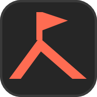

# BTCT brand mark

**Been There, Conquered That.** The mark is a flag planted on a summit, drawn
with the three carets an operator stares at all day: the summit is a `^`, the
flagpole is the text cursor `|`, and the pennant is the shell prompt `>`.
Planting it means "we were on this host and wrote it down". It is the sibling
of the Typst Studio favicon (dark tile, one bright accent, a caret) without
reusing its page.

## Files

| File | Use |
| --- | --- |
| `logo-mark.svg` | Primary mark: coral on the charcoal tile. Also `public/favicon.svg`. |
| `logo-mark-light.svg` | Mark on the paper tile (deep coral, ridge 0.2 heavier). |
| `logo-mark-mono.svg` | One colour, no tile, `currentColor`. Also `public/logo-mark-mono.svg` (the sidebar and login mask). |
| `wordmark.svg` | Drawn "BTCT" outlines, `currentColor`. |
| `logo-lockup-horizontal.svg` | Mark + wordmark, wordmark in `currentColor`. |
| `logo-lockup-dark.svg` / `logo-lockup-light.svg` | Lockups with fixed colours for dark and light grounds. |
| `favicon.ico` | 16, 32 and 48 px PNG entries. Also `public/favicon.ico`. |
| `png/btct-{16,32,48,64,192,512}.png` | Mark on the charcoal tile, transparent outside the tile. |
| `png/btct-light-{16,32,64,512}.png` | Mark on the paper tile. |
| `png/apple-touch-icon-180.png` | Full bleed square, no transparency (iOS rounds it). Also `public/apple-touch-icon.png`. |
| `png/btct-mono-{black,white}-512.png` | One colour checks. |

## Construction

The mark is drawn on a 32 unit grid; at 16 px one unit is half a pixel.

- **Tile**: 32 x 32, radius 7, a 0.75 inner edge (`#3a3a3a` dark, `#dcd9d4`
  paper) so the tile holds its shape on a tab strip of the same grey. Radius
  and edge follow the Typst Studio favicon on purpose.
- **Summit**: a chevron from (3, 26) up to the apex (13, 12.4) and down to
  (28.6, 26), with both feet cut flat on the baseline y 26. The legs are offset
  square to themselves, so the stroke is even along both.
- **Pole**: x 12 to 14, y 4 to 13.2, centred on the apex. Two units is exactly
  one pixel at 16 px and two at 32 px, so the cursor stays sharp in a browser
  tab.
- **Pennant**: from the pole top to the tip (22.4, 6.8) and back to (14, 10).

### Optical corrections

1. **Apex left of centre.** The apex sits at x 13, not 16. The pennant carries
   weight to the right, so a centred summit made the whole mark lean right.
2. **Asymmetric ridge.** The right leg is longer and shallower than the left,
   like a real ridge line and unlike a generated, mirror-perfect peak.
3. **Lifted pennant.** The tip is 0.2 above the pennant's midline. On the
   midline it read as drooping; lifted, it reads as a flag in wind.
4. **Irradiation.** Light ink on charcoal looks heavier than dark ink on paper,
   so the ridge is 3.1 thick on the dark tile and 3.3 on the paper tile.
5. **Pixel alignment.** Pole, pole top (y 4) and baseline (y 26) land on whole
   pixels at 16 and 32 px. Only the diagonals antialias.
6. **Pole thinner than the ridge.** The pole is 2, the ridge 3.1: the summit
   carries the weight and the flag reads as something added to it.

### Wordmark

"BTCT" is drawn as outlines, not set from a font. It follows DIN 1451 (the
Bahnschrift / Barlow family the UI uses) at cap height 24:

- Stems 4.0, horizontals 3.5 (horizontals look heavier than verticals of the
  same width, so they are drawn thinner).
- **B**: the upper bowl (radius 5.9) is narrower than the lower (6.1), with a
  small step at the waist. Counters are offset so the bowl sides stay 4.0.
- **C**: an ellipse 21.2 x 24.8, overshooting 0.4 above and below the caps,
  sides 4.3 and top and bottom 3.7, terminals cut flat (horizontal) as in DIN.
- **Spacing by eye**: the T crossbars are allowed to hang over the C's
  shoulders; the T to C and C to T gaps are measured at crossbar height, not
  between bounding boxes.
- The wordmark is neutral ink (`#ededed` on dark, `#1f1f1f` on light). It is
  never coral: the accent belongs to the mark. It also avoids setting "BTC"
  apart from the final "T", which would read as Bitcoin.

## Colours

| Token | Dark | Light |
| --- | --- | --- |
| Tile / canvas | `#262626` | `#f6f5f3` |
| Tile edge | `#3a3a3a` | `#dcd9d4` |
| Mark (accent) | `#ff6c52` | `#da452b` |
| Wordmark | `#ededed` | `#1f1f1f` |
| One colour | `#ffffff` | `#000000` |

These are the Typst Studio theme's canvas and accent. In the app the mark
should use `--op-accent` (as `.op-brand-mark` does) so it follows the theme.

## Clear space and minimum size

- **Clear space**: 8 grid units on every side of the tile (a quarter of the
  tile, about one pennant width). For the lockup, the same 8 units around its
  outer box. The gap between mark and wordmark is 10 units.
- **Minimum size**: tiled mark 16 px; untiled one colour mark 12 px; horizontal
  lockup 96 px wide (wordmark caps about 17 px). Below 96 px use the mark alone.

## Do

- Use the tiled mark for favicons and app icons, the untiled mono mark inside
  UI chrome where a tile would double up with a button or header box.
- Use `currentColor` / `--op-accent` versions in the app so both themes work.
- Keep the mark one colour. The tile is a ground, not a second colour.

## Do not

- Do not recolour the mark blue, green or purple, or add a gradient, glow,
  bevel or shadow.
- Do not centre the apex, mirror the ridge, or straighten the pennant tip.
- Do not put the mark in a shield, a padlock, a circle of laurels or a hexagon.
- Do not set "BTCT" in a font in place of the drawn wordmark, track it out, or
  colour one of its letters.
- Do not rotate the mark or put the flag on the left.
- Do not use the large PNGs in `public/`; ship the SVG and the small files.

## Research summary

### Trends (2025 to 2026)

- Simple marks with one owned detail and one accent colour: "Simple Twist" and
  "Little Blip" (a deliberate off element, readable type) in
  [Vistaprint / 99designs, 10 logo design trends for 2026](https://www.vistaprint.com/hub/logo-design-trends).
- Humanised minimalism, purposeful colour (fewer colours, restraint), typography
  first, one distinctive micro detail, logos as systems that work across sizes:
  [ManyPixels, Logo design trends 2026](https://www.manypixels.co/blog/brand-design/logo-design-trends).
- Same direction, with more expressive or looser type at the other end:
  [Shopify, logo trends](https://www.shopify.com/blog/logo-trends),
  [Onething, top 7 logo design trends in 2026](https://www.onething.design/post/top-7-logo-design-trends-in-2026).
- "Pixel Sharp" marks built on 8 to 16 px grids that stay legible at favicon
  size (Vistaprint, above). BTCT takes the pixel discipline, not the pixel
  look.

These are vendor blogs; they agree on restraint, one detail, one accent and
small size legibility, which is what this mark is built on.

### What makes a logo look generated

Sources: [Worldvectorlogo, how to spot a generated logo](https://worldvectorlogo.com/blog/how-to-spot-an-ai-generated-logo-and-why-it-matters-more-than-you-think/)
(over symmetry, generic motifs, typography glitches),
[Krumzi, how to tell if an image is generated](https://www.krumzi.com/blog/is-this-image-ai-generated)
("plausible shapes that belong to no real brand", identical repeats, letters
that almost form words; keep one brand system and practise restraint),
[Good Things Australia](https://goodthingsaustralia.org/learn-resource/how-to-spot-ai-generated-images/)
(lettering errors),
[Bushe, how to detect generated logos](https://bushe.co/answers/how-to-detect-ai-generated-logos/)
(perfect bilateral symmetry, mathematically even spacing).

### Hand made and intentional

- Correct by eye rather than by the grid, overshoot round forms, thin the
  reversed (white) version for irradiation:
  [Logo Geek, optical corrections every logo designer should know about](https://logogeek.uk/?p=2617),
  [Brainy, optical correction](https://brainy.ink/paper/glossary/optical-correction).
- Too many thin lines turn into mush at favicon size; a favicon is a reduced
  part of the logo:
  [OpenStack infra list, OpenDev logo as a favicon](https://lists.openstack.org/pipermail/openstack-infra/2019-February/006281.html),
  [O'Reilly, designing a website favicon](https://www.oreilly.com/library/view/photoshop-cc-the/9781491905593/ch17s03.html).

### Security brand clichés and marks to stay clear of

- The security category defaults to shields, padlocks and circuit lines, and
  to blue for "trust":
  [ManyPixels, security logos](https://www.manypixels.co/blog/brand-design/security-logo),
  [Zenind, cyber logo ideas](https://www.zenind.com/help/post/how-to-create-a-cyber-logo-20-emblem-ideas-and-design-tips-for-tech-brands).
- Metasploit's mark is a shield
  ([Rapid7, Metasploit design contest](https://www.rapid7.com/blog/post/2013/07/16/metasploit-design-contest-winners/)).
  BTCT has no enclosing shape at all.
- PortSwigger / Burp Suite uses an orange accent, `#FF6633`
  ([Dashboard Icons, PortSwigger](https://dashboardicons.com/icons/external/portswigger)),
  close to BTCT's coral. So the BTCT mark avoids anything bolt or spark
  shaped and always sits on the charcoal or paper tile, never alone on orange.
- Kali Linux's dragon is a protected mark
  ([Kali trademark policy](https://www.kali.org/docs/policy/trademark/)); no
  creature, no dragon, no blue.
- Hack The Box (lime green, a cube), TryHackMe (red and white, a playful
  mascot) and CPTC (a collegiate badge,
  [RIT news](https://www.rit.edu/computing/news/rit-hosts-national-pentesting-competition)):
  BTCT uses no cube or hexagon, no mascot, no badge or crest. The old BTCT
  icon (a crest with laurels) is retired for the same reason.

## Generated-logo tells checklist

| Tell | This mark |
| --- | --- |
| Gradient blob, glossy 3D, glow | Flat, one colour, no effects. |
| Purple to blue gradient | Coral on charcoal; one colour versions in pure black and white. |
| Perfect bilateral symmetry | Apex off centre, legs of different length, pennant tip lifted. |
| Meaningless abstract swoosh | Every part is a real glyph from the job: `^`, `|`, `>`, plus the name's "conquered" summit. |
| Sloppy or almost-letters | Wordmark is drawn letter by letter with stated stem and overshoot values, and is spelled right. |
| Over detailed illustration | Two paths. Works at 16 px (checked on pixel enlargements). |
| Too perfect geometry, no optical correction | Six named corrections above; the light and dark tiles differ in weight. |
| Shield, padlock, circuit, binary, skull, hoodie | None. |
| Identical repeated elements | None repeat; the two legs differ. |
| Generator or editor metadata | SVGs are hand written: no metadata, no editor namespaces, comments only describe construction. |
